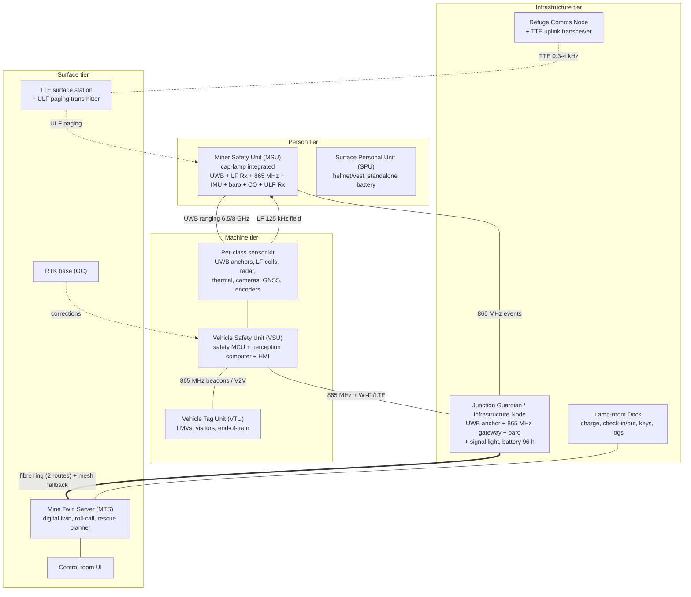
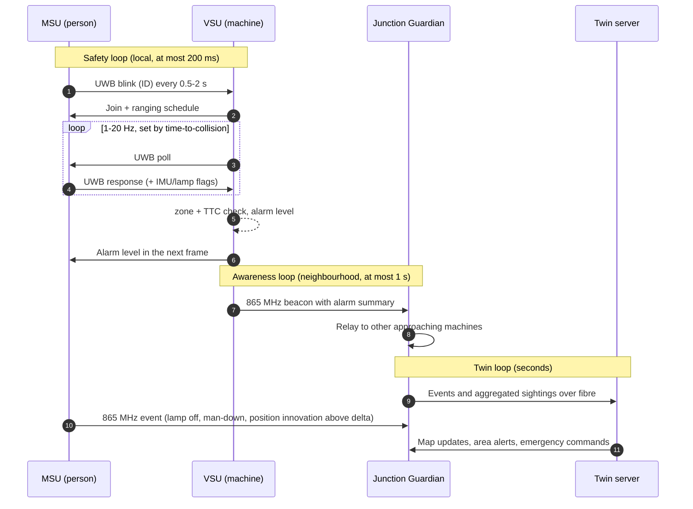
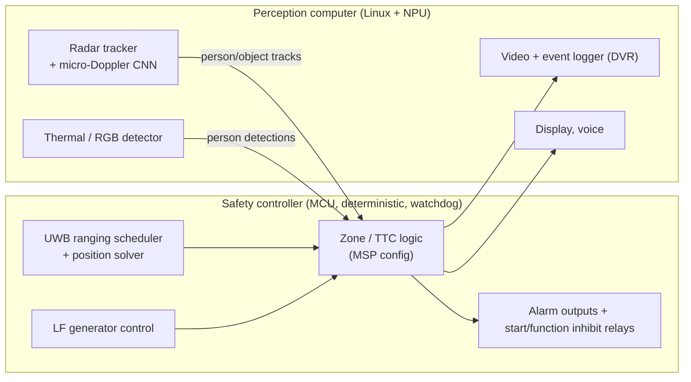

# 02 · System architecture

**Decision in one paragraph.** Every person wears a unit built into the cap lamp (underground) or helmet
(surface). It carries three independent ways of being detected: a **UWB time-of-flight radio** (who and
where, ~0.1 m ranging), an **LF 125 kHz magnetic receiver** (near-field, works through bodies and around
posture, µW listening), and a **sub-GHz 865 MHz radio** (event-driven telemetry and alerts). Every machine
carries anchors and LF coils on its hull, so **relative position is measured directly between the machine
and the person**. That needs no GNSS and no mine infrastructure, which is why it also works underground and
after infrastructure is destroyed. Radar, thermal and cameras catch people who are not wearing a unit. A
**digital twin** on the surface holds the shared mine map and the last known state of everyone. It is the
reason messages can be tiny and infrequent, and the reason rescue teams know where to dig. A separate
emergency chain (fibre ring → mesh → medium frequency → through-the-earth, plus a ULF paging downlink
into every cap lamp) reaches the surface when everything else has failed.

---

## 1. Design principles

| # | Principle | Why | Where applied |
|---|---|---|---|
| P1 | **Defence in depth with diverse physics.** No single technology decides alone. | Every single technology has a documented failure mode: RFID nulls and body shadowing [P1], radar nuisance alarms [P8], UWB NLOS [P5, P9], GNSS multipath [P3], acoustic LOS-only [P6]. Diverse physics fail differently. | [03](03_positioning_and_sensing.md) |
| P2 | **Asymmetric energy.** The machine (24 V, unlimited energy) transmits fields, listens continuously and computes. The wearable mostly sleeps and answers briefly. | Wearable energy is the scarce resource. A tag that listens continuously on UWB would draw ~65 mA, 100× the whole event-driven budget. | [05](05_communication.md) |
| P3 | **Event-driven, never fixed polling.** Rates follow risk; silence carries information. | Send-on-innovation cuts transmissions to 9% of steps at δ = 2σ [P4]; the computed wearable budget is 4× lower than polling. | [05](05_communication.md) |
| P4 | **Local-first safety.** Detect → decide → alarm/inhibit happens on the machine and on the wearable, within 200 ms, with no server in the loop. | Backbone and server can fail exactly when needed; latency budget. | [06](06_collision_avoidance_logic.md) |
| P5 | **Relative before absolute.** Collision avoidance needs the person's position *relative to the hull*, measured directly. Absolute (mine) coordinates are for the twin and rescue. | Removes GNSS and infrastructure from the critical path; works in new headings. | [03](03_positioning_and_sensing.md) |
| P6 | **Fail-loud, never fail-silent.** A lost tag is treated as "unknown, possibly close", not "absent". Sensor faults degrade to conservative modes and are announced. | Silence from a tag must not be read as safety. | [06](06_collision_avoidance_logic.md), [08](08_resilience_and_security.md) |
| P7 | **Monotonic safety.** Machine-learning perception can **raise** an alarm but can never **suppress** an alarm from a cooperative tag or the LF shell. | Keeps ML errors from creating missed detections. | [06](06_collision_avoidance_logic.md) |
| P8 | **One platform, per-machine configuration.** Same electronics; each machine class gets a Machine Safety Profile (geometry, kinematics, sensor kit, zones, interventions). | Brief: "each vehicle gets its own design" (Q11). NIOSH: results don't transfer between machine types [P3]. | [04](04_sensor_placement.md) |
| P9 | **Twin-synchronised communication.** Device and twin share map and motion models, so messages carry only references and innovations. | Smaller, rarer packets; through-the-earth bandwidth is ~10 b/s. | [05](05_communication.md), [07](07_digital_twin.md) |
| P10 | **Survivable by construction.** Redundant pathways, standby power, black boxes, emergency beacons, through-the-earth link. | MINER Act/MSHA expectations [E1]; brief's adversity requirement. | [08](08_resilience_and_security.md) |

## 2. Technology trade study

Scores: ●●● strong, ●● adequate, ● weak, ✗ not possible. "UG" = works underground.

| Technology | Range | Accuracy | Through body / NLOS | UG | Knows *who* | Sees untagged | Wearable energy | Cost | Role in this design |
|---|---|---|---|---|---|---|---|---|---|
| Passive RFID (LF/UHF) | ● (~2–7 m [P1]) | ✗ presence only | ● directional [P1] | ●●● | ●●● | ✗ | ●●● | ●●● | Not used for safety (lamp-room check-in only) |
| Active RFID / BLE RSSI | ●●● | ● (LANDMARC 1.1 m avg, ~1 min latency [P2]) | ● body shadow, nulls [P1] | ●●● | ●●● | ✗ | ●● | ●●● | Zone-level fallback + kNN ML baseline |
| **UWB time-of-flight** | ●● (30–80 m LOS) | ●●● (~0.1 m) | ●● NLOS bias, mitigable by ML [P5, P10] | ●●● [P9] | ●●● | ✗ | ●● | ●● | **Primary ranging and positioning** |
| **LF magnetic (125 kHz)** | ● (2–10 m) | ●● (20–50 cm [P12]) | ●●● body-transparent, orientation-free with 3-axis | ●●● | ●●● | ✗ | ●●● (µA listening) | ●● | **Near-field danger shell, wake-up, start-inhibit** |
| Acoustic chirps | ●● (≤ 50 m) | ●●● (cm in lab [P6]) | ✗ LOS only | ●● | ●● | ✗ | ● | ●● | Not used (LOS-only, 0.5 s chirps, noise) |
| **mmWave radar** | ●●● | ●●● range, ● identity | ●● dust/dark OK | ●● wall clutter | ✗ | ●●● | n/a | ●● | **Untagged objects; micro-Doppler person classifier** [P11] |
| **Thermal LWIR** | ●● | ●● | ● smoke OK, hot mines weak | ●● | ✗ | ●●● | n/a | ●● | **Untagged person confirmation** |
| RGB camera | ●● | ●● | ✗ dust/dark | ● | ✗ | ●● | n/a | ●●● | Operator visual check (NIOSH recommends) [P3] |
| LiDAR | ●●● | ●●● | ✗ dust/water | ●● | ✗ | ●● | n/a | ● | Optional: UG vehicle self-localisation by map matching |
| **GNSS-RTK (+NavIC)** | ●●● | ●●● (cm) | ✗ pit walls / multipath | ✗ | n/a | ✗ | ● | ●● | **OC vehicle pose, V2V awareness, geofences** |
| **IMU / PDR** | n/a | ● drifts | ●●● | ●●● | n/a | ✗ | ●● | ●●● | **Dead reckoning between fixes, man-down, impact** |
| Visible light (VLC) | ● | ●● | ✗ | ● | ●● | ✗ | ● | ●● | Not used (dust, darkness gaps [P16]) |
| Wi-Fi RTT | ●● | ● | ● | ●● | ●● | ✗ | ✗ power-hungry | ●● | Not used on wearables |

**Conclusion.** The best combination is UWB (who and where) + LF (cannot-miss near field) + radar/thermal
(untagged) + IMU (between fixes) + GNSS on the surface. This is the "fusion of multiple sensors and visual
information" that NIOSH named as the next step after its 2000–2006 field work [P3, P18].

## 3. System overview

### 3.1 Subsystems

| Unit | Where | Core function | Detail |
|---|---|---|---|
| **MSU** Miner Safety Unit | UG person; helmet crown pod + belt pack, powered by the cap-lamp battery + own backup cell | Be detected and warned; event-driven telemetry; lamp state; man-down/impact/overpressure/CO; ULF emergency paging; black box; rescue beacon | [04 §3](04_sensor_placement.md), [05](05_communication.md) |
| **SPU** Surface Personal Unit | OC person; helmet crown pod + vest pocket | Same as MSU minus ULF/CO; own 2,000 mAh battery | [04 §3](04_sensor_placement.md) |
| **VSU** Vehicle Safety Unit | Every machine | Safety controller (ranging scheduler, solver, zone logic, alarm, interlocks), perception computer (radar/thermal/camera ML, logging), HMI, radios | [04](04_sensor_placement.md), [06](06_collision_avoidance_logic.md) |
| **Sensor kit** | Per machine class | Anchors, LF coils, radars, thermal, cameras, GNSS, encoders, placed by rules | [04](04_sensor_placement.md) |
| **VTU** Vehicle Tag Unit | LMVs, two-wheelers, visiting vehicles, end of a tub train | Roof-mounted combo node: UWB tag/anchor + sub-GHz beacon + GNSS (OC) + small in-cab alarm | [04 §5](04_sensor_placement.md) |
| **Junction Guardian / Infrastructure Node** | UG junctions on traffic routes, OC blind intersections and ramps | Fixed UWB anchor (absolute fixes), 865 MHz gateway, relay of beacons around corners, signal light, barometer, standby battery | [04 §7](04_sensor_placement.md) |
| **Refuge Comms Node** | Refuge chambers, SCSR caches | Mesh + TTE uplink + air-quality sensors, 96 h battery | [05 §8](05_communication.md) |
| **Lamp-room Dock** | Lamp room / gate | Charging, check-in/check-out (roll-call source of truth), daily self-test, key provisioning, black-box offload, firmware update | [07](07_digital_twin.md) |
| **Mine Twin Server** | Surface, with a hot standby | Digital twin, roll-call, rescue planner, analytics, map distribution | [07](07_digital_twin.md) |
| **TTE station + ULF pager** | Surface above workings; underground at refuges | Emergency link through the strata | [05 §8](05_communication.md) |
| **Rescue Locator** | Rescue team handheld | Reads black boxes, direction-finds LF/UWB beacons through rubble | [08](08_resilience_and_security.md) |

## 4. Which layers protect which interaction

| Interaction | Primary | Secondary (independent physics) | Tertiary | Twin role |
|---|---|---|---|---|
| Person ↔ moving machine | UWB relative ranging (who, where, closing speed) | LF near-field shell (≤ 2–10 m) | Radar micro-Doppler + thermal (untagged) | Logs near misses, raises protection for unlit or isolated miners |
| Person ↔ stationary machine about to start | LF sweep at key-on + UWB | Short-range radar presence check (under/around tyres) | Camera view on HMI | Maintenance/lockout state |
| Machine ↔ machine | V2V beacons with pose/speed (865 MHz) + UWB V2V range | Radar | Junction Guardian relay around corners | Right-of-way on single-lane segments |
| Machine ↔ LMV | VTU beacon + UWB | Radar/camera (front blind zone) | Twin awareness map | Same |
| Machine ↔ fixed hazard | Geofence from twin (RTK pose OC; map-matched pose UG) | Radar (berm/edge) | — | Owns the hazard map |
| Person ↔ fixed hazard | MSU position vs twin geofence (unsupported roof, conveyor guard, sealed area) | Fixed node LF/UWB zone at conveyors | — | Same |

## 5. Data flows

## 6. System operating modes

| Mode | Trigger | Behaviour |
|---|---|---|
| NORMAL | Default | Full layers; event-driven telemetry; twin live |
| DEGRADED-NET | Backbone or server unreachable | Safety loops unaffected; nodes, vehicles and MSUs buffer events; twin marks data stale; control room informed by a watchdog |
| DEGRADED-SENSOR | Any self-test failure on a machine (anchor, radar, LF, camera) | Operator alert "PDS FAULT", logged; machine-specific policy (UG: no operation without PDS per MSHA practice [E2]; OC: speed restriction + supervisor sign-off) |
| EMERGENCY | Declared by control room, or auto-detected (overpressure seen by several nodes, mass power loss, CO) | All MSUs go to emergency mode; ULF evacuation page; twin freezes last-known states and starts the rescue planner; TTE link activated |
| MAINTENANCE / LOTO | Machine in workshop or under lockout | Start-inhibit latched while any tag is in or on the machine; V2V suppression in workshop geofence |
| BLAST | Shot-firing sequence armed in twin | Blast clearance check; transmit-power cap and LF generators off near charged holes |

## 7. Safety architecture of the machine unit

* The **safety controller** owns everything needed for the cooperative layers and the interlocks. It boots in under a second at key-on, so the start-inhibit check never waits for Linux.
* The **perception computer** can only *add* risk (monotonic safety, P7). If it crashes, the controller raises a fault and the cooperative layers keep working.
* Interlocks are wired fail-safe: the start-inhibit relay is energised to permit start, so a dead unit blocks start and the supervisor override is logged.
* Target integrity: ISO 13849-1 PL d (Category 3) for start-inhibit and stop functions; ISO 21815-1 for warning/avoidance behaviour and tests [E8].

## 8. Where machine learning sits (the Communications + ML scope)

| ML component | Input | Output | Starting point |
|---|---|---|---|
| NLOS classification + range-error regression | UWB channel impulse response (CIR) from vehicle anchors | LOS/NLOS label, bias estimate, weight | LS-SVM features [P5] → CNN on raw CIR [P10]; eWINE dataset [E17] |
| Person-vs-object radar classifier | Micro-Doppler spectrogram per radar track | Person / vehicle / static object | CNN, 97.6% in lab [P11] |
| Thermal/RGB person detector | Images | Person boxes | YOLO-class network on the NPU; FLIR/KAIST datasets [E23] |
| Zone-level fingerprinting | 865 MHz RSSI vectors at nodes | Segment/zone of a tag without UWB coverage | LANDMARC kNN (k = 4) [P2] |
| Man-down / posture | IMU features | Fall, lying, crawling, no-motion | Small on-device classifier |
| Near-miss analytics | Twin event log | Hot spots, risky routes and shifts | Twin analytics |

## 9. Deployment profiles

| Item | OC pilot (RG-1) | UG |
|---|---|---|
| Wearable | SPU (helmet pod + vest) | MSU (cap lamp) |
| Absolute positioning | GNSS-RTK (+NavIC) on machines; persons through machines and nodes | Infrastructure anchors + map-matched dead reckoning + machines as moving anchors |
| Backhaul | 865 MHz gateways on high points, LTE or Wi-Fi mesh for machines | Fibre ring + 865 MHz mesh + MF + TTE |
| Machine interventions | Start-inhibit; alarms only while moving | Function-inhibit / stop (CM per [E2]); creep/stop on LHD/SDL/shuttle car with two-layer confirmation |
| Certification | ETA (WPC) for radios; vehicle EMC | Plus Ex ia/Ex d certification (CIMFR) and DGMS approval |
| Unique hazards | Dump edges, highwalls, LMVs, trespassers, cattle, heat | Crosscut corners, pinch points, methane, roof falls, explosions, inundation |
