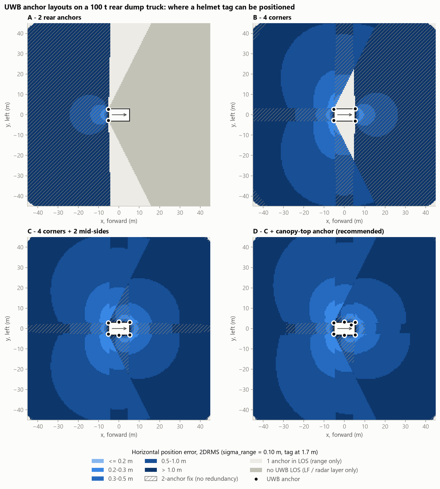
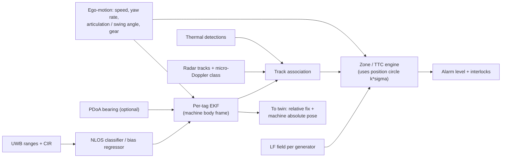

# 03 · Positioning and sensing

This document answers the brief's question 10 ("underground GNSS doesn't work and LiDAR/radar are not
enough, so what do we use?") and specifies every sensing layer. Accuracy claims come from the cited papers
or from the reproducible study in [tools/design_calcs.py](tools/design_calcs.py).

---

## 1. Split the problem: relative vs absolute position

| | Relative position | Absolute position |
|---|---|---|
| Question | Where is this person *relative to this machine's hull*, and how fast are they closing? | Where is this person *in the mine*? |
| Used for | Collision avoidance, start-inhibit, function-inhibit | Tracking, roll-call, geofences, rescue, analytics |
| Latency need | ≤ 200 ms | Seconds (refresh ≤ 60 s [E1]) |
| Accuracy need | 0.3–0.7 m within 15 m | 3–10 m UG, ≤ 2 m OC |
| Measured by | **Machine-mounted anchors ↔ worn tag, directly** | Infrastructure anchors, machines acting as moving anchors, dead reckoning on the map, GNSS (OC) |
| Needs GNSS? | No | OC only |
| Needs mine infrastructure? | No | Yes (degrades gracefully without it) |

Collision avoidance never needs to know where anyone is in the mine. It needs the geometry between two
bodies. Measuring that geometry directly removes the hardest underground problem (no satellite signal)
from the safety-critical path. Absolute positioning then becomes a slower, best-effort service for the twin.

## 2. Answer to question 10: why each candidate fails alone, and what replaces it

| Candidate | Failure mode underground | Replacement in this design |
|---|---|---|
| GNSS/GPS | No signal through rock; in deep pits, walls block satellites and multipath shifted a truck by 15 m in a NIOSH test [P3] | UWB relative ranging for safety; infrastructure anchors + map-matched dead reckoning for absolute |
| LiDAR | Blinded by dust and water spray; gives geometry but not *identity* or intent; cannot see around a pillar corner | Kept only as an optional UG vehicle self-localiser (map matching), not as a person detector |
| Radar | Cannot tell a person from a rib, berm or parked machine: 18% false and 42% nuisance alarms on a haul truck [P8]; tunnel walls flood it with clutter; no identity | Kept as the **untagged-person layer**, gated by a micro-Doppler person classifier [P11] and by the twin's wall map |
| Plain RFID (presence) | Presence only, no position; misses when the worker bends over; field nulls around the machine; sporadic edge zone gives false alarms [P1] | UWB time of flight (range, not signal strength) + LF magnetic field (body-transparent) |
| RSSI fingerprinting | Metre-level at best (1.1 m average) with minute-scale latency; breaks when people and machines move [P2] | Zone-level fallback only |
| Acoustic | Needs line of sight; 0.5 s chirps; machine noise [P6] | Not used |

**Answer.** Use cooperative radio ranging between the person and the machine: **UWB time of flight**
(6.5/8 GHz, ~0.1 m), backed by a **125 kHz magnetic near-field shell** that works through bodies and does
not care how the person is standing. Add **inertial dead reckoning constrained to the tunnel map** between
fixes, **fixed anchors at junctions**, and **machines acting as moving anchors**. Keep radar and thermal as
the independent layer for people who are not wearing a unit.

## 3. Layer A: UWB time-of-flight ranging

### 3.1 Radio configuration

| Parameter | Choice | Reason |
|---|---|---|
| Standard | IEEE 802.15.4z HRP UWB [E20]; ISO/IEC 24730-6x RTLS family | Interoperable silicon (Qorvo DW3000 family, NXP Trimension), secure ranging |
| Channel | **Ch 5 (6.4896 GHz)** primary, **Ch 9 (7.9872 GHz)** alternate; 499.2 MHz bandwidth | Both inside India's 6–8.5 GHz UWB band [E4]; Ch 5 has ~1.8 dB less free-space loss than Ch 9; two channels allow frequency planning between neighbouring machines |
| PRF / preamble | 64 MHz PRF; preamble 64–128 symbols for short sessions, 256–1024 for long-range discovery | Short preambles = less airtime and energy; long preambles = more processing gain |
| Data rate | 6.8 Mb/s for ranging frames; 850 kb/s for long-range blinks | Airtime ≈ 0.1–0.2 ms per frame |
| Security | Scrambled Timestamp Sequence (STS) on ranging frames | Blocks distance-reduction and distance-enlargement attacks; enlargement would make a person look farther away than they are |
| Antenna diversity | Dual-antenna parts (phase-difference of arrival, PDoA) on optional front/rear anchors | Bearing (±5–10° near boresight) helps when only one or two anchors are in line of sight |

### 3.2 Ranging schemes (who transmits, and when)

| Scheme | Exchange | Tag energy | Used for |
|---|---|---|---|
| **Blink** | Tag transmits a ~0.15 ms ID frame, then opens a scheduled 0.3 ms receive window | ≈ 29 µC per blink | Discovery by any machine or node in range. Infrastructure anchors also time-stamp blinks, giving TDoA position for the twin at **no extra tag energy** ("blink once, use thrice": discovery, absolute position, liveness) |
| **One-to-many DS-TWR** | Tag polls; each of N anchors replies in its slot; tag sends a final frame carrying its timestamps | ≈ 104 µC per fix (N = 4) | Ranging sessions with a machine (1–20 Hz). Double-sided TWR cancels clock drift without any synchronisation |
| SS-TWR with carrier-offset correction | Poll + response | Lowest per range | Fallback for a single anchor |
| Vehicle-local TDoA (advanced option) | Tag blinks; all anchors on the machine share one wired clock and time-stamp the same frame | ≈ 9 µC per fix (transmit + wake-up only; ≈ 11× less than TWR) | Future optimisation. Needs clock distribution and cable-delay calibration on the machine |

Discovery is **tag-initiated** because a tag that listened for machine polls would draw ~65 mA, about
100× the entire event-driven budget ([05 §6](05_communication.md)). The machine's anchors listen
continuously; the machine has the energy for it.

### 3.3 Position solver (machine side)

* **State per tag** in the machine body frame: position (x, y) and velocity (vx, vy). The tag height is known from the posture flag (standing ≈ 1.7 m, crouching ≈ 1.0 m, lying ≈ 0.3 m), so the solve is 2-D.
* **Measurement update:** weighted Gauss–Newton on ranges from the anchors in view. Each range's variance comes from the NLOS classifier (§3.4). A Huber-robust update limits the influence of outliers.
* **Two-anchor fixes are unique.** The mirror solution lies on the far side of the anchor baseline, where the hull blocks line of sight, so the tag cannot be there. The coverage study counts these as positionable.
* **Single anchor:** the range alone still decides the zone (range-only zone test), and the bearing comes from PDoA or the track.
* **Tracking filter:** a constant-velocity EKF in the body frame, with ego-motion from wheel speed and yaw rate. The closing speed it estimates drives time-to-collision.
* **Uncertainty is carried, not discarded:** the zone test uses the tag position as a circle of radius k·σ (k = 2), following Jobes et al. [P12].

### 3.4 Non-line-of-sight (NLOS): identify, then correct or exclude

NLOS is the dominant UWB error in mines. Bodies, machines and rock make the first path weak or absent,
which adds a **positive** range bias of 0.3–3 m [P5, P9].

| Step | Method | Runs on | Source |
|---|---|---|---|
| 1. Cheap screen | Difference between total received power and first-path power; > 10 dB suggests NLOS, < 6 dB suggests LOS (Qorvo/Decawave rule of thumb) | Every anchor, every frame | Vendor application notes |
| 2. Classify | Features: energy, max amplitude, rise time, mean excess delay, RMS delay spread, kurtosis → LS-SVM (> 91% with three features) | Safety controller | Maranò et al. [P5] |
| 3. Regress the bias | CNN on the raw channel impulse response → estimated range error and weight | Perception computer (NPU); runs on Raspberry-Pi-class hardware [P10] | Bregar & Mohorčič [P10] |
| 4. Use it | With ≥ 3 LOS anchors: drop NLOS ranges. Otherwise: subtract the predicted bias and down-weight (weighted least squares with error regression gave the best results in [P10]) | Solver | [P10] |
| 5. Adapt to the site | Retrain on data from SCCL machines and galleries (models trained in one building transfer poorly [P5]) | Offline | Measurement campaign ([10](10_simulation_and_data.md)) |

### 3.5 Anchor layout: what the coverage study shows

The study places a helmet tag (1.7 m) everywhere within 45 m of a 100 t dump truck. The hull is treated
as a solid box up to 4.2 m, range noise σ = 0.10 m, maximum range 60 m. It counts the anchors with line of
sight and computes the 2DRMS horizontal error.

| Layout | 5–15 m ring: positionable | 5–15 m: ≥ 3 anchors (redundant) | 5–15 m: p95 2DRMS | 15–40 m: ≥ 3 anchors | 15–40 m: median 2DRMS |
|---|---|---|---|---|---|
| A: 2 rear anchors (single-reader thinking) | 40% | 0% | 18.3 m | 0% | 2.4 m |
| B: 4 corners | 90% | 33% | 4.7 m | 47% | 1.1 m |
| C: 4 corners + 2 mid-sides | 100% | 78% | 0.68 m | 95% | 0.95 m |
| **D: C + canopy-top anchor (recommended)** | **100%** | **90%** | **0.68 m** | **99%** | **0.92 m** |

Conclusions that drive [04_sensor_placement.md](04_sensor_placement.md):

1. **Rear-only sensing cannot position anything.** It only answers "something is behind".
2. **Mid-side anchors matter most.** On long machines the side faces otherwise see only two nearly collinear corner anchors, and errors explode (B's p95 of 4.7 m).
3. **A high anchor sees over the body.** The canopy anchor lifts redundant coverage from 78% to 90% in the critical 5–15 m ring and gives V2V line of sight over other machines.
4. **Within 0–5 m, only 46% of positions have three anchors.** That is acceptable, because the danger decision there uses the LF shell and range-only tests, not a full 2-D fix.

### 3.6 Calibration and self-test

* **Antenna delay calibration** per anchor at install (two-way ranging against a reference at known distance).
* **Anchor survey:** tape or total station, ± 2 cm, in the MSP body frame.
* **Continuous self-test:** anchors on the same machine range to each other every few seconds. The distances are known, so any drift, blocked antenna or cable fault shows up immediately as a "PDS FAULT".
* **Pre-shift bump test:** a reference tag at a marked spot in the parking bay; the machine must measure it within tolerance before the shift (like a gas-detector bump test).

## 4. Layer B: LF magnetic near-field shell (125 kHz)

### 4.1 Why magnetic

* At 125 kHz the wavelength is 2.4 km, so within 10 m the field is **quasi-static**: |B| ∝ m / r³.
* **The human body, coal and dry rock barely affect the field.** Posture, bending over or turning the back do not matter. A 3-axis receiver measures |B| independent of orientation. These were exactly the failure modes of the 315 MHz tags in the base paper [P1].
* **Distance from field strength is forgiving.** Because r ∝ |B|^(−1/3), a ±3 dB field error (±41%) moves the distance estimate by only ±12%. At UHF, RSSI with ±10–20 dB fading makes distance almost meaningless.
* Proven in underground proximity detection: NIOSH's magnetic system located the personal alarm device to 20–50 cm [P12]. Proximity detection systems use 70–500 kHz [E3]. MSHA-compliant continuous-miner systems are magnetic [E2].

### 4.2 How the shell is built

* Each machine carries 2–5 ferrite or air-core generator coils (positions in [04](04_sensor_placement.md)). They are driven in **time slots** (e.g., 4 × 10 ms every 100 ms), each slot Manchester-coded with *machine ID + generator ID*.
* The wearable's 3-D wake-up receiver (AS3933 class: 15–150 kHz carrier, 2.3 µA typical three-channel listening [E19]) wakes on the pattern, measures RSSI on three axes, and computes |B| per generator.
* Zone thresholds are set **per machine** from a measured field map (grid walk, as NIOSH did for detection zones [P3]), because steel distorts the field.
* Outputs: (a) the tag *knows locally* that it is in machine X's danger shell, and alarms itself without any radio exchange; (b) the tag raises its UWB rate to maximum; (c) the machine learns the event in the next UWB frame or 865 MHz message.

### 4.3 Roles and limits

| Role | Detail |
|---|---|
| Danger shell | 2–8 m around the hull (configurable per MSP), independent of UWB |
| Start-inhibit sweep | At key-on the machine pulses all generators at full power; any tag inside answers immediately |
| Wake-up | Tags in PATROL mode jump straight to DANGER mode on LF detection |
| Limits | Short range (shell, not warning zone); distortion near large steel (calibrate; NIOSH saw a gap near a parked conveyor [P3]); LF noise from VFDs and cables (coded patterns + correlation); generators are powered down near charged blast holes |

## 5. Layer C: inertial dead reckoning on the map

| Item | Design |
|---|---|
| Sensor | 6-axis IMU in the belt pack (waist PDR) + high-g accelerometer in the helmet (impact) + barometer |
| Algorithm | Step detection, step length model, heading from gyro; zero-velocity at rest; optional boot IMU (foot-mounted ZUPT) for rescue teams |
| Drift | Waist PDR typically drifts by a few % of distance walked; foot-mounted ZUPT is often below 1% (literature ranges, to be measured) |
| **Map constraint** | The twin's roadway graph turns 2-D drift into 1-D chainage error along a segment. A particle filter cannot cross a pillar. Turning at a junction is itself a strong fix |
| Barometer | Level in multi-seam workings and inclines; also explosion overpressure and ventilation-change detection ([08](08_resilience_and_security.md)) |
| Power gating | Gyro runs only while the accelerometer reports motion (≈ 35% of shift), saving ~0.3 mA |

## 6. Absolute positioning underground

| Source | How | Typical accuracy |
|---|---|---|
| **Infrastructure anchors** at junctions on traffic routes ("coverage follows traffic") | Synchronised anchors time-stamp tag blinks (TDoA) or range (TWR) | 0.3–1 m near the junction |
| **Machines as moving anchors** | A person's relative fix from a machine, composed with that machine's absolute pose | Machine pose error + ~0.5 m |
| Machine absolute pose | Wheel odometry + IMU, map-matched to the roadway graph; reset by infrastructure anchors; optional 2-D LiDAR scan matching against the twin's tunnel profile (the approach used by underground automation systems) | 0.5–2 m |
| Dead reckoning between fixes | §5 | 1–10 m depending on time since last fix |
| Zone fallback | 865 MHz RSSI at nodes → kNN (LANDMARC [P2]) | Segment level (MSHA: within 200 ft [E1]) |
| Level | Barometer vs node barometers | Seam / incline level |

**Anchor density.** In bord-and-pillar panels, junctions repeat every 30–45 m. Instrumenting every
junction is expensive. Anchors go on **haulage and travel roads, working faces, loading points and belt
transfer points**, where machines and people actually meet. Elsewhere, positioning falls back to dead
reckoning and zone-level fixes, and the moving machines bring anchors with them wherever they go.

## 7. Absolute positioning on the surface (OC)

| Item | Design |
|---|---|
| Machines | Multi-band multi-constellation RTK (GPS, GLONASS, Galileo, BeiDou, NavIC where the receiver supports it); dual antenna for heading on large HEMM ([04](04_sensor_placement.md)); corrections from a site base over LTE/Wi-Fi or 865 MHz |
| Integrity | RTK fix status, innovation checks against odometry and IMU, jump detection (NIOSH saw 15 m reflection shifts [P3]); zones widen automatically when the solution degrades (deep pit, highwall) |
| Cross-check | UWB machine-to-machine ranges must agree with GNSS-derived distances; disagreement flags spoofing or multipath |
| Persons | No GNSS needed for safety. Absolute fixes come through machines and Junction Guardians. An optional GNSS snapshot in the SPU is event-driven |

## 8. Layer D: non-cooperative sensing (people without a unit)

| Sensor | Processing | Strength | Weakness | Mitigation |
|---|---|---|---|---|
| 77 GHz FMCW MIMO radar (HEMM) / 60 GHz (UG, short range) | CFAR → clustering → tracking; ego-motion compensation; static clutter removed using the twin map; **micro-Doppler spectrogram → CNN person classifier** [P11] | Dust, darkness, rain; measures range and radial speed | Cannot identify; wall clutter UG | Narrow FOV underground, map subtraction, classifier gating |
| Short-range 60 GHz presence radar under/around a parked machine | Breathing and limb micro-motion detection at a few metres | Finds a person resting in the shade under a parked dumper | Only when the machine is still | Used only for the start-inhibit check |
| Thermal LWIR | Person detector (YOLO-class) on the NPU | Night, smoke, light dust | Low contrast in hot workings (30–40 °C); sun-heated rocks | Fused with radar; never used alone |
| RGB / IR camera | Shown to the operator; optional detector | Lets the operator *verify* (NIOSH pairs alarms with cameras [P3]) | Dust, darkness, glare | Not a primary sensor |

**Association with tags.** Each radar or thermal person track is matched against UWB tag tracks
(gating on position and velocity). A matched track confirms a tagged person. An **unmatched person
track** raises "UNTAGGED PERSON" at the operator and reports to the twin, which flags trespass or a
missing unit. This also covers contract workers, visitors who skipped the lamp room, and coal scavengers
in opencast pits.

## 9. Fusion architecture

## 10. Accuracy budget summary

| Situation | Dominant error | Expected (design) | Verification |
|---|---|---|---|
| Person 5–15 m from machine, LOS | Range noise × geometry | p95 0.68 m single epoch; ≈ 0.4 m filtered | Coverage study; NIOSH grid test |
| Person 5–15 m, body or machine NLOS | NLOS bias | ≤ 1 m after exclusion/mitigation | Field campaign + ML model |
| Person ≤ 5 m, any posture | LF calibration | ±12% of distance per ±3 dB | Field map per machine |
| Person 15–40 m | Geometry dilution | median 0.92 m | Coverage study |
| UG absolute, at an instrumented junction | Anchor geometry | 0.3–1 m | Survey points |
| UG absolute, between junctions | Dead-reckoning drift along segment | 1–10 m (bounded by next junction) | Walk tests |
| OC machine, RTK fixed | Multipath | 2–5 cm | RTK status logs |
