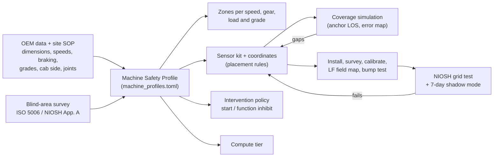

# 04 · Sensor placement per object of interest

This document gives **exact mounting positions** for every object of interest: persons, surface machines,
underground machines and fixed infrastructure. It also describes how each machine gets its own design
(question 11). The coordinate tables are generated by [tools/design_calcs.py](tools/design_calcs.py) from
[tools/machine_profiles.toml](tools/machine_profiles.toml). If a dimension changes, re-run the script and
every coordinate moves with it.

**Coordinate frame (all tables).** The origin is the centre of the machine footprint at ground level.
**x points forward, y to the machine's left, z up**, in metres. Yaw 0° faces forward, +90° faces left,
180° faces rearward and −90° faces right. Pitch is negative when the sensor looks down. For swing machines
the frame rotates with the house and its origin is the swing centre. In the sketches the front is on the
right of the page and the machine's left side is at the top.

Legend for sketches: `U` UWB anchor · `F` LF 125 kHz coil · `R` radar · `T` thermal camera · `C` RGB/IR camera · `G` GNSS antenna · `E` joint/state sensor · `N` combo node.

---

## 1. Placement rules (apply to every machine)

| # | Rule | Reason |
|---|---|---|
| G1 | **UWB anchors on the extremities of the hull**: four corners, plus mid-sides when length ≥ 8 m, plus one high anchor (canopy/ROPS/cab roof) | Widest baseline gives the best geometry. Mid-sides remove the near-collinear side geometry (B → C in the study: p95 4.7 m → 0.68 m). The high anchor sees over the body (+12 points of redundant coverage) [03 §3.5](03_positioning_and_sensing.md) |
| G2 | **Height bands.** UWB anchors 1.0–2.0 m (the plane of a helmet and belt pack); LF coils 0.8–1.2 m (torso); radars **≤ chest height**, 0.9–1.2 m; cameras and thermal 2.5–3.5 m pitched 20–35° down; GNSS on the highest point with open sky | NIOSH: with radar at 2.1–2.7 m people walked *under* the beam [P3, P18]. Anchors near tag height minimise vertical dilution. Cameras up high see the ground next to the machine |
| G3 | **Mount on the frame, never on moving tools** (bucket, blade, dump body, ripper, boom), unless that part's pose is measured | A raised dump body or bucket would carry the sensor out of position |
| G4 | **Out of mud-throw and spill zones**: not directly behind tyres, not under the loading area; behind guards; adjustable-tilt brackets with vibration isolation | NIOSH: avoid tyre mud throw; water entered one radar enclosure; adjustable brackets needed [P3, P18] |
| G5 | **0.15 m outboard** of the hull line, radome facing out, patterns overlapping ≥ 30° | Clears paint, rails and handholds; no gaps between adjacent sensors |
| G6 | **Blind side first.** The side opposite the cab gets an extra radar, thermal and camera | On a 280 t truck the right-side blind area runs past 24 m [P18] |
| G7 | **Rear radars toed in 15°** so the beams cross behind the dual tyres. Verify the 0–3 m strip behind the axle | NIOSH missed a person within 3 m of the rear axle when the radar was tuned to ignore the tyres [P8] |
| G8 | **Measure every joint** that changes the hull: articulation angle, swing angle, body-up switch, bucket/boom height, seat direction | The danger polygon must follow the real shape of the machine |
| G9 | **No welding or drilling without OEM approval; never on axle housings** | NIOSH installation lessons [P18] |
| G10 | **UG: stay inside the machine's envelope** (no added height or width) and use certified Ex enclosures | Narrow galleries and low seams; methane |
| G11 | **Verify, don't assume**: coverage simulation first, then the NIOSH 1 m grid walk with a real person in several postures [P3, P7] | Results on one machine type don't transfer to another [P3] |

## 2. One platform, a separate design per machine (question 11)



Every machine runs the **same Vehicle Safety Unit electronics and firmware**. What differs per machine
is the profile and the kit:

| Per-machine element | Example: 100 t dump truck | Example: continuous miner |
|---|---|---|
| Geometry and joints | 10.3 × 6.1 m box, body-up switch | 11 × 3.3 m, conveyor-swing and boom positions |
| Kinematics | 30 km/h forward, 10 km/h reverse, 2.0 m/s² braking, 1:16 grade | 1.5 km/h tram |
| Zones | Stop 53 m / warn 73 m forward at 30 km/h; 15/24 m reversing at 10 km/h | Ten function zones (Jobes) instead of radial zones |
| Kit | 7 UWB, 4 LF, 4 radar, 2 thermal, 3 cameras, 2 GNSS | 6 UWB, 5 LF, function-inhibit I/O |
| Interventions | Start-inhibit only (moving: alarms) | Function-specific inhibit; stop tram before contact |
| Compute tier | Tier 2 (many perception sensors) | Tier 1 in a flameproof enclosure |
| Models | Radar clutter map and classifier fine-tuned on this truck's own body reflections | Clutter map of tunnel walls |

**Compute tiers**

| Tier | Hardware | Used on |
|---|---|---|
| 0 | Safety MCU only, no perception | VTU on LMVs, two-wheelers, end-of-train units |
| 1 | Safety MCU + low-power NPU computer (Raspberry Pi 5 + Hailo-8L class) | Small HEMM, backhoe, drill, all UG machines (inside Ex d enclosure) |
| 2 | Safety MCU + embedded GPU (Jetson Orin class) | Large HEMM: dump trucks ≥ 60 t, shovels, dozers, wheel loaders |

---

## 3. Persons

### 3.1 Miner Safety Unit (MSU), underground, built into the cap lamp

```
      side view                          what goes where
        ___
      /  U  \   <- helmet crown pod (~1.75 m): UWB radio + antenna on top (vertical
     |=======|      polarisation, 360 deg azimuth), high-g accelerometer, amber LED ring
     |  (o)  |  <- existing cap-lamp head-piece: LED driver tapped for state; flash
       ( )         patterns are an alert channel the miner cannot miss
        ||  <- lamp cord: power + 2-wire data between crown pod and belt pack
       /||\
        ||
      [BP]  <- belt pack at the rear-right hip (~1.0 m), inside the lamp-battery housing:
       / \      LF 3-axis receiver, MCU + 865 MHz radio, IMU, barometer, CO cell,
               ULF receiver, vibration motor, buzzer, guarded SOS button, backup cell
```

| Component | Location (person standing, height above ground) | Why there |
|---|---|---|
| UWB radio + antenna | Helmet crown pod, top-rear of the helmet shell, ~1.75 m | Highest point on the body, so body shadowing is least. The helmet is the one item always worn. The radio sits next to its antenna because a cable at 6.5 GHz loses too much. The base paper's side-of-helmet tag was missed when workers bent over [P1]; a crown antenna stays clear of the head |
| Second UWB radio (production option) | Back face of the belt pack, ~1.0 m | Antenna diversity: covers the rear when the miner crawls in a low seam and the helmet faces forward |
| High-g accelerometer (±200 g) | Crown pod | Detects a roof-fall strike to the head directly |
| Amber/red LED ring | Crown pod, facing outward | Makes the person visible to the operator; flashes when a machine is near |
| LF 3-axis receiver (AS3933 class + 3 ferrite coils) | Belt pack | LF passes through the body, so the hip is fine. Three axes make it orientation-free |
| IMU (6-axis) | Belt pack | The waist is near the centre of mass, the best spot for step detection |
| Barometer | Belt pack, vented membrane | Level, overpressure, ventilation changes |
| CO electrochemical cell | Belt pack, vented | Fire and post-explosion gas |
| ULF receiver (ferrite rod pair) | Belt pack | Emergency paging from the surface ([05 §8](05_communication.md)) |
| Vibration motors | Belt pack + crown pod | Miners wear hearing protection; vibration always gets through |
| Buzzer (85–95 dB at 10 cm) | Belt pack | Secondary alert |
| SOS button (guarded) + ACK button | Belt pack top edge | Reachable with a gloved hand |
| Power | Lamp battery (Li-ion) through a DC-DC; backup cell (≈ 600 mAh) in the belt pack; ≈ 150 mAh cell in the crown pod | Lamp battery makes the electronics almost free (≈ 6 mAh per shift vs ≈ 4 Ah for the lamp). Backup cells keep the emergency beacon alive if the lamp battery dies or the cord is cut ([05 §6](05_communication.md)) |

### 3.2 Surface Personal Unit (SPU), opencast

Same electronics without the ULF receiver and CO cell. The UWB radio and LED ring sit in a **crown pod
clipped to the hard hat**. The belt-pack functions move to a **vest pocket at the upper back** (between the
shoulder blades, ~1.4 m), which keeps the 865 MHz antenna high and the IMU near the trunk. It has its own
2,000 mAh Li-ion battery and charges in the gate/lamp-room dock. Retro-reflective vest tape is kept, since
cameras and operators still rely on eyes.

### 3.3 Variants

| Who | Difference |
|---|---|
| Machine operator | Same unit. Excluded from their **own** machine's alarms only while inside the cab volume with the seat switch on. The moment they step out, they are a pedestrian ([06 §6](06_collision_avoidance_logic.md)) |
| Continuous-miner operator | Same unit + the remote-control transmitter carries its own tag. **Never** excluded: the CM's zones are built around the operator's legitimate positions |
| Supervisor / shot-firer | + methane sensor (NDIR) + small display; can run the blast-clearance check |
| Visitor / contractor | Visitor MSU/SPU issued at the gate; linked to an escort's unit in the twin; geofenced to permitted areas |
| Rescue team | MSU + boot-mounted IMU (zero-velocity updates) + the handheld Rescue Locator ([08](08_resilience_and_security.md)) |

---

## 4. Surface machines

### 4.1 Rear dump truck (RDT), 100 t class: reference design

```
                          LEFT side (cab side, +y)
      U5 o------------------- U3 o F3 --------------------- o U1
         |                                        +-----+   |
  T1 C3  |                                        | cab |   |  C1
  F2 R2  |      dump body: no sensors on it       +-----+   |  R1 F1   --> FRONT (+x)
     R3  |      (it rises when tipping)       U7 G1 G2      |
         |                                   (canopy top)   |
      U6 o------------------- U4 o F4 R4 T2 C2 ------------ o U2
                         RIGHT side (blind side, -y)
```

| Sensor | ID | x | y | z | yaw | pitch | Purpose |
|---|---|---|---|---|---|---|---|
| UWB anchor | U1 | 5.3 | 3.05 | 1.6 | 45 | - | front-left corner |
| UWB anchor | U2 | 5.3 | -3.05 | 1.6 | -45 | - | front-right corner |
| UWB anchor | U3 | 0.0 | 3.2 | 1.8 | 90 | - | mid-left (fills side null) |
| UWB anchor | U4 | 0.0 | -3.2 | 1.8 | -90 | - | mid-right (fills side null) |
| UWB anchor | U5 | -5.3 | 2.75 | 2.0 | 135 | - | rear-left, fender bracket behind duals |
| UWB anchor | U6 | -5.3 | -2.75 | 2.0 | -135 | - | rear-right, fender bracket behind duals |
| UWB anchor | U7 | 3.35 | 1.85 | 5.1 | omni | - | canopy top: over-body LOS, V2V ranging |
| LF coil 125 kHz | F1 | 5.3 | 0.0 | 1.0 | 0 | - | near-field shell, front |
| LF coil 125 kHz | F2 | -5.3 | 0.0 | 1.0 | 180 | - | near-field shell, rear |
| LF coil 125 kHz | F3 | 0.0 | 3.2 | 1.0 | 90 | - | near-field shell, left / tyres |
| LF coil 125 kHz | F4 | 0.0 | -3.2 | 1.0 | -90 | - | near-field shell, right / tyres |
| Radar 77 GHz | R1 | 5.3 | 0.0 | 1.0 | 0 | 0 | front, FOV 120 deg, 0.5-80 m |
| Radar 77 GHz | R2 | -5.3 | 1.52 | 1.0 | -165 | 0 | rear-left, toed-in 15 deg (NIOSH) |
| Radar 77 GHz | R3 | -5.3 | -1.52 | 1.0 | 165 | 0 | rear-right, toed-in 15 deg (NIOSH) |
| Radar 77 GHz | R4 | 0.5 | -3.2 | 1.2 | -90 | 0 | right (blind) side, 0.3-20 m |
| Thermal LWIR | T1 | -5.3 | 0.0 | 2.6 | 180 | -25 | rear, untagged-person detection |
| Thermal LWIR | T2 | 1.0 | -3.2 | 3.0 | -90 | -30 | right side (optional) |
| RGB camera | C1 | 5.3 | 0.0 | 2.5 | 0 | -15 | front view |
| RGB camera | C2 | 3.15 | -3.2 | 3.5 | -100 | -35 | right side, looking down/back |
| RGB camera | C3 | -5.3 | 0.0 | 3.0 | 180 | -30 | rear view (auto on reverse gear) |
| GNSS antenna | G1 | 3.65 | 2.05 | 5.15 | - | - | RTK, moving-baseline primary |
| GNSS antenna | G2 | 3.65 | -2.05 | 5.15 | - | - | RTK heading (baseline = W-2 m) |

**Why this layout**

* **Seven anchors** come out of the coverage study: 100% of the 5–15 m ring positionable, 90% with three or more anchors, p95 0.68 m ([03 §3.5](03_positioning_and_sensing.md)).
* **Rear anchors sit on fixed fender brackets behind the duals, not on the dump body**, which rises when tipping.
* **The LF shell covers the tyres and the space under the body.** That is where a person is invisible to every camera and where start-inhibit matters most.
* **Radars:** one front unit for the large front blind area (an LMV parked ahead), two rear units toed in 15° (NIOSH), and one on the blind side. All are ≤ 1.2 m high.
* **Cameras follow NIOSH practice: front, right side and rear.** The rear view switches on automatically with reverse gear, and alarm icons are drawn on the camera image so there is one display [P18].
* **Dual GNSS antennas on the canopy** give heading when stationary. That is needed to know which way a parked truck will move at start-up.
* **State inputs** come from CAN/J1939 (gear, speed, brake, payload) plus a body-up switch (overhead-line geofence while tipping).

**Same kit, other haul-type machines.** The 60 t truck (RDT60), water sprinkler (WTR28) and motor grader
(GRD) use identical rules. Their coordinates scale with their dimensions (full tables in
[tools/generated_tables.md](tools/generated_tables.md)). Grader-specific: the moldboard circle sits
mid-machine, so the mid-side anchors U3/U4 go on the frame just behind the circle.

### 4.2 Hydraulic excavator / shovel (swing machine)

```
                     +y (left, cab side)
         U1 o--------------------o U3 ----+
  R1 <\     |  counterweight   F2   cab   | \
  T1 C1 F1  |    swing centre (*) E1      |   === boom === bucket  --> +x (house frame)
  R2 </     |                  F3         | /
         U2 o--------------------o U4 ----+
                     -y (right, boom side, blind)
   U5 on cab roof (z 7.1 m); U6/U7 on the track-frame ends (undercarriage frame)
   Danger annulus: r <= 7.1 m from the swing centre (tail swing 5.6 m + 1.5 m)
```

| Sensor | ID | x | y | z | yaw | pitch | Purpose |
|---|---|---|---|---|---|---|---|
| UWB anchor | U1 | -5.4 | 2.45 | 2.2 | 135 | - | counterweight rear-left |
| UWB anchor | U2 | -5.4 | -2.45 | 2.2 | -135 | - | counterweight rear-right |
| UWB anchor | U3 | 2.0 | 2.9 | 2.0 | 60 | - | house front-left |
| UWB anchor | U4 | 2.0 | -2.9 | 2.0 | -60 | - | house front-right (boom side) |
| UWB anchor | U5 | 2.0 | 1.75 | 7.1 | omni | - | cab roof |
| UWB anchor | U6 | 3.65 | 0.0 | 1.0 | 0 | - | undercarriage track end (frame U) |
| UWB anchor | U7 | -3.65 | 0.0 | 1.0 | 180 | - | undercarriage track end (frame U) |
| Swing encoder | E1 | 0.0 | 0.0 | 1.5 | - | - | house angle vs undercarriage (or dual IMU) |
| LF coil 125 kHz | F1 | -5.6 | 0.0 | 1.8 | 180 | - | swing annulus shell, counterweight |
| LF coil 125 kHz | F2 | 0.0 | 2.9 | 1.5 | 90 | - | house left |
| LF coil 125 kHz | F3 | 0.0 | -2.9 | 1.5 | -90 | - | house right |
| Radar 77 GHz | R1 | -5.6 | 1.0 | 1.6 | 145 | 0 | counterweight, diverging 35 deg |
| Radar 77 GHz | R2 | -5.6 | -1.0 | 1.6 | -145 | 0 | counterweight, diverging 35 deg |
| Thermal LWIR | T1 | -5.6 | 0.0 | 2.6 | 180 | -20 | counterweight |
| RGB camera | C1 | -5.6 | 0.0 | 3.0 | 180 | -30 | rear (counterweight) |
| RGB camera | C2 | 1.0 | -2.9 | 3.2 | -90 | -30 | right side (opposite cab) |
| GNSS antenna | G1 | -5.0 | 1.5 | 4.2 | - | - | house top, RTK |
| GNSS antenna | G2 | -5.0 | -1.5 | 4.2 | - | - | house top, heading |

**Why:** The hazards are the **counterweight swinging through people** and the bucket swinging over a
cab. Once swinging at 4 rpm, the counterweight travels **5.5 m of arc after an alarm before it stops**
([generated tables §1](tools/generated_tables.md)). So the swing annulus is an **exclusion zone**, not a
reaction-time zone. Sensors therefore sit on the **counterweight**, the leading edge of the hazard in
either swing direction, with the radars diverging ±35° to cover the arc. The swing encoder rotates the
hull polygon. Undercarriage anchors protect people near the tracks during travel. NIOSH lists side
opposite the cab, rear and swing radius as the areas to monitor on shovels [P18]. **Rope shovels and
draglines** use the same rules on their house, with the swing exclusion radius (tens of metres for a
dragline) enforced mainly as a **twin geofence**.

### 4.3 Crawler dozer

```
                  +y
      U5 o---------------o U3 F3 R3 ---------o U1
  R1 <\  |  ripper                           |   ||
  T1 C1  |                    U7 (ROPS top)  | F1|| blade   --> +x
  F2 R2</|                                   |   ||  R5 C2 above the blade
      U6 o---------------o U4 F4 R4 ---------o U2
                  -y
```

| Sensor | ID | x | y | z | yaw | pitch | Purpose |
|---|---|---|---|---|---|---|---|
| UWB anchor | U1 | 3.45 | 1.65 | 2.0 | 45 | - | radiator-guard front-left (not on blade) |
| UWB anchor | U2 | 3.45 | -1.65 | 2.0 | -45 | - | radiator-guard front-right |
| UWB anchor | U3 | 0.0 | 1.95 | 1.9 | 90 | - | left fender |
| UWB anchor | U4 | 0.0 | -1.95 | 1.9 | -90 | - | right fender |
| UWB anchor | U5 | -3.25 | 1.55 | 2.0 | 135 | - | rear-left (frame, not ripper) |
| UWB anchor | U6 | -3.25 | -1.55 | 2.0 | -135 | - | rear-right (frame, not ripper) |
| UWB anchor | U7 | -0.5 | 0.0 | 4.1 | omni | - | ROPS top |
| LF coil 125 kHz | F1 | 3.45 | 0.0 | 1.2 | 0 | - | front (behind blade) |
| LF coil 125 kHz | F2 | -3.75 | 0.0 | 1.2 | 180 | - | rear |
| LF coil 125 kHz | F3 | 0.0 | 2.15 | 1.0 | 90 | - | left |
| LF coil 125 kHz | F4 | 0.0 | -2.15 | 1.0 | -90 | - | right |
| Radar 77 GHz | R1 | -3.75 | 1.0 | 1.2 | -165 | 0 | rear-left, toed-in |
| Radar 77 GHz | R2 | -3.75 | -1.0 | 1.2 | 165 | 0 | rear-right, toed-in |
| Radar 77 GHz | R3 | 0.0 | 2.3 | 1.2 | 90 | 0 | left side (dozers pivot fast) |
| Radar 77 GHz | R4 | 0.0 | -2.3 | 1.2 | -90 | 0 | right side |
| Radar 77 GHz | R5 | 3.25 | 0.0 | 2.3 | 0 | -10 | front, over blade |
| Thermal LWIR | T1 | -3.75 | 0.0 | 2.6 | 180 | -25 | rear |
| RGB camera | C1 | -3.75 | 0.0 | 2.8 | 180 | -30 | rear |
| RGB camera | C2 | 3.45 | 0.0 | 2.6 | 0 | -20 | front (blade raised) |
| GNSS antenna | G1 | -0.5 | 1.0 | 4.15 | - | - | ROPS, RTK |
| GNSS antenna | G2 | -0.5 | -1.0 | 4.15 | - | - | ROPS, heading |

**Why:** NIOSH: monitor the rear, the front when the blade is raised, **and both sides, because dozers spin
quickly** [P18]. Dozers reverse faster than they go forward (14 vs 11 km/h), so the rear zone is the
largest (stop 20 m, warn 31 m). Anchors avoid the blade and ripper (moving tools) and sit on the radiator
guard, fenders and main frame. The front radar sits above the blade line to see past it.

### 4.4 Wheel loader (articulated)

```
              REAR FRAME                     | joint |        FRONT FRAME
      U5 o---------------------------o U3 F3 |  E1   |------------o U1
  F2 R2  |   engine / counterweight     U7 (canopy)  |            |   +--------+
  T1 C1  |                                   |       |         R1 |   | bucket | --> +x
         |                                   |       |         C2 |   +--------+
      U6 o---------------------------o U4 F4 |       |------------o U2
```

| Sensor | ID | x | y | z | yaw | pitch | Purpose |
|---|---|---|---|---|---|---|---|
| UWB anchor | U1 | 3.0 | 1.8 | 1.4 | 45 | - | front frame, at lift-arm pivot (not bucket) |
| UWB anchor | U2 | 3.0 | -1.8 | 1.4 | -45 | - | front frame, at lift-arm pivot |
| UWB anchor | U3 | 0.0 | 1.8 | 1.3 | 90 | - | articulation pinch zone left |
| UWB anchor | U4 | 0.0 | -1.8 | 1.3 | -90 | - | articulation pinch zone right |
| UWB anchor | U5 | -4.75 | 1.45 | 1.4 | 135 | - | rear frame corner |
| UWB anchor | U6 | -4.75 | -1.45 | 1.4 | -135 | - | rear frame corner |
| UWB anchor | U7 | -1.0 | 0.0 | 3.65 | omni | - | canopy top |
| Articulation encoder | E1 | 0.0 | 0.0 | 1.0 | - | - | hull polygon follows steering |
| LF coil 125 kHz | F1 | 3.0 | 0.0 | 1.0 | 0 | - | front |
| LF coil 125 kHz | F2 | -4.75 | 0.0 | 1.0 | 180 | - | rear |
| LF coil 125 kHz | F3 | 0.0 | 1.8 | 1.0 | 90 | - | pinch zone left |
| LF coil 125 kHz | F4 | 0.0 | -1.8 | 1.0 | -90 | - | pinch zone right |
| Radar 60/77 GHz | R1 | 2.8 | 0.0 | 3.4 | 0 | -5 | front, above bucket line |
| Radar 60/77 GHz | R2 | -4.75 | 0.0 | 1.0 | 180 | 0 | rear |
| Thermal LWIR | T1 | -4.75 | 0.0 | 2.4 | 180 | -20 | rear |
| RGB/IR camera | C1 | -4.75 | 0.0 | 2.6 | 180 | -25 | rear |
| RGB/IR camera | C2 | 2.8 | 0.0 | 3.6 | 0 | -15 | front (bucket raised) |
| GNSS antenna | G1 | -1.0 | 0.6 | 3.75 | - | - | RTK |
| GNSS antenna | G2 | -1.0 | -0.6 | 3.75 | - | - | heading (rear frame) |

**Why:** The **articulation joint is a crushing point**: a person beside the joint is squeezed when the
loader steers. Anchors U3/U4 and coils F3/F4 sit exactly there, and the encoder bends the danger polygon
with the steering angle. Front anchors go on the lift-arm pivots, not the bucket. NIOSH: loaders need
the rear monitored, plus the front when the bucket is raised [P18]. Front sensors are therefore on the
canopy front edge, above the raised-bucket line.

### 4.5 Backhoe loader (JCB 3DX class)

| Sensor | ID | x | y | z | yaw | pitch | Purpose |
|---|---|---|---|---|---|---|---|
| UWB anchor | U1 | 2.05 | 1.32 | 1.3 | 45 | - | front-left (behind loader arms) |
| UWB anchor | U2 | 2.05 | -1.32 | 1.3 | -45 | - | front-right |
| UWB anchor | U3 | -2.35 | 1.32 | 1.3 | 135 | - | rear-left (stabiliser leg, outside swing) |
| UWB anchor | U4 | -2.35 | -1.32 | 1.3 | -135 | - | rear-right |
| UWB anchor | U5 | 0.0 | 0.0 | 3.65 | omni | - | cab roof |
| Seat-direction switch | E1 | 0.0 | 0.0 | 1.0 | - | - | loader mode vs backhoe mode |
| LF coil 125 kHz | F1 | 2.05 | 0.0 | 1.0 | 0 | - | front |
| LF coil 125 kHz | F2 | -2.35 | 0.0 | 1.0 | 180 | - | rear / backhoe swing |
| Radar 24/60 GHz | R1 | 2.05 | 0.0 | 1.4 | 0 | 0 | front near-field |
| Radar 24/60 GHz | R2 | -2.35 | 0.0 | 1.4 | 180 | 0 | rear near-field |
| RGB camera | C1 | -2.35 | 0.0 | 2.4 | 180 | -30 | rear |
| GNSS antenna | G1 | 0.0 | 0.0 | 3.75 | - | - | RTK (single, IMU heading) |

**Why:** A backhoe loader has **two working ends and two modes**. The **seat-direction switch** selects the
zone set. In loader mode it behaves like a small loader with speed-based zones. In backhoe mode, with the
stabilisers down, the hazard is the **backhoe swing**: a radial exclusion of reach 5.5 m + 1.5 m = 7.0 m
from the swing post. It is small, so cheap short-range radars (24/60 GHz) are enough, and the machine stays
in compute Tier 1.

### 4.6 Blast-hole drill (crawler)

| Sensor | ID | x | y | z | yaw | pitch | Purpose |
|---|---|---|---|---|---|---|---|
| UWB anchor | U1 | 4.65 | 2.25 | 1.5 | 45 | - | front-left |
| UWB anchor | U2 | 4.65 | -2.25 | 1.5 | -45 | - | front-right |
| UWB anchor | U3 | -4.65 | 2.25 | 1.5 | 135 | - | rear-left |
| UWB anchor | U4 | -4.65 | -2.25 | 1.5 | -135 | - | rear-right |
| UWB anchor | U5 | 0.0 | 0.0 | 4.6 | omni | - | deck top (mast down) |
| LF coil 125 kHz | F1 | 4.65 | 0.0 | 1.0 | 0 | - | front / drill-string zone |
| LF coil 125 kHz | F2 | -4.65 | 0.0 | 1.0 | 180 | - | rear |
| Radar 24/60 GHz | R1 | -4.65 | 0.0 | 1.2 | 180 | 0 | rear (tramming) |
| RGB camera | C1 | -4.65 | 0.0 | 2.6 | 180 | -30 | rear |
| Mast-angle switch | E1 | 0.0 | 0.0 | 2.0 | - | - | mast up = overhead-line geofence check |
| GNSS antenna | G1 | 0.0 | 1.0 | 4.65 | - | - | RTK (hole positioning reuse) |

**Why:** A drill is mostly stationary, with helpers working beside the drill string. The LF shell and
UWB guard the **tram-start** and the rotating string. The mast-angle switch arms the overhead-line
geofence. LF generators are **switched off in BLAST mode** when the drill works near charged holes
([06 §9](06_collision_avoidance_logic.md)).

### 4.7 Light motor vehicle (jeep/pickup), two-wheelers and visiting vehicles: Vehicle Tag Unit

| Sensor | ID | x | y | z | yaw | pitch | Purpose |
|---|---|---|---|---|---|---|---|
| Combo node (UWB+sub-GHz) | N1 | 0.2 | 0.0 | 2.0 | omni | - | magnetic roof mount, beacon + V2X |
| UWB anchor | U1 | 2.35 | 0.0 | 0.9 | 0 | - | front bumper (optional) |
| UWB anchor | U2 | -2.35 | 0.0 | 1.0 | 180 | - | rear bumper (optional) |
| Radar 24/60 GHz | R1 | -2.35 | 0.0 | 0.6 | 180 | 0 | rear (optional) |
| Cab alert unit | H1 | 0.6 | 0.0 | 1.2 | - | - | buzzer + LED + voice |
| GNSS antenna | G1 | 0.2 | 0.3 | 2.02 | - | - | in combo node |
| Whip flag + strobe | V1 | -1.0 | 0.6 | 4.4 | - | - | visibility to HEMM drivers |

**Why:** The LMV's main risk is being **crushed by a large machine that cannot see it**. A light-vehicle
collision in NIOSH's data killed two people [P18]. What matters most is that the **HEMM detects the LMV**.
So the essential part is the roof-mounted combo node: a UWB tag/anchor that every HEMM ranges to, plus an
865 MHz beacon carrying the RTK pose. The **magnetic mount** lets the gate issue it to visiting vehicles
and two-wheelers in seconds. Bumper anchors and the rear radar are optional upgrades for LMVs driven near
pedestrians.

---

## 5. Underground machines

All UG electronics sit in certified enclosures (Ex ia sensors, Ex d computer) and inside the machine's
existing envelope.

### 5.1 Load-haul-dump (LHD), articulated

```
             REAR FRAME                     | joint |        FRONT FRAME
     U5 o----------------------------o U3 F3|  E1   |---------------o U1
 F2 R2  |  engine/battery     U7 (canopy)   |       |      R1 C2 T2 |  +------+
 T1 C1  |  L2 (LiDAR)                       |       |   L1 (LiDAR)  |  |bucket| --> +x
     U6 o----------------------------o U4 F4|       |---------------o U2 +------+
```

| Sensor | ID | x | y | z | yaw | pitch | Purpose |
|---|---|---|---|---|---|---|---|
| UWB anchor | U1 | 2.9 | 1.25 | 1.4 | 45 | - | front frame, at lift-arm pivot (not bucket) |
| UWB anchor | U2 | 2.9 | -1.25 | 1.4 | -45 | - | front frame, at lift-arm pivot |
| UWB anchor | U3 | 0.4 | 1.25 | 1.3 | 90 | - | articulation pinch zone left |
| UWB anchor | U4 | 0.4 | -1.25 | 1.3 | -90 | - | articulation pinch zone right |
| UWB anchor | U5 | -4.65 | 0.9 | 1.4 | 135 | - | rear frame corner |
| UWB anchor | U6 | -4.65 | -0.9 | 1.4 | -135 | - | rear frame corner |
| UWB anchor | U7 | -0.6 | 0.0 | 2.15 | omni | - | canopy top |
| Articulation encoder | E1 | 0.4 | 0.0 | 1.0 | - | - | hull polygon follows steering |
| LF coil 125 kHz | F1 | 2.9 | 0.0 | 1.0 | 0 | - | front |
| LF coil 125 kHz | F2 | -4.65 | 0.0 | 1.0 | 180 | - | rear |
| LF coil 125 kHz | F3 | 0.4 | 1.25 | 1.0 | 90 | - | pinch zone left |
| LF coil 125 kHz | F4 | 0.4 | -1.25 | 1.0 | -90 | - | pinch zone right |
| Radar 60/77 GHz | R1 | 2.7 | 0.0 | 1.9 | 0 | -5 | front, above bucket line |
| Radar 60/77 GHz | R2 | -4.65 | 0.0 | 1.0 | 180 | 0 | rear (FOV 90 deg in tunnels) |
| Thermal LWIR | T1 | -4.65 | 0.0 | 1.8 | 180 | -20 | rear |
| RGB/IR camera | C1 | -4.65 | 0.0 | 1.9 | 180 | -25 | rear |
| RGB/IR camera | C2 | 2.7 | 0.0 | 2.1 | 0 | -15 | front (bucket raised) |
| Thermal LWIR | T2 | 2.7 | 0.0 | 2.0 | 0 | -10 | front |
| 2-D LiDAR (Ex) | L1 | 3.9 | 0.0 | 1.6 | 0 | 0 | front: map-matching localisation |
| 2-D LiDAR (Ex) | L2 | -3.9 | 0.0 | 1.6 | 180 | 0 | rear: map-matching localisation |

**Why:** In a 4–5 m gallery, people are **ahead or behind**, rarely beside, so the long axis gets
redundant sensing at both ends. The pinch point at the joint gets dedicated anchors and coils. Radars use
a **narrower field of view (≈ 90°)** and the twin's wall map to reject rib clutter. Thermal is fused with
radar, never used alone, because hot workings reduce thermal contrast. The 2-D LiDARs are for the
**machine's own absolute position** (scan matching against the tunnel profile in the twin), not person
detection. Remove them if cost or certification blocks them; odometry plus junction anchors still work.

### 5.2 Side discharge loader (SDL)

| Sensor | ID | x | y | z | yaw | pitch | Purpose |
|---|---|---|---|---|---|---|---|
| UWB anchor | U1 | 3.4 | 0.93 | 1.1 | 45 | - | front-left |
| UWB anchor | U2 | 3.4 | -0.93 | 1.1 | -45 | - | front-right |
| UWB anchor | U3 | -3.4 | 0.93 | 1.1 | 135 | - | rear-left |
| UWB anchor | U4 | -3.4 | -0.93 | 1.1 | -135 | - | rear-right |
| UWB anchor | U5 | 0.0 | 1.07 | 1.2 | 90 | - | operator side |
| LF coil 125 kHz | F1 | 3.4 | 0.0 | 0.8 | 0 | - | front |
| LF coil 125 kHz | F2 | -3.4 | 0.0 | 0.8 | 180 | - | rear |
| LF coil 125 kHz | F3 | 0.0 | 1.07 | 0.8 | 90 | - | left |
| LF coil 125 kHz | F4 | 0.0 | -1.07 | 0.8 | -90 | - | right |
| Radar 60 GHz | R1 | 3.4 | 0.0 | 0.9 | 0 | 0 | front, FOV 90 deg |
| Radar 60 GHz | R2 | -3.4 | 0.0 | 0.9 | 180 | 0 | rear, FOV 90 deg |
| Thermal LWIR | T1 | 3.4 | 0.0 | 1.3 | 0 | -10 | front |
| Thermal LWIR | T2 | -3.4 | 0.0 | 1.3 | 180 | -10 | rear |

**Why:** A low, compact, rigid machine. Four corners plus the operator side are enough. Everything stays
below the 1.45 m machine height. The side-discharge side is where people stand during loading, so the
LF coil there defines a tight shell.

### 5.3 Continuous miner (remote controlled)

```
                                 +y
  F5  o U5 -------------- U3 o F3 ------------- F1 o U1  +-----------+
  tail conveyor ====                                     |  cutter   |  --> +x
  (swings +/-45 deg)                                     |  drum     |
      o U6 -------------- U4 o F4 ------------- F2 o U2  +-----------+
  The operator's remote-control unit carries its own tag.
```

| Sensor | ID | x | y | z | yaw | pitch | Purpose |
|---|---|---|---|---|---|---|---|
| UWB anchor | U1 | 4.7 | 1.8 | 1.2 | 60 | - | cutter-drum end left |
| UWB anchor | U2 | 4.7 | -1.8 | 1.2 | -60 | - | cutter-drum end right |
| UWB anchor | U3 | 0.0 | 1.8 | 1.2 | 90 | - | mid-left (operator walkway) |
| UWB anchor | U4 | 0.0 | -1.8 | 1.2 | -90 | - | mid-right |
| UWB anchor | U5 | -4.5 | 1.05 | 1.2 | 135 | - | tail-boom left |
| UWB anchor | U6 | -4.5 | -1.05 | 1.2 | -135 | - | tail-boom right |
| LF coil 125 kHz | F1 | 3.5 | 1.65 | 0.9 | 60 | - | front-left (cutter boom pivot) |
| LF coil 125 kHz | F2 | 3.5 | -1.65 | 0.9 | -60 | - | front-right |
| LF coil 125 kHz | F3 | -0.5 | 1.65 | 0.9 | 90 | - | mid-left |
| LF coil 125 kHz | F4 | -0.5 | -1.65 | 0.9 | -90 | - | mid-right |
| LF coil 125 kHz | F5 | -5.0 | 0.0 | 0.9 | 180 | - | tail conveyor |
| Function-inhibit I/O | E1 | 0.0 | 0.0 | 1.0 | - | - | tram/swing/cutter/gathering-arm interlocks |

**Why:** This follows the proven commercial pattern: magnetic generators around the machine, which MSHA's
rule effectively requires [E2]. UWB is added for identity and continuous position. The response is
**function-specific** (Jobes et al. [P12]). There are ten zones around the machine, and each zone blocks
only the motions that can hurt someone standing in it: tram left/right/forward/reverse, conveyor swing,
cutter-head raise/lower, gathering arms. That lets the operator keep working from a safe position instead
of the whole machine stopping. The person's position is a circle of uncertainty (k·σ) tested against the
zone polygons, so overlapping zones block the union of their functions [P12]. A 3 ft (0.9 m) minimum
clearance cut simulated strike incidents by 40% compared with 2 ft [P12]. That sets the inner margin of
every zone.

### 5.4 Shuttle car (bidirectional)

| Sensor | ID | x | y | z | yaw | pitch | Purpose |
|---|---|---|---|---|---|---|---|
| UWB anchor | U1 | 4.4 | 1.5 | 1.0 | 45 | - | end A left |
| UWB anchor | U2 | 4.4 | -1.5 | 1.0 | -45 | - | end A right |
| UWB anchor | U3 | -4.4 | 1.5 | 1.0 | 135 | - | end B left |
| UWB anchor | U4 | -4.4 | -1.5 | 1.0 | -135 | - | end B right |
| UWB anchor | U5 | 0.0 | 1.65 | 1.1 | 90 | - | mid-left |
| UWB anchor | U6 | 0.0 | -1.65 | 1.1 | -90 | - | mid-right |
| LF coil 125 kHz | F1 | 4.4 | 0.0 | 0.8 | 0 | - | end A |
| LF coil 125 kHz | F2 | -4.4 | 0.0 | 0.8 | 180 | - | end B |
| LF coil 125 kHz | F3 | 0.0 | 1.65 | 0.8 | 90 | - | operator-cab side |
| LF coil 125 kHz | F4 | 0.0 | -1.65 | 0.8 | -90 | - | cable-reel side |
| Radar 60 GHz | R1 | 4.4 | 0.0 | 0.9 | 0 | 0 | end A |
| Radar 60 GHz | R2 | -4.4 | 0.0 | 0.9 | 180 | 0 | end B |
| IR camera | C1 | 4.4 | 0.0 | 1.3 | 0 | -10 | end A |
| IR camera | C2 | -4.4 | 0.0 | 1.3 | 180 | -10 | end B |

**Why:** A shuttle car has **no front or back**. The operator sits sideways, and the direction of travel
decides which end is leading. The kit is symmetrical, and the zone engine picks the leading end from the
travel direction. The cable-reel side gets its own coil because the trailing cable is a trip and entanglement
hazard.

### 5.5 Battery locomotive with tubs

```
  N1 (end-of-train unit on the last tub)  [tub][tub]...[tub]  U3/U4 o[ LOCO ]o U1/U2  R1 C1 F1  --> +x
                    <---------- train length ~45 m ---------->     F2 R2 on the loco rear
```

| Sensor | ID | x | y | z | yaw | pitch | Purpose |
|---|---|---|---|---|---|---|---|
| UWB anchor | U1 | 2.4 | 0.45 | 1.3 | 20 | - | loco front-left |
| UWB anchor | U2 | 2.4 | -0.45 | 1.3 | -20 | - | loco front-right |
| UWB anchor | U3 | -2.4 | 0.45 | 1.3 | 160 | - | loco rear-left |
| UWB anchor | U4 | -2.4 | -0.45 | 1.3 | -160 | - | loco rear-right |
| End-of-train unit | N1 | -47.25 | 0.0 | 1.0 | 180 | - | last tub: UWB+sub-GHz, train length |
| LF coil 125 kHz | F1 | 2.4 | 0.0 | 0.8 | 0 | - | front |
| LF coil 125 kHz | F2 | -2.4 | 0.0 | 0.8 | 180 | - | rear |
| Radar 60 GHz | R1 | 2.4 | 0.0 | 1.0 | 0 | 0 | front, FOV 30-60 deg along track |
| Radar 60 GHz | R2 | -2.4 | 0.0 | 1.0 | 180 | 0 | rear |
| IR camera | C1 | 2.4 | 0.0 | 1.4 | 0 | -5 | front |

**Why:** A train **cannot steer**, and it stops slowly (0.8 m/s² gives stop 21 m / warn 30 m at
10 km/h). Detection must reach far **along the track**, so the radars use narrow beams aligned with it.
The **end-of-train unit** (battery, magnet-mounted) does two jobs. It tells the twin the true train length,
and it protects people at the *tail* of a long rake during push movements. Tracks are 1-D, so the twin
also runs **block reservation** (only one train per block) as railway signalling does.

### 5.6 Personnel / utility carrier (UG)

| Sensor | ID | x | y | z | yaw | pitch | Purpose |
|---|---|---|---|---|---|---|---|
| Combo node (UWB+sub-GHz) | N1 | 0.2 | 0.0 | 2.0 | omni | - | magnetic roof mount, beacon + V2X |
| UWB anchor | U1 | 2.65 | 0.0 | 0.9 | 0 | - | front bumper (optional) |
| UWB anchor | U2 | -2.65 | 0.0 | 1.0 | 180 | - | rear bumper (optional) |
| Radar 24/60 GHz | R1 | -2.65 | 0.0 | 0.6 | 180 | 0 | rear (optional) |
| Cab alert unit | H1 | 0.6 | 0.0 | 1.2 | - | - | buzzer + LED + voice |
| Radar 60 GHz | R2 | 2.65 | 0.0 | 0.8 | 0 | 0 | front |

### 5.7 Roof bolter, longwall shearer and face equipment (rules)

| Machine | Placement rule |
|---|---|
| Roof bolter | Four-corner UWB + LF coils at both drill booms. Tram-inhibit while a tag is inside the boom zone. Bolting itself is operator-controlled at close range, so alarms only |
| Longwall shearer | LF coils at both ranging-arm ends (drum zones) + UWB anchors on the shearer body. **Face anchors every 10th powered support** (≈ 17.5 m) give miners' positions as a support number along the face walkway. A person inside a drum zone triggers a shearer stop request through the shearer control system |
| Armoured face conveyor / stage loader / crusher | Fixed hazards in the twin; start-inhibit if a tag is in the guarded zone; existing pull-wire stops remain primary |

---

## 6. Fixed infrastructure

### 6.1 Junction Guardian (UG junction or crosscut)

```
                 roadway A
                    |  |
                    |  | <- LED signal facing A
   crosscut B ------+  +------ crosscut D
                    |JG|  <- node in a recessed niche at the pillar corner, 2.0-2.4 m high;
   ---------- ------+  +------    UWB antenna on a 0.3 m bracket pointing into the junction,
                    |  |          so all four branches are in line of sight
                    |  |
                 roadway C
```

| Item | Position | Why |
|---|---|---|
| Enclosure | Recessed niche or behind a steel guard at a **pillar corner**, 2.0–2.4 m high, ≥ 0.3 m below the roof line | MSHA: install in recessed areas or around corners for survivability [E1]; out of reach of machines |
| UWB anchor antenna | 0.3 m bracket projecting diagonally into the junction | Line of sight down all four branches (UWB needs LOS around corners [P9]) |
| 865 MHz antenna | Same bracket, vertical | Gateway and relay of machine beacons around the corner |
| LED signal heads | One facing each branch, at operator eye level | Shows "machine approaching from another branch" before anyone can see it |
| Barometer, temperature, CO (optional) | Inside the node | Explosion localisation, fire detection, ventilation change |
| Power / data | Fibre ring + IS power; standby battery ≥ 24 h (target 96 h) | MSHA standby guidance [E1]; [generated tables §6](tools/generated_tables.md) |

**Where:** every junction on haulage and travel roads, at loading points, belt transfer points, workshop
entrances, refuge chambers and SCSR caches. A mid-gallery anchor goes in wherever pillars are longer than
60 m. **Coverage follows traffic.** Panels without vehicle traffic rely on dead reckoning and zone fixes.

### 6.2 Opencast Guardian (blind intersections, ramps, dump points)

A pole (5 m) carrying: a UWB anchor at 2.0 m (person plane), a second UWB anchor at the top (line of sight
over trucks), an 865 MHz gateway, an LED signal, a solar panel and a battery. Place them at ramp crests,
blind haul-road intersections, dump-yard entries and shovel loading areas. Plus one RTK base station on the
mine office roof with clear sky.

### 6.3 Conveyor guard node

At belt drive heads, tail ends and transfer points: an LF loop laid around the guarded area plus a UWB
anchor. The belt start circuit is interlocked so it will not start while a tag is inside the guard zone.
This is in addition to the statutory pre-start warning. A running belt only alarms; pull-wires remain the
primary stop.

### 6.4 Refuge Comms Node

Inside each refuge chamber or SCSR cache: a mesh node with an antenna outside the chamber, the
through-the-earth uplink transceiver, a TTE loop laid around the adjacent pillar, air-quality sensors and
a ≥ 96 h battery ([05 §8](05_communication.md)).

### 6.5 Lamp-room / gate dock

A charging rack with a data contact per slot. It handles check-in and check-out (the roll-call source of
truth), the daily self-test, key provisioning, black-box offload, firmware updates and the visitor issue
point.

---

## 7. Commissioning checklist (per machine)

1. Collect OEM data and site SOP values into the MSP (dimensions, joints, speeds, braking, grades, cab side).
2. Blind-area survey: simplified ISO 5006 plots at ground level and at 1.5 m, as NIOSH did [P18].
3. Run `design_calcs.py` for the kit, coordinates and zones; check the coverage map for gaps; adjust brackets to the real obstructions.
4. Install with OEM approval for any drilling or welding. Use vibration-isolated, adjustable brackets, IP69K connectors and protected cable runs [P18].
5. Survey every sensor position to ±2 cm and write it into the MSP.
6. Calibrate UWB antenna delays. Inter-anchor self-ranging must close within ±5 cm.
7. Map the LF field on a 1 m grid with a reference tag and set the shell thresholds.
8. Calibrate radar and camera extrinsics with targets.
9. Run the NIOSH Appendix B test: reliable and sporadic zones, **real person** 172 ± 8 cm, standing, bending, crouching and lying; alarm delay < 200 ms [P18]. Run the Marks & Teizer approach test: 36 angles × 2 runs × 3 zone settings [P7].
10. Run 7 × 24 h shadow mode with DVR and classify every alarm as true, false, nuisance or missed [P18].
11. Sign off, and store the MSP version and calibration in the twin.
