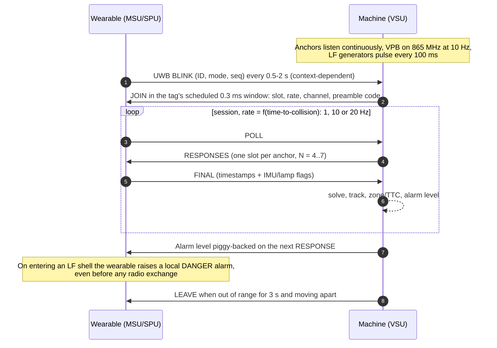
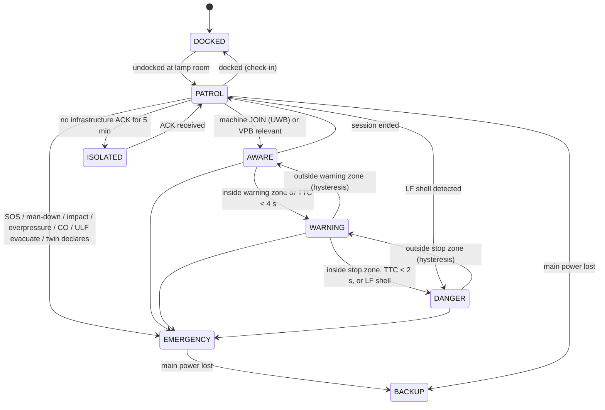
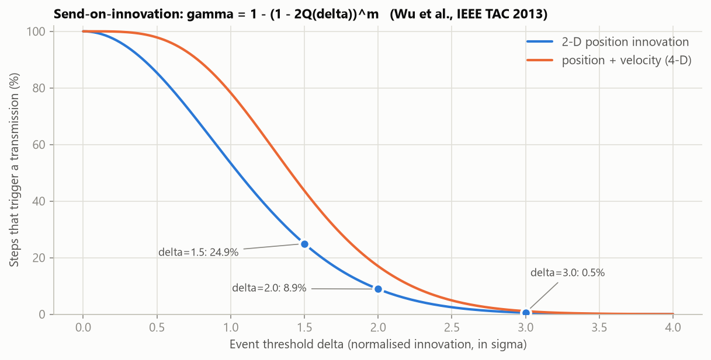
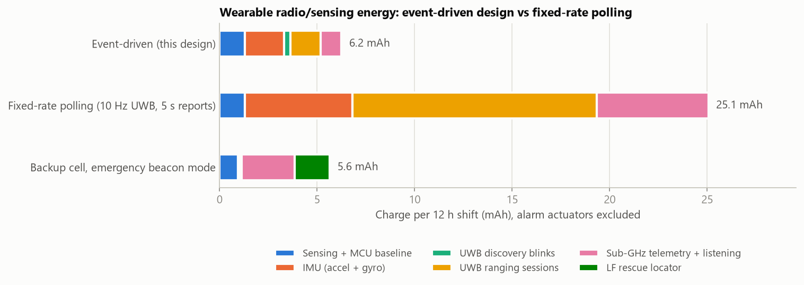
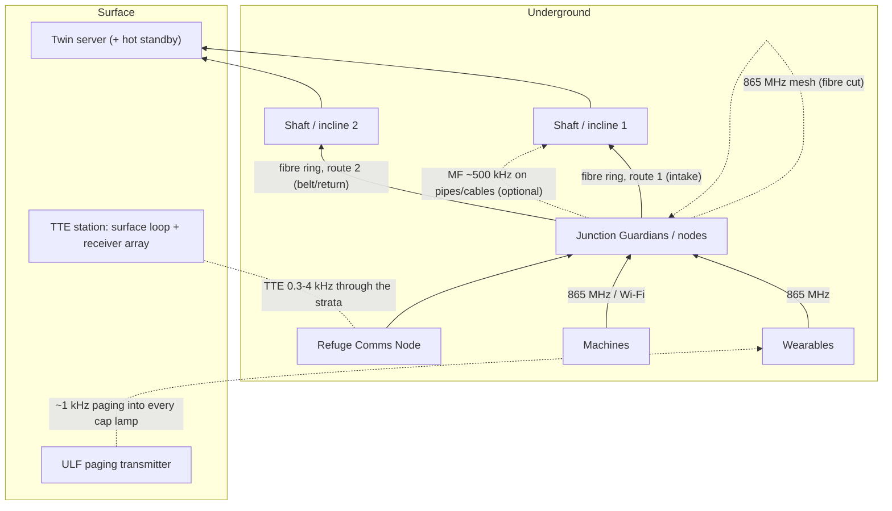
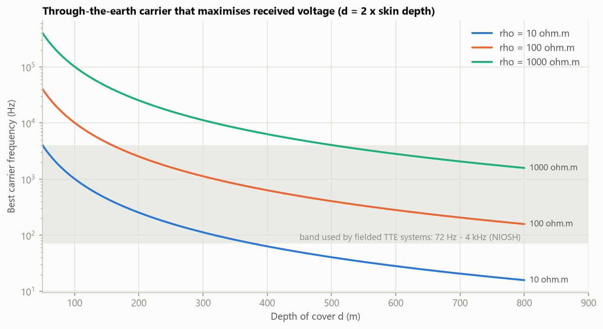

# 05 · Communication, event-driven protocol and power

This document answers question 5 (frequencies and modulations from underground to the surface, tuned for
low power and accuracy), question 8 (lamp-off status in the twin) and question 9 (alerts to the server
and to surrounding objects). It also specifies the event-driven protocol that replaces polling. Numbers
marked † come from [tools/design_calcs.py](tools/design_calcs.py).

---

## 1. Link map

| Link | Purpose | Band | PHY / modulation | Rate | Range | Who carries the energy cost |
|---|---|---|---|---|---|---|
| **L1** UWB | Person ↔ machine ranging, machine ↔ machine ranging, infrastructure TDoA | 6.4896 GHz (Ch 5) / 7.9872 GHz (Ch 9), 499.2 MHz wide | IEEE 802.15.4z HRP, BPM-BPSK pulses, STS secure ranging | 6.8 Mb/s (ranging), 850 kb/s (long blinks) | 30–80 m LOS (validate on site) | Machine listens; tag transmits briefly |
| **L2** LF magnetic | Near-field danger shell, wake-up, start-inhibit sweep | 125 kHz | OOK/ASK, Manchester-coded machine + generator ID | ~4 kb/s pattern | 2–10 m | Machine only (tag listens at µA) |
| **L3** Sub-GHz | Wearable/node telemetry, machine presence beacons (VPB), V2V state, alerts, commands | 865–867 MHz (India license-exempt [E5]) | LoRa CSS (SF7–SF10, BW125) or GFSK 50 kb/s, adaptive | 0.3–50 kb/s | 0.3–1 km straight entry; surface km | Both, event-driven |
| **L4** Machine backhaul | Video clips, logs, twin sync for machines | OC: LTE or 5 GHz Wi-Fi mesh; UG: Wi-Fi at nodes/parking bays | Standard | Mb/s | Site | Machine |
| **L5** Backbone | Nodes ↔ surface | Single-mode fibre, **ring through two separate roadways** | Ethernet, ring protection (sub-second failover) | 1 Gb/s | km | Infrastructure |
| **L6** Mesh fallback | Node ↔ node when fibre is cut | 865–867 MHz | LoRa/GFSK multi-hop | kb/s | Node spacing | Infrastructure battery |
| **L7** Medium frequency (optional) | Conductor-coupled voice/data that survives fibre cuts | 300 kHz–3 MHz, typically ~500 kHz [E3] | Narrowband | Voice / low-rate data | 3–6 km along any pipe, cable or rail [E3] | Infrastructure |
| **L8** Through-the-earth (TTE) | Emergency link from refuge chambers to the surface with **no in-mine infrastructure** | 0.3–4 kHz (fielded systems 72 Hz–4 kHz [E3]) | Downlink BPSK; uplink orthogonal 16-FSK on inter-harmonic tones; strong FEC | 10–300 b/s | Hundreds of metres of cover | Surface station; refuge battery |
| **L9** ULF paging | Evacuation and route codes to **every cap lamp** | ~1 kHz (PED precedent [E11]) | Narrowband FSK/BPSK, one-way | ~10–50 b/s | Whole mine | Surface transmitter; MSU listens at µA |
| **L10** GNSS-RTK | OC machine pose | L1/L5 (GPS, NavIC, others) + corrections over L3/L4 | — | — | — | Machine |

## 2. Why these frequencies and modulations

| Choice | Accuracy argument | Power argument |
|---|---|---|
| **UWB for ranging** (not RSSI) | Ranging precision scales with bandwidth: 500 MHz resolves the first path to ~0.1 m [P9, P10]. RSSI ranging is metre-level with minute-scale latency [P2] | Frames last ~0.1–0.2 ms, so energy per fix is micro-coulombs (≈ 104 µC for a four-anchor fix†). The expensive part is *listening*, so the design makes the powered machine do it |
| **125 kHz magnetic for the near zone** | Quasi-static 1/r³ field: a ±3 dB field error is only ±12% in distance, through the body, in any orientation ([03 §4](03_positioning_and_sensing.md)) | Wake-up receivers listen at ~2–8 µA [E19]; the machine generates the field |
| **865–867 MHz for telemetry** | NIOSH found 900 MHz gives the most range in coal-mine entries, and UHF goes around corners and into crosscuts better than VHF [E3]. LoRa chirp spread spectrum resists multipath, interference and Doppler [P16] | Highest link budget per joule of the license-exempt options. Time on air: 51.5 ms (LoRa SF7, 16 B) vs 4.3 ms (GFSK 50 kb/s)†. Adaptive PHY picks GFSK whenever the link margin allows, cutting airtime 12× |
| **Fibre ring for the backbone** | — | Lowest energy per bit; immune to RF problems; two physical routes meet MSHA's redundancy guidance [E1] |
| **0.3–4 kHz for TTE** | Only frequencies whose skin depth is comparable to the overburden get through rock ([§8](#8-underground-to-surface-crust-to-atmosphere)) | The carrier is chosen to maximise received voltage for the actual depth and rock resistivity, which minimises transmit energy per bit |
| **Orthogonal M-FSK for the TTE uplink** | Non-coherent detection, no carrier-phase recovery needed through a noisy, dispersive channel | In a power-limited channel, orthogonal signalling needs less energy per bit as M grows (≈ 2 dB better than uncoded BPSK at M = 16); tones placed between 50 Hz mains harmonics avoid the strongest noise |

**Regulatory guard rails.** UWB stays within −41.3 dBm/MHz in 6–8.5 GHz. Vehicle-mounted anchors
implement transmit power control and a duty-cycle limiter, so they qualify for the −41.3 dBm/MHz mitigated
limit [E4] (see the capacity check in §3.4). Sub-GHz stays within 865–867 MHz, ≤ 200 kHz occupied
bandwidth, and +14 dBm (25 mW), far below the 1 W cap [E5]. That keeps the IS RF-threshold margin
(6 W, Group I [E7]) and electric-detonator margins wide.

## 3. Discovery and ranging protocol (L1 + L2 + L3)

### 3.1 Sequence



### 3.2 Discovery rate is set by context, not by motion alone

A person standing still beside a haul road is the hard case. A truck at 30 km/h covers 41 m in 5 s, so a
stationary tag cannot simply go quiet. The minimum blink rate comes from the **traffic class of the
segment** the wearable is on (stored in its compact twin map):

| Segment class (from twin map) | Blink interval | Discovery lag at 30 km/h |
|---|---|---|
| Vehicle route / unknown | 0.5 s | ≤ 4.2 m (absorbed in the awareness band) |
| Pedestrian-only, no vehicle access | 2 s | n/a |
| Inside a machine session | Session rate replaces blinks | — |
| In the lamp-room dock | No radio | — |

The **LF shell** backs this up: any tag that enters a shell is promoted to DANGER rate instantly,
whatever its blink interval. At **key-on**, the machine sweeps all LF generators at full power. Every tag
in the start-inhibit zone answers within one LF slot, so the start decision never waits for a blink.

### 3.3 Medium access

* **Machine-centred TDMA.** Each machine runs a 100 ms superframe with ~50 slots of 2 ms for ranging. Higher-risk tags get more slots.
* **Neighbouring machines** announce their superframe timing in their 865 MHz beacon (VPB). They avoid each other by different **UWB channel** (Ch 5/Ch 9), different **preamble codes** (802.15.4z defines several per channel), and slot offsets.
* **Infrastructure anchors** run TDoA reception on tag blinks (wired-synchronised over the fibre ring) and do no ranging transmissions, so they add no airtime.

### 3.4 Capacity and duty-cycle check

| Load on one machine | Fixes/s | Slots used (of 500/s) |
|---|---|---|
| 5 persons in DANGER (20 Hz) | 100 | 100 |
| 15 persons in WARNING (10 Hz) | 150 | 150 |
| 75 persons AWARE (2 Hz) | 150 | 150 |
| **Total** | **400** | **80%** |

That handles a shift-change crowd at a man-riding station. The **LF shell has no capacity limit**: it is a
broadcast that every tag measures independently. Each anchor transmits about 0.15 ms per fix. Fully
loaded, that is ~6–8% of airtime, above a 5% low-duty-cycle limit. So the anchors (a) use transmit power
control, which is the other allowed mitigation [E4], and (b) cap their own duty and drop AWARE-level fixes
first, never DANGER-level fixes. Typical load is far lower.

## 4. Event-driven protocol (replaces polling)

### 4.1 Wearable operating modes



| Mode | UWB | 865 MHz uplink | Listening | Local alert |
|---|---|---|---|---|
| DOCKED | Off | Off (wired dock) | — | — |
| PATROL | Blink 0.5–2 s | **Event POS when innovation > δ = 2σ**; state events; heartbeat 60 s | CAD sniff 1 s; LF always | — |
| AWARE | Session 1–2 Hz | Silent (machine forwards fixes) | Session windows | — |
| WARNING | Session 10 Hz | Silent | Session windows | Haptic pulse 200 ms / 2 s, lamp slow flash |
| DANGER | Session 20 Hz | Silent | Session windows | Continuous haptic + buzzer, lamp rapid flash |
| EMERGENCY | Blink 1 s | Heartbeat 10 s on every path; repeats ×3 | ULF every 10 s | Per cause |
| ISOLATED | As PATROL | Store-and-forward; retries back off; relays via any machine or wearable in range | — | Discreet indication |
| BACKUP (main power lost) | Blink 5 s | Beacon every 30 s (LoRa SF9) | ULF; LF locator on request or every 2 s | Minimal |

The ranging rate inside a session follows time-to-collision: **f = clamp(10 / TTC, 1 Hz, 20 Hz)**, with a
floor of 10 Hz inside the warning zone.

### 4.2 Send-on-innovation with the twin (Wu et al. adapted)

Both the wearable and the twin run **the same predictor**: a constant-velocity filter constrained to the
roadway graph, driven by the last reported state. The wearable knows exactly what the twin currently
believes. It transmits only when its own estimate differs from that belief by more than a threshold, in
units of the current uncertainty:

```
send  if  max_i | Σ^(-1/2) (x_wearable − x_twin_pred) |_i  >  δ(risk)
```

* **Silence is information.** When nothing arrives, the twin knows the error is below δ and tightens its covariance accordingly. This is the key result of Wu et al. [P4].
* **Transmission rate** per evaluation step is γ = 1 − (1 − 2Q(δ))^m. For 2-D position: δ = 1.5 → 24.9%, **δ = 2 → 8.9%**, δ = 3 → 0.54%†.
* **Risk-adaptive δ** extends [P4], which used one fixed threshold. δ = 2 in PATROL. Inside machine sessions the machine reports instead. Near fixed hazards (unsupported roof, conveyor guard) δ drops to 1.
* **Hard bound for rescue:** the last known location is always within δ·σ of the truth at the moment of the last message, plus the bounded drift since then.
* A heartbeat at least every 60 s satisfies MSHA's refresh guidance [E1] even when nothing changes.



### 4.3 Machines and nodes are event-driven too

| Sender | Local broadcast | Uplink to twin |
|---|---|---|
| Machine (VSU) | VPB at 10 Hz moving / 1 Hz parked (pose, speed, heading, articulation or swing, gear, zone sizes, alarm summary) | 1 Hz while moving; on gear, mode or alarm change; on segment change |
| Junction Guardian | Relays VPBs around the corner (≤ 50 ms) | Tag *entered/left* events, aggregated; heartbeat 30 s; power and pathway status on change |
| Refuge node | — | Occupancy and air quality on change; heartbeat 60 s |

## 5. Twin-synchronised message formats

Every device holds a **shared dictionary** from the twin: short entity IDs, segment IDs, event codes,
route codes and zone IDs, all versioned by a map hash. Messages therefore carry references instead of
coordinates or text.

| Message | Fields (bits) | Size |
|---|---|---|
| BLINK (UWB) | short ID 12, mode 3, seq 8, flags 5 (lamp, battery low, SOS, motion, posture) | 4 B + PHY |
| VPB (machine beacon) | ID 12, class 6, pose: segment 13 + chainage 11 (UG) or E/N 2 × 24 (OC), heading 9, speed 8, articulation/swing 8, gear 2, zone radii 3 × 8, alarm summary 8, seq 8, MIC 32 | 18–23 B |
| HB (heartbeat) | type 4, ID 12, seq 8, mode 3, battery 4 + 4, lamp 3, flags 6, segment 13, chainage 11 | 8 B + 4 B MIC |
| POS (innovation event) | type 4, ID 12, seq 8, segment 13, chainage 11, level 4, velocity 6, heading 6, quality 3 | 9 B + 4 B MIC |
| EVT (state event) | type 4, ID 12, seq 8, event code 8, value 16, time offset 12 | 8 B + 4 B MIC |
| ALM (alarm) | type 4, machine 12, person 12, level 3, distance 8, TTC 6, zone 5, seq 8 | 8 B + 4 B MIC |
| EMG (emergency) | type 4, ID 12, cause 6, segment 13, chainage 11, time since 12, vitals flags 8, seq 8 | 10 B + 4 B MIC |

A JSON or raw-coordinate equivalent of a POS message is 50–100 bytes, so twin-referenced messages are
**5–10× smaller**. They also stay inside a single short LoRa or GFSK frame.

## 6. Power

### 6.1 Wearable budget



| Mode | Average current† | Per 12 h shift† |
|---|---|---|
| **Event-driven (this design)** | **521 µA** | **6.2 mAh** |
| Fixed-rate polling (10 Hz UWB, report every 5 s) | 2,088 µA | 25.1 mAh |
| Backup cell, emergency beacon mode | 470 µA | 5.6 mAh |
| Hypothetical tag that listens continuously on UWB | ≈ 65 mA | ≈ 780 mAh |

Assumptions (all in the script): 70% of the shift far from machines, 22% aware, 6% warning, 2% danger;
35% walking; 60% of the time on vehicle routes; currents are datasheet-class (UWB TX 35 mA, RX 65 mA;
LoRa TX 40 mA at +14 dBm; AS3933 listening ~6 µA). **Measure the prototype** with a power profiler and
update them.

**Where low power really matters.** Built into a cap lamp, even the polling design adds under 1% to a
lamp that uses ~4 Ah per shift. Event-driven design still matters, for four other reasons:

1. **Backup life after a disaster:** 600 mAh, derated 50%, gives **≈ 638 h** of emergency beaconing†, against the ≥ 96 h requirement.
2. **Surface units have no lamp battery:** 2,000 mAh supports more than 50 shifts of radio and sensing.
3. **Channel capacity:** fewer packets mean fewer collisions with hundreds of tags.
4. **UWB duty-cycle limits for vehicle-mounted anchors** [E4].

Alarm actuators (vibration 70 mA) average 1.12 mA, or 13.4 mAh per shift†. Haptics cost more than the
radios. That is acceptable, because alarms are the point.

### 6.2 Infrastructure node standby

| Case | Average | 24 h (MSHA minimum) | 96 h (design target) |
|---|---|---|---|
| Normal (line power) | 3.10 W | — | — |
| Standby, fibre alive, radio at MSHA 5/5/90 duty [E1] | 1.18 W | 28 Wh | 113 Wh |
| Standby, fibre cut, mesh only | 0.18 W | 4.2 Wh | 16.9 Wh |

A 12.8 V, 15 Ah LiFePO4 pack (192 Wh) covers 96 h with ageing margin. In UG coal, the battery sits in a
certified enclosure, and its energy may be limited by the IS certificate, so the pack can be split across
units.

### 6.3 Machine unit

A Tier-2 kit (4 radars, 2 thermal, 3 cameras, 7 anchors, 4 LF coils, GPU) draws roughly 40–70 W from the
24 V system. A hold-up supply keeps the safety controller alive through engine cranking and for a few
minutes after key-off.

## 7. Alert dissemination (question 9)

**Yes. Alerts go to the server and to the surrounding objects of interest, and that is viable, provided
the order is right (local first) and third parties receive only alerts relevant to them.**

| Tier | Recipients | Path | Latency | What they receive |
|---|---|---|---|---|
| T1 Local | The endangered person and the machine operator | UWB session frame, LF shell, cab HMI, external horn/strobe, lamp flash | ≤ 200 ms | Full alarm (L3/L4) |
| T2 Neighbourhood | Other machines and wearables whose **predicted paths cross the hazard area within 10 s**; Junction Guardian signals | ALM summary inside the machine's VPB at 10 Hz; Junction Guardian relay | ≤ 1 s | Awareness ("person near RDT-07 at J12"), not a full alarm |
| T3 Server/twin | Twin, control room, section supervisor | 865 MHz → node → fibre | ≤ 2 s p95 | Every L3/L4 event with context, for near-miss analytics and escalation |
| T4 Mine-wide | Everyone | Twin → 865 MHz downlink + VPB rebroadcast + ULF paging | Seconds | Emergency only (evacuate, route code) |

**Relevance filter (prevents alarm flooding).** The twin and the machines forward a third-party alert
only if all three conditions hold:

1. The recipient is within the hazard's awareness radius, or their predicted path crosses the hazard polygon within 10 s.
2. The alert level is ≥ L3.
3. The same alert was not sent to that recipient within the last 10 s.

**Why it is viable.**

* Machines and nodes are powered, so the broadcast costs nothing that matters.
* Wearables receive third-party alerts inside listen windows they already have (session frames, the 1 s sniff).
* Alarms are rare events, so the channel load is negligible.
* The local tier never depends on the other tiers.

## 8. Underground to surface ("crust to atmosphere")

### 8.1 Pathway stack



| Order | Path | Survives | Fails when |
|---|---|---|---|
| 1 | Fibre ring through two roadways | One cut (ring heals in under a second) | Both routes cut |
| 2 | 865 MHz mesh, node to node | Any number of fibre cuts while nodes stand | Many nodes destroyed |
| 3 | Medium frequency on existing conductors (optional; many mines have it) | Fibre and nodes destroyed but a pipe, cable or rail continues | All conductors broken |
| 4 | **TTE from refuge chambers** | **Everything in between destroyed** | Refuge battery exhausted (designed for 96 h) |
| 5 | **ULF paging to every cap lamp** (downlink only) | Everything in the mine destroyed | Never in practice; surface-powered |
| — | Seismic fallback | Trapped miners strike roof bolts; surface geophones locate them (US Bureau of Mines-era practice) | — |

### 8.2 TTE carrier frequency

A magnetic dipole's field through rock falls with distance and with skin attenuation e^(−d/δ), where
δ = 503·√(ρ/f) m. A receive coil's voltage grows with frequency (Faraday's law). Maximising f·e^(−d/δ)
gives the optimum at **d = 2δ**, that is

```
f_opt = 4ρ / (π μ0 d²)  ≈  1.01×10⁶ · ρ / d²   [Hz, ρ in Ω·m, d in m]
```



| Depth of cover | ρ = 10 Ω·m | ρ = 100 Ω·m | ρ = 1000 Ω·m | Carrier between 50 Hz harmonics (ρ = 100) |
|---|---|---|---|---|
| 100 m | 1.0 kHz | 10.1 kHz | 101 kHz | 10,125 Hz |
| 200 m | 253 Hz | 2.5 kHz | 25 kHz | 2,525 Hz |
| 300 m | 113 Hz | 1.1 kHz | 11 kHz | 1,125 Hz |
| 400 m | 63 Hz | 633 Hz | 6.3 kHz | 625 Hz |
| 600 m | 28 Hz | 281 Hz | 2.8 kHz | 275 Hz |

The optimum is broad, and real noise rises at low frequency. Fielded systems sit in **72 Hz – 4 kHz**
[E3], consistent with the table for typical coal-measure rocks. **Procedure:** measure ρ (borehole logs or
a surface resistivity survey) and the depth at each refuge chamber. Compute f_opt, then move the carrier
to the nearest **inter-harmonic** frequency ((n + ½) × 50 Hz). India's 50 Hz grid puts its strongest
noise lines at multiples of 50 Hz.

### 8.3 TTE modulation, coding and antennas

| Item | Downlink (surface → underground) | Uplink (refuge → surface) |
|---|---|---|
| Transmitter | Large surface loop (hundreds of metres perimeter) or a grounded line; 100 W – 1 kW from a generator (surface transmitters can exceed 1 kW [E3]) | Wire loop laid around an adjacent pillar (as MagneLink does [E10]); 10–50 W from the refuge battery |
| Modulation | Coherent BPSK, 20–300 b/s | **Orthogonal 16-FSK**: tones at 50 Hz spacing placed *between* mains harmonics around f_opt (e.g., 1,025–1,775 Hz), 0.2 s symbols → 20 b/s raw |
| Coding | Convolutional r = ½ (K = 7) + interleaving over ~10 s against impulsive noise (switching transients, lightning) | Same; net ≈ 10 b/s; ARQ via downlink acknowledgements |
| Receiver | 3-axis ferrite coils (orientation-free) at refuge chambers; MSU ULF receiver | Array of 3-axis coils on the surface + **reference coils for noise cancellation**; GPS-disciplined timing |
| Proven by | PED: one-way ULF text to cap lamps, in use > 25 years, 150+ mines [E11] | MagneLink: MSHA-approved two-way voice/text, tested to 1,550 ft [E10] |

### 8.4 Twin-referenced TTE messages (the "digital twin to communicate" idea)

At ~10 b/s every bit is expensive (≈ 2 J per bit at 20 W). The surface twin already knows the map and
everyone's last state, so the refuge station sends **only what changed**:

| Message | Bits† | At 10 b/s net† | Uplink energy at 20 W† |
|---|---|---|---|
| Full roll-call, 200 persons, raw float coordinates | 24,076 | 40 min | 48 kJ |
| Full roll-call, 200 persons, twin-referenced | 6,476 | 11 min | 13 kJ |
| **Delta roll-call: 15 persons changed** | **556** | **56 s** | **1.1 kJ** |
| Refuge status: count, injured, O2/CO | 112 | 11 s | 0.2 kJ |
| Downlink: evacuate via route code | 84 | 8 s | — |

Twin-referenced delta messages are **43× smaller** than raw coordinates. That is the difference between
a status update every minute and one every 40 minutes on the same battery.

## 9. Lamp state and the twin (question 8)

The MSU measures the cap lamp directly: LED current, mode, battery voltage and state of charge, cord
continuity and dock contact. **Every state transition is an event** (EVT message, ≤ 2 s to the twin when
any path exists). Nothing is polled.

| Lamp state | Detected by | Twin action |
|---|---|---|
| DOCKED_CHARGING | Dock contact | Person **checked in**; removed from the underground roll-call |
| ISSUED_ON | LED current, undocked | Normal |
| **ISSUED_OFF (underground)** | LED current = 0, power present | Annotate "lamp off, time". If there is also **no motion for 10 min outside a rest-area geofence**, ask the miner to acknowledge (vibration + flash); no acknowledgement → supervisor alert. **During an emergency this is expected** (miners save light), so the twin only tracks it |
| LOW_BATTERY | Voltage / state of charge | Predict **time to darkness**; tell the miner and supervisor; spare-lamp location |
| LAMP_FAULT / CORD_FAULT | Open/short LED, cord continuity | **Person in darkness.** Supervisor priority alert. The twin **raises that person's protection**: machines nearby get larger zones and higher ranging rates, because an unlit person is invisible to operators |
| MAIN_POWER_LOST | Battery gone or cord cut | MSU switches to its backup cell; twin flags "light lost + main power lost" (high priority in any emergency) |
| EMERGENCY_DIM | Commanded or automatic in EMERGENCY | Lamp dims to stretch light; twin shows remaining light hours for rescue planning |
| Not docked at end of shift | Roll-call vs dock | "Missing person" escalation |

## 10. Security summary

Per-device AES-128 keys are provisioned in the dock (a wired, physically secured point) and rotated per
shift. Every 865 MHz frame carries a CCM MIC and a frame counter (replay protection). UWB ranging uses
802.15.4z STS, so an attacker cannot make a person appear farther away. Jamming is detected from the noise
floor and missed exchanges and treated as a fault (fail-loud). Details are in
[08_resilience_and_security.md](08_resilience_and_security.md).
