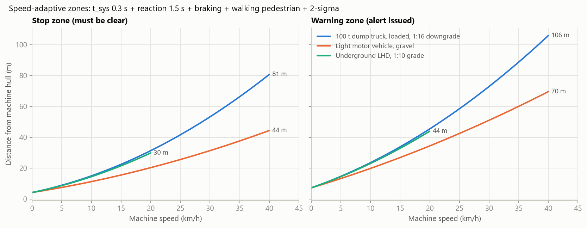
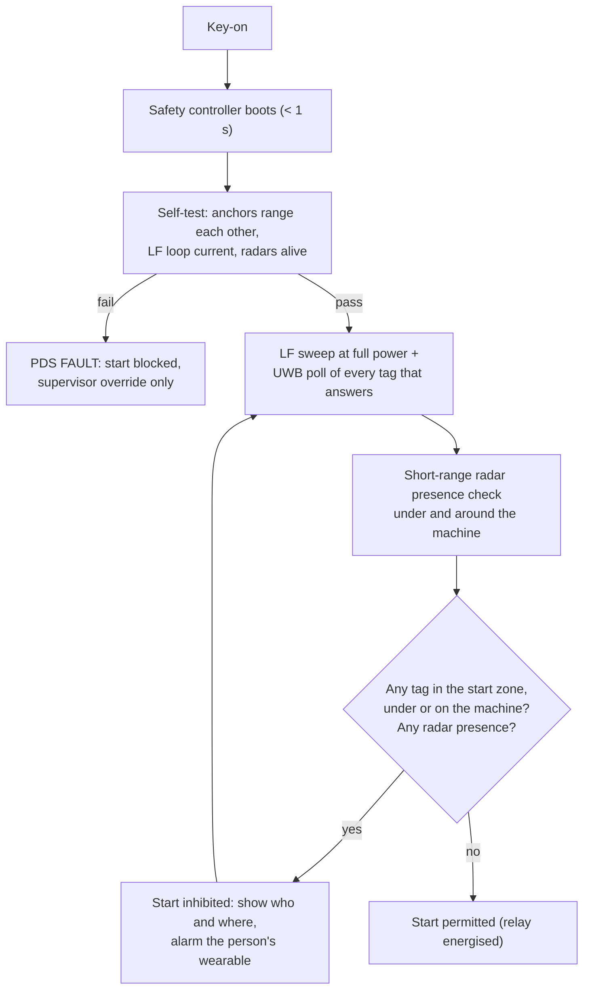

# 06 · Collision-avoidance logic

This document covers how a machine decides what to do with the positions it measures: zones, path
prediction, alarm levels, interventions, nuisance suppression, machine-to-machine conflicts and fixed
hazards. Everything here runs on the machine's safety controller with no server in the loop.

---

## 1. Speed-adaptive zones

NIOSH's field program concluded that "ideally, detection range would automatically adjust with equipment
speed", but no system it tested could do that [P3]. Here every zone is computed from the machine's own
profile and its live state:

```
stop    = v·(t_sys + t_react) + v²/(2·a_eff) + v_ped·T_total + k·σ + buffer
warning = stop + (v + v_ped)·t_warn
aware   = warning + v·t_aware
a_eff   = a_brake(load) − g·grade        T_total = t_sys + t_react + v / a_eff
```

| Symbol | Default | Meaning |
|---|---|---|
| t_sys | 0.3 s | Sensing + radio + decision + alarm actuation (budget in §11) |
| t_react | 1.5 s | Alerted operator perception-reaction time |
| v_ped | 1.5 m/s | Pedestrian walking toward the path during the whole stop |
| k·σ | 2 × 0.25 m | Position uncertainty as a circle, not a point [P12] |
| buffer | 1.0 m | Mirrors, overhangs, tag-on-helmet vs body extent |
| t_warn, t_aware | 2 s, 3 s | Extra lead time for the warning and awareness bands |
| grade | From the twin's road model or the IMU pitch | Downgrade makes a_eff smaller |
| load | From payload/strut pressure or the twin's loading event | Loaded braking is weaker |



| Machine | Forward speed | Stop / warn (forward) | Reverse speed | Stop / warn (reverse) | Start-inhibit radius |
|---|---|---|---|---|---|
| Dump truck 100 t (loaded, 1:16 downgrade) | 30 km/h | 53 / 73 m | 10 km/h | 15 / 24 m | 4.2 m |
| Dump truck 60 t | 30 km/h | 49 / 69 m | 10 km/h | 14 / 23 m | 4.2 m |
| Water sprinkler | 25 km/h | 42 / 59 m | 8 km/h | 12 / 20 m | 4.2 m |
| Motor grader | 20 km/h | 27 / 41 m | 15 km/h | 20 / 31 m | 4.2 m |
| Dozer | 11 km/h | 16 / 25 m | 14 km/h | 20 / 31 m | 4.2 m |
| Wheel loader | 20 km/h | 27 / 41 m | 15 km/h | 20 / 31 m | 4.2 m |
| Backhoe loader | 20 km/h | 24 / 38 m | 10 km/h | 13 / 21 m | 4.2 m |
| LMV | 40 km/h | 44 / 70 m | 10 km/h | 11 / 20 m | 4.2 m |
| LHD (UG, 1:10) | 12 km/h | 17 / 27 m | 12 km/h | 17 / 27 m | 4.2 m |
| SDL | 6 km/h | 11 / 17 m | 6 km/h | 11 / 17 m | 4.2 m |
| Shuttle car | 8 km/h | 12 / 20 m | 8 km/h | 12 / 20 m | 4.2 m |
| Battery loco + tubs | 10 km/h | 21 / 30 m | 10 km/h | 21 / 30 m | 4.2 m |
| Continuous miner | Function zones (§4.2), not radial | | | | |
| Excavator / shovel | Swing exclusion: danger radius 7.1 m, warning 12.8 m from the swing centre | | | | |

Source: [tools/generated_tables.md](tools/generated_tables.md), representative profiles.

**Engineering consequences**

* A loaded 100 t truck on a downgrade **cannot stop for a person closer than ~40 m** at 30 km/h, even before counting the pedestrian's movement. Detection must therefore reach 75–100 m, and pedestrians must be kept off haul roads by rule. That is why the design includes 77 GHz radars with 80 m range, the canopy UWB anchor, and twin-based awareness beyond line of sight.
* At **reversing** speeds the stop zone shrinks to 15 m, within the reliable reach of every layer.
* The **start-inhibit radius of 4.2 m** is the distance a person can walk into the first-motion path during the operator's reaction time. It applies around the whole hull and *under* it.

## 2. Path-based risk instead of a plain circle

A radial distance treats a person 3 m beside a truck driving straight ahead the same as a person 3 m behind
a reversing truck. The logic instead uses the machine's **predicted swept path**:

| Machine type | Kinematic model for the swept path |
|---|---|
| Rigid wheeled (trucks, graders, LMV) | Bicycle model from speed, steering angle and gear |
| Articulated (loaders, LHD) | Two-body model with the articulation angle and rate (encoder) |
| Tracked (dozer, drill, excavator travel) | Skid-steer model; includes spin-in-place |
| Swing (excavator house, backhoe) | Arc swept by the counterweight and bucket from swing angle and rate |
| Rail (loco + train) | 1-D along the track, including the full train length from the end-of-train unit |
| Bidirectional (shuttle car) | Leading end selected by travel direction |

For each target the engine computes:

* **d_hull** — distance from the target's uncertainty circle to the current hull polygon.
* **in_path** — whether the target's reachable disk (radius v_ped·t) intersects the swept path within the horizon (2–6 s).
* **TTC** — first time at which the path meets the reachable disk.

## 3. Alarm levels

| Level | Condition (person) | Operator cab | Person (wearable) | Outside the machine | EMESRT / ISO 21815 |
|---|---|---|---|---|---|
| L0 | Nothing relevant | — | — | — | — |
| L1 Awareness | Within the awareness band | Icon on map/camera view | — | — | Level 7 (awareness) |
| L2 Caution | Within the warning band, not in the path | Single chime, highlighted icon | — | — | Level 7 |
| L3 Warning | In the path with TTC < 4 s, or inside the stop band but not in the path | Three fast pulses, then repeat every 2 s; camera view jumps to the target | Haptic pulses, slow lamp flash | Amber strobe | Level 8 (advisory) |
| L4 Danger | In the path and inside the stop band, TTC < 2 s, **or inside the LF shell** | Continuous tone + voice prompt ("PERSON BEHIND", in Telugu, Hindi and English) | Continuous haptic + buzzer + rapid lamp flash | Horn + strobe | Level 8, arms Level 9 interventions |

Human-factor rules from NIOSH's trials [P3, P18]:

* **Sound carries the alarm**, because drivers don't watch displays while reversing.
* Graded alarms: three pulses at the outer edge; continuous only when close.
* **Constant pulsing makes drivers switch the sound off**, so nuisance control (§6) is a safety function, not a comfort feature.
* The alarm is shown **on the camera monitor** (one display), and the view switches with gear.
* Volume has a floor; operators can adjust brightness and volume above the floor; tampering is logged.
* Displays are placed with operator input and do not create new blind spots or night glare.

## 4. Interventions

Automatic braking of moving surface HEMM is **not** in the pilot: NIOSH advises against braking on sensor
input because of nuisance alarms [P3]. Interventions are limited to cases where they are safe and expected.

### 4.1 Policy per machine

| Code | Intervention | Machines | Condition |
|---|---|---|---|
| I1 | **Start-inhibit** (engine start / tram / park-brake release blocked) | All machines, surface and UG | Any tag in the start-inhibit zone, under the machine or on the machine outside the cab; or short-range radar sees a person under/around a parked machine |
| I2 | **Function-specific inhibit** | Continuous miner, roof bolter, longwall shearer (via its controller) | Tag circle intersects a function zone (§4.2) |
| I3 | Speed limit / creep | UG LHD, SDL, shuttle car, utility carrier (after validation) | L3 with the person in the path |
| I4 | Stop | UG continuous miner tramming (MSHA requires stop before contact [E2]); UG LHD/SDL/shuttle car | L4 **confirmed by two independent layers** (UWB + LF, or UWB + radar person class). A single layer → alarm only, to keep nuisance stops rare |
| — | Alarms only | Moving surface HEMM, locomotives | Driver brakes. Locos also sound the horn and flash headlights automatically |

* **Overrides** need a supervisor key, are time-limited, and are logged with the reason. During an override the alarm keeps sounding.
* Start-inhibit is different from automatic braking: it prevents motion rather than reacting to it. It targets the most common surface scenario, "a person approaches a stationary machine and it moves unexpectedly" [P3].

### 4.2 Function zones for the continuous miner (after Jobes et al. [P12])

```
            zone 3        zone 5        zone 7        zone 9
   tail  +---------------------------------------------------+  cutter
  zone 2 |                      MACHINE                      | zone 10
         +---------------------------------------------------+
            zone 1        zone 4        zone 6        zone 8
```

Each zone is a polygon in the machine frame, linked to the motions that can hurt someone standing in it.
Examples: tram toward the person's side, conveyor swing toward that side, cutter-head raise/lower,
gathering arms. The **circle of uncertainty** around the person is tested against every polygon. Overlapping
zones block the union of their functions. Motions that cannot reach the person stay enabled, so the
operator keeps working from a safe position [P12]. The specific zone and function table is drawn up per
mine with the operator and DGMS. The NIOSH example is illustrative, not a recommendation [P12].

## 5. Operator, passengers and people on the machine

| Situation | Rule |
|---|---|
| Operator in the cab | That tag is excluded from its **own** machine's alarms only while inside the cab volume (an MSP polygon), the seat switch is on, and it is the logged-in operator. This meets Ruff's requirement to ignore the operator's own tag [P1] without a manual switch |
| Operator dismounts | Exclusion ends the moment the tag leaves the cab volume. The operator is now a pedestrian: a classic fatal scenario is the operator stepping out next to their own or another machine |
| Passenger in the cab | Excluded, logged; the twin checks it is a seat position |
| Person on the machine outside the cab (ladder, deck, dump body) | "Person on machine": start-inhibit while stationary; L4 if the machine moves; twin event "unauthorised rider" |
| Person under the machine | Start-inhibit. A tag low (lying) inside the footprint, or short-range radar presence |
| Continuous-miner operator | **Never excluded.** The function zones are designed around the legitimate operator positions |
| Person inside an LMV | Their tag is folded into the LMV entity for display (no double alarms), but stays individually tracked |

## 6. Nuisance and false-alarm control

The radar baseline to beat is 18% false and 42% nuisance alarms [P8]. Targets are ≤ 5% false and ≤ 15%
nuisance (R-CA-4).

| Source of nuisance | Control |
|---|---|
| Static objects (berms, rock piles, ribs, parked machines) seen by radar | Gate radar alarms with the micro-Doppler person classifier [P11]; subtract the twin's static map and this machine's own body reflections; a known static object raises at most L1–L2 |
| Shovel and truck during loading | Paired-loading context: the truck is in the loading-bay geofence and is the shovel's assigned truck. **Machine-to-machine** alarms between the pair are suppressed. **Person alarms are never suppressed** |
| Workshop / parking | Maintenance geofence: no motion alarms between parked machines; start-inhibit stays active |
| Towing a disabled machine | Tow pairing: suppressed between the two machines only |
| Tags at the far edge of range (Ruff's sporadic zone [P1]) | Zones are decided by measured position, not by "heard / not heard"; hysteresis of 1 m / 0.5 s on exit |
| Flicker | Enter after 2 of 3 consecutive fixes, **but never adding more than 100 ms to an L4 decision** |
| Person beside, not in, the path | Path-based risk (§2) caps them at L2 |
| Operator's own tag | §5 |

**Never suppressed:** L4 from a cooperative tag, any LF shell hit, a person-class radar or thermal track in
the path, a lost track of a person who was in WARNING or DANGER (§10).

## 7. Machine-to-machine and machine-to-LMV

| Scenario | Detection | Logic |
|---|---|---|
| Two machines approaching on a haul road | VPB pose and speed (RTK on surface, map-matched underground) + UWB V2V range | TTC from both predicted paths; L3 at TTC < 6 s, L4 at TTC < 3 s (larger than for persons because both are massive and fast) |
| LMV hidden in a truck's front blind area | LMV's VTU (UWB + VPB) + truck front radar | Stationary truck: start-inhibit if the LMV is inside the front start zone. Moving: L4 when the LMV is in the path |
| Blind intersection / crosscut corner | **Junction Guardian** relays each approaching machine's VPB into the other branches and drives LED signals | Both operators see the conflict before line of sight; signal shows which branch has the right of way |
| Single-lane ramp or roadway, rail blocks | Twin **segment reservation**, like railway block signalling: a machine requests a segment; others get "wait" via VPB and signals | Advisory in the pilot; the human SOP stays primary |
| Following too close in a queue | V2V range + speeds | Warning when the headway is below the stop distance of the follower |
| GNSS disagrees with UWB V2V range | Cross-check | GNSS integrity fault → zones widen, operator informed ([03 §7](03_positioning_and_sensing.md)) |

## 8. Fixed hazards and geofences (owned by the twin)

| Hazard | Rule |
|---|---|
| **Dump edge / tip point** (8 of 21 NIOSH blind-area fatalities; in coal, 4 of 6: three trucks backing over a dump point and one dozer over a highwall [P18]) | Edge polyline from survey, updated after every dump-area change. Reverse warning when the rear-axle distance to the edge is below v_rev·(t_sys + t_react) + v²/(2a) + 1 m. Radar checks the berm (should be at least mid-axle height of the largest machine; SOP to confirm) |
| Highwall / bench crest | Same, for any machine |
| **Overhead power lines** | Body-up (truck), mast-up (drill) or boom height inside a line corridor → L4 + start/tram inhibit |
| **Unsupported roof** (UG, beyond the last row of bolts [P12]) | Person tag inside the "beyond supported roof" polygon → L3 to the person and the section supervisor |
| Sealed, barricaded, flooded or gassy areas | Entry → L3 + twin event |
| Conveyor guard zones | Start-inhibit of the belt (§6.3 of [04](04_sensor_placement.md)) |
| Speed zones | Twin pushes the limit per segment; warning on overspeed |

## 9. Blast clearance

1. The shot-firer arms the blast in the twin: blast polygon, danger radius (per the mine's statutory blasting SOP), shelter geofences and the firing time.
2. The twin lists **every tag, machine and VTU inside the danger zone**, excluding registered persons in approved shelters, and shows untagged-person reports from machine perception.
3. The firing permission needs a **zero count** plus a manual sweep.
4. Everyone within an extended radius gets "BLAST IMMINENT" on their wearable (vibration + lamp flash) and through VPB rebroadcast.
5. **Blast mode:** LF generators off and 865 MHz power capped near charged holes. UWB emissions are far below any detonator concern.
6. After the blast, re-entry is blocked until the all-clear is given in the twin.

## 10. Loss of information: fail-loud behaviour

| Event | Behaviour |
|---|---|
| A tag that was in WARNING or DANGER stops answering | Keep the last level; propagate its uncertainty circle toward the machine at walking speed; L4 if that circle reaches the stop band; the operator sees "LOST TRACK". **Never treated as gone** until the circle cannot reach the path, or 3 s of exchanges resume |
| A sensor self-test fails (anchor, coil, radar, camera) | "PDS FAULT" alarm + twin event. UG: machine must not operate without a working PDS. OC: speed restriction until a supervisor signs off |
| Perception computer crash | Cooperative layers continue; fault shown |
| GNSS degraded (OC) | Zones widen by the reported uncertainty; V2V falls back to UWB range |
| Jamming detected (noise floor up, exchanges failing) | Treated as a fault: alarm + slow-down advice (UG: creep) + twin event |
| Twin/backbone down | No effect on safety loops; events buffered |

## 11. Latency budget (danger alarm ≤ 200 ms)

| Stage | Worst case |
|---|---|
| Ranging period at 20 Hz (time until the next fix) | 50 ms |
| Air time of a 4–7-anchor exchange | 2 ms |
| NLOS screen + solve + track | 10 ms |
| Zone / TTC evaluation | 2 ms |
| Cab buzzer and display actuation | 20 ms |
| Alarm level to the wearable (next session frame) | 50 ms |
| Wearable haptic/buzzer actuation | 20 ms |
| **Total, machine side** (first five rows) | **≈ 85 ms** |
| **Total, wearable side** (all rows except the cab buzzer) | **≈ 135 ms** |
| LF path (independent): LF slot period + wake-up + local alarm | ≈ 110 ms |

The person must already be in a session when they cross into the stop band. Discovery happens 4–60 m
earlier, in the awareness band ([05 §3.2](05_communication.md)).

## 12. Key-on sequence (start-inhibit)


