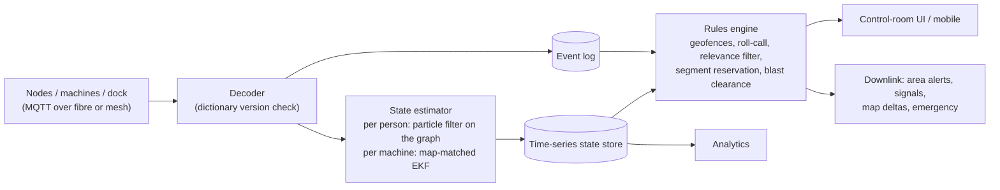

# 07 · Digital twin

The twin is the mine's **shared world model**: map, machines, people, their last known states, and the
history of everything that happened. It runs on the surface, with a hot standby. It is deliberately
**not in the safety loop**. Machines and wearables protect people on their own. The twin makes four
other things possible:

1. **Small, rare messages.** Devices and twin share dictionaries and predictors ([05 §4–5](05_communication.md)).
2. **Mine-wide awareness.** Conflicts beyond line of sight, junction signals, segment reservation, blast clearance.
3. **Rescue.** Last known location, uncertainty, reachable set, blocked segments, refuge occupancy.
4. **Learning.** Near-miss analytics, alarm statistics, and simulation/replay for testing.

---

## 1. Layers

| Layer | Content | Changes |
|---|---|---|
| Static map | OC: terrain model, benches, haul roads, ramps, dump points, edges, power lines, buildings. UG: **roadway graph** (junctions = nodes, roadway segments = edges with chainage), cross-sections, support status, ventilation (intake/return), traffic class, refuge chambers, SCSR caches, doors, conveyors | Survey updates (UG statutory plans; OC survey/drone); new headings |
| Configuration | Machine Safety Profiles, sensor coordinates and calibrations, zone policies, anchor positions, dictionaries | Commissioning, firmware releases |
| Dynamic state | Pose + covariance, mode, alarm level, lamp/battery, gas, vitals flags, last-seen time and source | Events (seconds) |
| Events | Append-only log: alarms, interventions, lamp events, check-in/out, faults, overrides, emergencies | Continuous |
| Prediction | Per-entity motion model on the map, reachable sets, segment reservations | On demand |
| Analytics | Near-miss heatmaps, true/false/nuisance statistics, compliance, device health | Batch |

## 2. Data model

### 2.1 Entity

```json
{
  "id": "e5b1c7a2-4c1e-4b8e-9e44-0f2d3c9a7b10",
  "short_id": 1187,
  "type": "person",
  "class": "miner",
  "assigned_device": "MSU-00412",
  "profile_ref": null,
  "state": {
    "t": "2026-10-16T09:14:07.120Z",
    "frame": "ug_graph",
    "segment": 4093, "chainage_m": 37.5, "level": 2,
    "xyz_m": [1532.4, -288.1, -312.0],
    "cov_m2": [[0.9, 0.1], [0.1, 1.6]],
    "speed_mps": 1.1, "heading_deg": 271,
    "source": "machine_rel:LHD-03",
    "mode": "AWARE", "alarm_level": 1
  },
  "health": {
    "lamp_state": "ISSUED_ON", "lamp_soc_pct": 63, "backup_soc_pct": 98,
    "sensors_ok": true, "fw": "1.4.2"
  },
  "env": { "co_ppm": 4, "baro_hpa": 1046.2, "temp_c": 33.5 },
  "emergency": { "status": "none", "last_known_ref": null }
}
```

Machines use the same envelope with `profile_ref` (MSP version), gear, articulation/swing angle, payload
and interlock states. Infrastructure nodes add power source, battery state of charge and pathway status.

### 2.2 Map graph (UG)

| Table | Key fields |
|---|---|
| `node` | id, xyz, type (junction, face, refuge, shaft bottom, transfer point), anchor ids |
| `segment` | id (13-bit radio id), from/to node, length, width, height, traffic class (vehicle / pedestrian / no-go), ventilation, support status, speed limit, one-way flag |
| `zone` | id, polygon or segment range, kind (unsupported roof, sealed, conveyor guard, blast, rest area, workshop, loading bay), rules |
| `anchor` | id, xyz, segment, sync group, survey date |
| `dictionary` | version hash, short-id ↔ UUID map, event codes, route codes |

### 2.3 Event

```json
{ "t": "2026-10-16T09:14:07.410Z", "entity": 1187, "type": "ALARM",
  "severity": 4, "machine": "LHD-03", "distance_m": 6.2, "ttc_s": 1.6,
  "zone": "rear-stop", "layers": ["uwb", "lf"], "intervention": "I4-stop",
  "segment": 4093, "chainage_m": 37.5, "ack": null }
```

## 3. Ingestion and state estimation



The person estimator fuses everything that says something about where that person is:

| Input | Converted to |
|---|---|
| Machine-relative fix + the machine's absolute pose | Absolute fix (covariances added) |
| Infrastructure TDoA/TWR from blinks | Absolute fix |
| POS innovation message | Absolute fix with the device's own covariance |
| Silence (no POS within the heartbeat interval) | **Bounded-innovation update**: error below δσ (Wu et al. [P4]) |
| Zone sighting (865 MHz RSSI, kNN [P2]) | Segment-level constraint |
| Barometer | Level / incline constraint |
| Map | Particles cannot cross pillars or enter no-go segments |

## 4. Device synchronisation

| Item | Path | Frequency |
|---|---|---|
| Full compact map for the wearable's district (≈ 2,000 segments × 16 B ≈ 32 kB) + dictionary + predictor parameters | Lamp-room dock (wired) | Every check-out |
| Map deltas (new heading, sealed area, changed traffic class) | 865 MHz downlink, versioned | When changed |
| Machine profile and zone policy | Machine backhaul / parking-bay Wi-Fi | On change, with commissioning sign-off |
| Device → twin | Events only ([05 §4](05_communication.md)) | Event-driven, heartbeat ≤ 60 s |

Every message carries the dictionary version. A device with a stale version keeps working and flags
"map stale". The twin decodes old versions from its history.

## 5. Roll-call

* The **lamp-room or gate check-out** defines who is expected underground or in the pit. It is the source of truth.
* Live state comes from wearables. Each person is shown as **live** (seen ≤ 60 s ago), **stale** (60 s – 10 min, last known location shown) or **missing** (> 10 min, or no sighting since check-out).
* Mismatch rules:
  * checked out but never seen → **missing**;
  * seen but not checked out → **unauthorised/visitor**;
  * docked lamp with its person still "underground" → resolved as **checked in**.
* The surface roll-call can be printed with the last known location and timestamp of each miner, as MSHA guidance asks [E1].

## 6. Rescue mode

Triggered when an emergency is declared, or automatically on multi-node overpressure, mass power loss or
an alarm cluster.

1. **Freeze and timestamp** every last known state. Keep updating from anything that still reports (mesh, TTE, surviving machines, wearables in BACKUP mode).
2. **Locate the event.** Nodes stop reporting in a sequence, and node and wearable barometers time-stamp the pressure wave. Path-distance multilateration on the graph estimates the source segment. Segments around it are marked **probably blocked**.
3. **Reachable set** for each missing person:
   * Run Dijkstra on the roadway graph from the last known (segment, chainage).
   * Travel time = length ÷ walking speed: 1.2 m/s normally, 0.5 m/s in smoke or crawling.
   * Run it up to the elapsed time, excluding blocked segments.
   * Weight the result toward refuge chambers and escapeways, which is where trained miners go.

   The output is a probability map, not a point.
4. **Resources.** Refuge occupancy (from the Refuge Comms Node, or via TTE), **light remaining** per person (lamp state of charge), and SCSR cache usage.
5. **Rescue team package.** An offline copy of the map, last known states and reachable sets goes to rescue tablets. Rescue Locators read wearables' black boxes and direction-find the LF beacon on site ([08 §4](08_resilience_and_security.md)).
6. **TTE traffic.** Only deltas against the frozen twin are exchanged ([05 §8.4](05_communication.md)).

## 7. Analytics (leading indicators)

| Output | Use |
|---|---|
| Near-miss heatmap (L3/L4 events per location, shift, machine) | Engineering controls (berms, crossings, signs, speed limits) |
| Alarm classification (true / false / nuisance / missed) from operator review of DVR clips | NIOSH-style evaluation [P3]; tuning |
| Untagged-person reports | Trespass and compliance |
| Speed-zone and right-of-way compliance | Supervision |
| Device health (battery ageing, self-test failures, anchor drift) | Maintenance |
| Lamp-off / low-battery patterns | Lamp maintenance and spare planning |

## 8. Technology stack

| Function | Choice | Note |
|---|---|---|
| Messaging | MQTT broker (EMQX or Mosquitto), mutual TLS | Topics: `site/{mine}/entity/{id}/state`, `.../event`, `.../cmd` |
| Storage | PostgreSQL + TimescaleDB (time series) + PostGIS (geometry) | Raw data ≥ 2 weeks (MSHA [E1]); incidents kept indefinitely; aggregates ≥ 1 year |
| Graph and estimation | Python services (FastAPI), NetworkX for the roadway graph, NumPy particle filters | Containerised |
| UI | Web map (MapLibre/Leaflet in 2-D, Cesium for the OC terrain), live over WebSocket | Printable roll-call |
| Simulation link | ROS 2 / MQTT bridge to CARLA and Gazebo ([10](10_simulation_and_data.md)) | Same interfaces as real devices |
| Availability | Hot standby in another building, UPS + generator; nodes keep data locally through link loss | MSHA: storage must not depend on the link [E1] |

## 9. Privacy and governance

Worker location data is sensitive, and unions have raised concerns about misuse of real-time tracking
[P16]. Rules:

* The purpose is limited to **safety, rescue and incident investigation**.
* Access is role-based and every access is logged.
* Retention follows the table above.
* Individual movement histories are not used for productivity monitoring.
* The policy is agreed with worker representatives before the pilot.

## 10. The twin as a test harness

The same twin runs against simulated devices (CARLA / Gazebo + virtual sensors), against recorded logs
(replay), and against the live mine. Every alarm algorithm change is regression-tested on recorded
near-miss scenarios before deployment ([10](10_simulation_and_data.md)).
