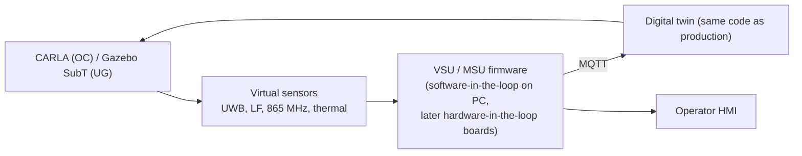

# 10 · Simulation, real data and validation

This document answers question 3 (are LMVs and HEMM possible in CARLA?) and question 12 (can mines be
simulated, and is there real data?). It also gives the test plan that turns the requirements in
[01](01_requirements.md) into pass/fail checks.

---

## 1. Answer to question 3: LMV and HEMM in CARLA

| | Native in CARLA? | How to get it |
|---|---|---|
| **LMV** (jeep, pickup, van, bus, ambulance) | **Yes.** The blueprint library has cars, SUVs, vans, trucks and buses. List them with `world.get_blueprint_library().filter('vehicle.*')` | Use directly; tune mass and braking to the SCCL LMV fleet |
| **HEMM** (dump trucks, dozers, excavators, loaders, graders, drills) | **No.** There are no mining machines in the catalogue | Import custom models through CARLA's vehicle content-authoring workflow: rig an armature with separate wheel bones, import the FBX into Unreal, create the vehicle blueprint, register it [E13]. This needs CARLA built from source with the Unreal editor (0.9.x on UE4, the 0.10 line on UE5) |
| Six-wheel dump trucks | Partly | CARLA's vehicle physics expects **four wheels** (`VehiclePhysicsControl.wheels`: FL, FR, RL, RR) [E13]. Model the rear duals as one wide wheel per side and tune mass (~165 t loaded), torque curve, gear ratios and brake torque until deceleration matches the MSP (2.0 m/s²) |
| Tracked machines (dozer, excavator, drill) and **articulated** machines (wheel loader, LHD) | No (the wheeled model can't represent them) | Drive them **kinematically**: move the actor every tick with `set_transform`, following a scripted path from the correct kinematic model ([06 §2](06_collision_avoidance_logic.md)). Use two actors (front/rear frame or undercarriage/house) for joints. Physics fidelity isn't needed for testing detection logic |
| Excavator swing | No | A separate house actor rotated each tick, or a skeletal animation |

**Verdict.** CARLA is a good tool for the **opencast** scenarios: haul roads, intersections, LMV/HEMM
interaction, pedestrians, V2V. HEMM needs custom assets and kinematic workarounds. It is a poor fit for
**underground** work (§3), and it has **no UWB, LF magnetic, sub-GHz radio or thermal sensors**. Those are
added as Python virtual sensors (§2.3).

## 2. Building the opencast mine in CARLA

### 2.1 What CARLA provides

| Feature | Available | Note |
|---|---|---|
| Sensors | RGB, depth, semantic and instance segmentation cameras, DVS, optical flow, ray-cast LiDAR and semantic LiDAR, radar, GNSS, IMU, collision, obstacle, lane invasion, RSS, **V2X** [E13] | LiDAR has `atmosphere_attenuation_rate`, drop-off and `noise_stddev` attributes (a crude dust proxy). Radar is a low-fidelity ray-cast (default 30° × 30° FOV, 100 m) |
| V2X sensor | `sensor.other.v2x` (ETSI CAM) and `sensor.other.v2x_custom` (arbitrary payload, e.g., JSON), geometric or WINNER path-loss models, configurable power, sensitivity and path-loss exponent [E13] | Usable for VPB beacons and alerts (set the path-loss parameters for 865 MHz conditions) |
| Ray casting | `world.cast_ray(a, b)` returns the labelled points intersected between two locations; `project_point`, `ground_projection` [E13] | The basis of the LOS/NLOS decision for virtual UWB |
| Pedestrians | Walkers with AI controllers | Workers, including lying/crouching poses via animation |
| Weather / light | Fog, rain, sun altitude | Fog affects cameras only; night via negative sun altitude |
| Scenarios | ScenarioRunner / OpenSCENARIO | Reproducible test cases |

### 2.2 Map pipeline

1. Start from the RG-1 surface survey (DEM) and haul-road centrelines.
2. Build the terrain in Unreal Landscape or RoadRunner. Benches, ramps and dump yards become terrain; haul roads become OpenDRIVE roads so the traffic manager can drive LMVs.
3. Place static assets: berms, buildings, power lines, parking bays.
4. Import HEMM assets (§1) and spawn them with scripted or kinematic controllers.
5. Mirror the same geometry into the twin (same coordinate frame), so twin geofences and simulated poses agree.

### 2.3 Virtual sensors (Python, per tick)

```python
import random
import carla

def uwb_ranges(world, anchors, tag, sigma_los=0.10, nlos_bias_mean=0.8):
    """Simulated two-way-ranging results from machine anchors to a worn tag.

    anchors: list of carla.Location (world frame, from the MSP coordinates)
    tag:     carla.Location of the helmet tag
    Returns a list of (range_m, is_nlos).
    """
    out = []
    for a in anchors:
        d = a.distance(tag)
        hits = world.cast_ray(a, tag)  # labelled points along the segment
        blockers = [h for h in hits
                    if h.location.distance(a) > 0.3 and h.location.distance(tag) > 0.3]
        nlos = bool(blockers)
        bias = random.expovariate(1.0 / nlos_bias_mean) if nlos else 0.0  # NLOS adds positive bias
        sigma = 0.25 if nlos else sigma_los
        out.append((d + bias + random.gauss(0.0, sigma), nlos))
    return out
```

* Check whether `cast_ray` reports dynamic actors in your CARLA version. If not, add ray–bounding-box tests against vehicles and walkers (`actor.bounding_box`).
* Replace the exponential NLOS bias with distributions fitted to the eWINE dataset first, then to SCCL measurements (§4).
* **LF shell:** |B| ∝ 1/r³ per generator, log-normal ±3 dB noise, zone thresholds from the MSP.
* **865 MHz:** `sensor.other.v2x_custom`, or a Python link model (log-distance path loss plus extra loss per obstruction found by `cast_ray`).
* **Thermal:** derived from the semantic or instance camera (walkers rendered "hot", sun-facing rock tagged "warm") plus noise, as a stand-in for a real LWIR model.

### 2.4 Co-simulation



The firmware does not know it is in a simulation: it consumes ranges and events in the same format as
real hardware. Later, real MCU boards replace the software models (hardware-in-the-loop) with simulated
ranges injected over a debug port.

## 3. Underground simulation

| Tool | Why | Use |
|---|---|---|
| **Gazebo (Ignition) + DARPA SubT Virtual Testbed** | Open-source, dockerised; large photogrammetry-based tunnel and cave worlds; a **communications-constraint plugin** (Wi-Fi doesn't pass through rock); thermal camera; **dynamic rock falls** [E14] | UG machines and people, comms loss, roof-fall scenarios |
| NVIDIA Isaac Sim | High-fidelity RTX LiDAR, radar and camera rendering | Optional, for perception studies |
| Custom gallery model | SCCL statutory plans → extruded roadway mesh (4.2–4.8 m × 3 m galleries, pillars) | Shared by Gazebo, Sionna RT and the twin |

## 4. RF and network simulation

| Question | Tool | Method |
|---|---|---|
| UWB channel impulse responses in a gallery, around corners and machines | **NVIDIA Sionna RT** (ray tracing; scenes from Blender/Mitsuba) | Model coal/rock/steel materials; generate LOS/NLOS CIRs to train the NLOS classifier before field data exists |
| 865 MHz path loss in galleries and crosscuts | Sionna RT, checked against NIOSH tunnel figures (≈ 72 dB at 1,000 ft in a 14 × 7 ft entry at 900 MHz [E3]) | Node spacing, link margins |
| Network scale (hundreds of tags, event-driven MAC) | **ns-3** with the LoRaWAN module, or a discrete-event Python model | Collisions, latency, capacity |
| TTE link | Analytic (skin depth, dipole field, inter-harmonic noise model) + **bench demonstrator** (audio power amplifier, wire loop, ferrite receive coil, sound card or SDR at 1–3 kHz across a building) | Validate the 16-FSK modem and FEC |

## 5. Answer to question 12: real data

**Yes. There is public real data for most parts.** None of it is a complete underground collision-avoidance
dataset, so the project should also collect its own (§5.2).

### 5.1 Public datasets and sources

| Source | Content | Use in this project |
|---|---|---|
| **AutoMine** (CVPR 2022) and its multimodal journal extension (J. Field Robotics, 2025) [E15] | Open-pit driving: 18+ h, 18K annotated LiDAR and image frames, mining trucks, pedestrians, dust and snow; the extension covers five platforms at eight mine sites | Train and test OC person/vehicle detectors; realistic sensor noise |
| **SubSurfaceGeoRobo** (2024) [E16] | Freiberg silver mine: radar, 3-D LiDAR, depth/RGB cameras, IMU, 2-D laser scanners, survey-grade ground truth | UG radar clutter, LiDAR map matching |
| **MIN3D** (2023) [E16] | WW2 tunnels at Walim: two LiDARs, stereo/mono/**thermal** cameras, three IMUs, laser-scanner ground truth (~150 GB) | Thermal behaviour in tunnels; PDR/IMU tests |
| DARPA SubT datasets and worlds [E14] | Tunnels, caves, urban underground | Simulation and algorithm tests |
| **eWINE UWB LOS/NLOS dataset** (Bregar) [E17, P10] | ~42,000 DW1000 CIR samples from 7 indoor sites, with code | Pre-train the NLOS classifier and range-error regressor |
| Seeing Through Fog (DENSE) [P15] | Multimodal driving in fog, snow and rain | Fusion under degraded visibility (dust analogue) |
| KAIST multispectral pedestrians; FLIR ADAS thermal [E23] | RGB + thermal pedestrians | Pre-train the thermal person detector |
| University of Glasgow radar signatures of human activities [E23] | Micro-Doppler spectrograms | Pre-train the radar person classifier [P11] |
| **MSHA open government data** (accidents and injuries) | US mine accident records with narratives | Scenario library and risk weighting |
| **DGMS annual reports and statistics** | Indian mine accident analyses | Indian scenario priorities (reversing HEMM, dumpers) |
| NIOSH RI 9672 and related reports [P3, P8] | Blind-area plots, detection-zone maps, alarm statistics | Baselines to beat (82/18/42) |

A 2025 coal-mine thermal + LiDAR dataset ("UTLD") was presented at EGU 2025; whether it is public is not
yet verified.

### 5.2 Own data collection at SCCL (with permissions and a safety plan)

| Campaign | What | Why |
|---|---|---|
| UWB CIR, LOS/NLOS | Anchors on a parked truck, loader and LMV; a person walking the 1 m grid in standing, bending, crouching and lying postures; galleries and crosscuts underground (training gallery) | Site-specific NLOS models (indoor-trained models transfer poorly [P5]) |
| LF field maps | 1 m grid around each machine type | Shell thresholds |
| Radar clutter | Static and driving recordings on haul roads and at the face | Clutter maps, classifier fine-tuning |
| Thermal | Day/night, summer/monsoon | False-positive rates on hot rock |
| 865 MHz path loss | Drive and walk tests around the pit and galleries | Gateway and node placement |
| Shadow mode | 7 × 24 h per machine with DVR, alarms logged but not sounded [P3] | True/false/nuisance/missed statistics before alarms go live |

## 6. Scenario library (simulation and test course)

| ID | Scenario | Pass criterion |
|---|---|---|
| S01 | Truck reversing toward a standing worker, 0°–±60° off the centreline | L4 before the stop boundary; 0 misses |
| S02 | Worker bending, crouching or lying behind a reversing truck | Detected by LF or UWB; L4 in time |
| S03 | Worker walks into a parked truck's front blind area; key-on | Start inhibited |
| S04 | LMV parked in a truck's front blind area; key-on | Start inhibited |
| S05 | Two trucks at a blind bench-corner intersection | L3 ≥ 6 s before the conflict via the OC Guardian |
| S06 | Person beside (not in) the path of a passing truck | ≤ L2 (no nuisance) |
| S07 | Shovel loading its paired truck with a helper nearby | Machine–machine suppressed; helper alarms intact |
| S08 | Untagged person behind a reversing truck at night | Radar/thermal "UNTAGGED PERSON" ≥ 90% |
| S09 | Truck reversing toward a dump edge | Edge warning in time; berm check |
| S10 | LHD approaching a crosscut while a miner comes round the corner | Junction Guardian relay → L3 before LOS |
| S11 | Miner beside an LHD articulation joint during steering | L4 + I4 stop with two-layer confirmation |
| S12 | CM operator steps into the conveyor-swing zone | Only conveyor swing inhibited |
| S13 | Roof fall: nodes destroyed, miner struck | Man-down in ≤ 60 s via mesh; last known location ≤ 10 m; LF locator finds the unit in a test pile |
| S14 | Explosion: overpressure at several nodes, fibre cut | Emergency declared automatically; ULF page received; TTE delta roll-call delivered |
| S15 | Shift-change crowd (60 tags) around a machine | No missed DANGER fixes; latency ≤ 200 ms |
| S16 | Jamming of 865 MHz and UWB | Fault alarms; LF still protects; conservative mode |

S01–S03, S05, S06 and S08 are run with datasheet models of the exact parts (DWM3000, AS3932, AWR1843AOP,
ZED-F9P, SX1262) in [13](13_component_simulation.md), with results and the list of KPIs to measure.

## 7. Validation phases and KPIs

| Phase | Where | Exit criterion |
|---|---|---|
| A. Simulation | CARLA / Gazebo + virtual sensors + twin | Scenario library passes |
| B. Bench | Lab: UWB ranging and antenna delays, LF fields, power profiling, TTE modem | Budgets confirmed or updated |
| C. Static machine tests | SCCL test area, parked machines | NIOSH Appendix B zones mapped; real person, four postures; alarm delay < 200 ms [P3, P18]; 36-angle approaches [P7] |
| D. Dynamic tests | LMV surrogate at 16 km/h (as Marks & Teizer [P7]), then HEMM at low speed | No misses; latency met |
| E. Shadow mode | 7 × 24 h per machine | False ≤ 5%, nuisance ≤ 15% |
| F. Live pilot | RG-1, alarms on, start-inhibit on | KPIs below over ≥ 3 months; operator feedback forms (NIOSH Appendix C) |
| G. UG demonstrator | Non-gassy training gallery, after approvals | MSU/LHD/Junction Guardian loop; TTE bench-to-field |

| KPI | Target | Measured by |
|---|---|---|
| Tagged-person detection in the reliable zone | 100% (0 misses) | Grid tests, shadow mode |
| Danger-alarm latency | p99 ≤ 200 ms | Timestamped logs + high-speed video |
| Relative position error | p95 ≤ 0.7 m at 5–15 m | Surveyed grid points |
| False / nuisance alarms | ≤ 5% / ≤ 15% | DVR review |
| Untagged-person detection | ≥ 90% within 15 m (rear and blind side) | Real person, stationary-machine tests |
| Start-inhibit | 100% correct blocks; ≤ 1% unnecessary blocks | Test matrix |
| Wearable endurance | ≥ 16 h main; ≥ 96 h backup | Bench + field logs |
| Twin freshness | ≥ 99% of active tags updated within 60 s | Twin logs |
| Alert to twin | ≤ 2 s p95 | Logs |
| Wearable traffic at rest | ≤ 1 packet/min | Logs |

NIOSH could not show accident reduction from a short pilot either, and recommends multi-mine before/after
studies [P18]. The pilot therefore claims **detection rate, latency, false/nuisance rates and near-miss
counts**, not fatality reduction.

## 8. Pilot configuration for RG-1 (8 machine units, 80 personal units)

| Item | Allocation | Reason |
|---|---|---|
| Machine units | 4 rear dump trucks (2 large, 2 medium), 1 shovel/excavator, 1 dozer, 1 water sprinkler or grader, 1 wheel loader or backhoe | Trucks are the leading fatality class (38%, 67% of deaths while reversing [P18]); the shovel and dozer create the loading and dump-yard interactions |
| VTUs (low cost, outside the 8) | Every LMV entering the pilot area | LMV collisions are the other big surface risk |
| Personal units | 24 operators (8 machines × 3 shifts), ~50 pedestrians (supervisors, helpers, surveyors, maintenance, blasting crew), 6 spares | Everyone who works in the pilot area |
| Infrastructure | RTK base, 2–3 pole gateways, 2–4 OC Guardians at blind spots, twin server, gate dock | Minimum for awareness, absolute positions and roll-call |
