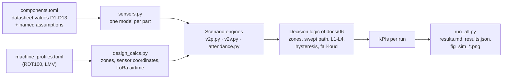

# 13 · Simulating the market components: V2V/V2P collision warning and biometric + helmet attendance

The earlier documents describe each sensor by class ("DW3000 class", "AS3933 class"). This document
replaces every class with an **exact part you can buy**, reads the numbers from its **datasheet**, and
runs those numbers through the scenario library of [10 §6](10_simulation_and_data.md) and the decision
logic of [06](06_collision_avoidance_logic.md). It covers three things:

1. **Collision warning, vehicle-to-person (V2P) and vehicle-to-vehicle (V2V)**, on the SCCL RG-1 pilot's
   100 t dump truck and an LMV.
2. **Attendance with biometric + helmet**: a person is marked present only when the fingerprint, their
   own helmet and its personal unit, and the helmet being worn all check out. UHF RFID helmet tags are
   simulated as one of the options.
3. **Every method available to simulate market sensors**, and **the list of results the project has to
   evaluate**, with the simulated value and the target for each.

The code is in [`sim/`](../sim/README.md); the generated tables are in [`sim/results.md`](../sim/results.md).
Citations: `[D*]` are the component datasheets and `[E*]`, `[P*]` the sources in
[12_references.md](12_references.md).

---

## 1. The exact components

| Function | Part | Datasheet numbers used in the models | Ref |
|---|---|---|---|
| UWB helmet tag, hull anchors, LMV unit | **Qorvo DWM3000** (DW3110 IC) | CH5 6489.6 MHz, 500 MHz; −41.3 dBm/MHz; sensitivity −94.3 dBm (6.8 Mb/s, 1 % PER); link budget 89 dB; ranging ±6 cm calibrated, σ 1.5 cm at −85 dBm; TX 40 mA, RX 50 mA, deep sleep 260 nA | D1, D2 |
| LF 3-D wake-up receiver in the personal unit | **ams/ScioSense AS3932** (110–150 kHz) | 100 µVrms at 125 kHz; 5.7 µA listening on 3 channels; 2,184 symbols/s, preamble ≥ 1.55 ms, 16-bit pattern → 17.6 ms telegram, 20 ms slot per coil | D3 |
| Rear radar (untagged people) | **TI AWR1843AOP** (76–81 GHz) | EIRP 16 dBm, EINF 10 dB, IF 10 MHz, ±60° beam (−8 dB RX, −6 dB TX at the edge), 3 TX × 4 RX | D4 |
| Short-range side radar (option, 60 GHz) | **TI IWR6843AOP** | EIRP 16 dBm, EINF 9 dB | D5 |
| Module radar used for comparison | **Continental ARS 408-21** | 72 ms cycle; 0.2–70 m at ±45°, 20 m at ±60°, 250 m at ±9°; ±0.10 m near range | D6 |
| Machine and LMV pose (V2V) | **u-blox ZED-F9P-04B** | RTK 0.01 m + 1 ppm CEP, SBAS 1.0 m, standalone 1.5 m CEP; RTK convergence < 10 s; 7 Hz RTK; 0.05 m/s | D7 |
| 865 MHz beacons, Guardian relay, telemetry | **Semtech SX1262** | LoRa SF7/125 kHz −124 dBm, SF12 −137 dBm; GFSK 38.4 kb/s −109 dBm; +14 dBm used in India; RX 4.6 mA, TX 45 mA; blocking 88 dB | D8 |
| UHF RFID reader (gate; and the RFID baseline on a truck) | **Impinj R700** (ETSI/India IPJ-R700-241) | +30 dBm (PoE), −92 dBm receive, 1,100 reads/s | D9 |
| UHF RFID helmet tag | **Impinj M730** inlay in the helmet shell | read −24 dBm, write −21 dBm | D10 |
| Fingerprint, 1:1 / 1:k at the gate | **Grow R503** (capacitive) | FAR < 0.001 %, FRR < 1 %, capture < 0.2 s, features < 0.5 s, 200 templates | D11 |
| Fingerprint, 1:N terminal (baseline) | **ADH-Tech GT-521F52** (optical) | FAR < 0.001 %, FRR < 0.1 %, 3,000 templates, identification < 1.5 s | D12 |
| Helmet-worn sensor | **TI FDC1004** with a 20 × 20 mm sweatband electrode | ±15 pF, 0.5 fF, 33.2 aF/√Hz at 100 S/s, 750 µA | D13 |

Two corrections to earlier documents came out of reading the datasheets:

* The LF receiver modelled is the **AS3932** (110–150 kHz), whose datasheet was available; it covers the
  125 kHz carrier. The design text names the AS3933 (15–150 kHz superset); either fits.
* The DWM3000's real currents are **TX 40 mA and RX 50 mA** (CH5), not the indicative 35/65 mA used in
  [05 §6](05_communication.md). Re-running that budget with datasheet currents gives **6.0 mAh per 12 h
  shift event-driven vs 23.4 mAh polling (3.9×)**, against 6.2 vs 25.1 mAh before (§7).

**What is not on a datasheet** is kept separate in the `[assumptions]` table of
[`sim/components.toml`](../sim/components.toml), each with its basis. The ones that matter most:

| Assumption | Value | Basis | Replace with |
|---|---|---|---|
| Person radar cross-section | −8 dBsm mean, Swerling 1; side −5 dB; lying −6 dB | Yamada at 76 GHz [E27] | Measurements at RG-1 |
| UWB NLOS | Body −12 dB; bias exponential, mean 0.8 m | [10 §2.3](10_simulation_and_data.md) default | eWINE fit [E17], then site data |
| 865 MHz path loss | Exponent 2.7, shadowing 6 dB; knife-edge (ITU-R P.526) at bench corners | Open-pit assumption | Drive tests |
| Same-modulation capture | 6 dB | [E28] | Bench test |
| Operator reaction | Log-normal, median 1.5 s, p95 ≈ 2.4 s | Design value of [06 §1](06_collision_avoidance_logic.md) | Shadow-mode logs |
| Radar losses, chirp | 8 dB; 20 MHz/µs × 30 µs, 192 chirps per 50 ms frame (75 m, 0.25 m) | Engineering choice | TI mmWave Sensing Estimator |
| Person classifier | 97.6 % after 0.5 s | [P11] | Site-trained CNN |
| Fingerprints | 10 % "difficult" fingers with 20 % per-attempt rejection; 2 % cannot enrol | Between NIST ~2 % and the ~15 % manual-labour estimate [E29] | Enrolment trial at RG-1 |
| Helmet-worn cues | Electrode 1–4 mm from skin when worn; threshold 2.0 pF; tilt ≤ 25°; strap switch | Geometry assumption | Bench measurement with the FDC1004 EVM |

---

## 2. Every method available to simulate market sensors

No single tool covers UWB, LF magnetics, mmWave radar, GNSS, sub-GHz radio, RFID and fingerprint modules.
The methods below go from cheapest to closest to the real thing. They stack: the datasheet model (M1–M2)
is what this document runs; the others refine one part of it, or replace it with measured data.

| # | Method | What it does | Tools | What it takes from the datasheet | Good for | Limits |
|---|---|---|---|---|---|---|
| M1 | **Datasheet-parametric Monte Carlo** (behavioural models) | Turns each spec into a probabilistic measurement model (detect / miss, noise, latency) and runs thousands of scenarios | Python + NumPy (this work), MATLAB, SimPy | Sensitivity, link budget, accuracy, update rate, FOV, FAR/FRR, currents | System KPIs, design trade-offs, comparing parts before buying | Only as good as the assumptions that are not on the datasheet |
| M2 | **Closed-form link budgets** | Friis/log-distance, radar equation with EIRP and EINF, magnetic dipole near field, RFID forward/reverse link, LoRa time on air | Spreadsheet, Python, the vendor calculators in M3 | EIRP, EINF, sensitivity, antenna gain, airtime | Reach of each sensor (§4.1), regulatory checks | No dynamics, no interference |
| M3 | **Vendor design calculators and evaluation software** | The vendor's own model of its chip | TI mmWave Sensing Estimator, mmWave Studio, Demo Visualizer; Qorvo DW3000 API and examples, PDoA demo; Semtech LoRa Calculator; u-blox u-center (UBX log replay); Impinj ItemTest; ScioSense AS3933 demo-kit GUI; Grow/ZKTeco SDK demos | Chirp/frame settings, SF/BW, power | Choosing chip settings; checking M1 against the vendor | Chip-level only |
| M4 | **Engineering toolboxes** | Scenario plus sensor models configured from spec values | MATLAB Automated Driving Toolbox (`drivingScenario`, `radarDataGenerator`, `gpsSensor`, `insSensor`), Radar Toolbox (FMCW waveforms), Communications Toolbox (IEEE 802.15.4z HRP UWB waveforms and ranging examples), Sensor Fusion and Tracking Toolbox, Simulink | FOV, range/angle accuracy, Pd/Pfa, update rate | Tracking and fusion studies; waveform-level UWB | License; no LF or RFID models |
| M5 | **3-D vehicle and robot simulators with virtual sensors** | Physics, geometry, line of sight | CARLA (radar, GNSS, IMU, V2X, `cast_ray`; UWB/LF/RFID added as Python sensors, [10 §2.3](10_simulation_and_data.md)), Gazebo/Ignition with DARPA SubT worlds, Webots, NVIDIA Isaac Sim | Same as M1, applied per tick | Realistic geometry, occlusion, operator-in-the-loop; HEMM needs custom assets | Effort; radar/RF fidelity limited |
| M6 | **Traffic and network co-simulation (V2V)** | Many vehicles, MAC and channel | SUMO + OMNeT++/Veins or Artery; ns-3 (LoRaWAN module); FLoRa; LoRaSim [E28] | Sensitivity table, airtime, capture, duty cycle | Channel load, beacon rates, MAC design | Simplified PHY |
| M7 | **Ray tracing and EM solvers** | Site-specific propagation and antenna patterns | NVIDIA Sionna RT, MATLAB ray tracing, Remcom Wireless InSite; openEMS, CST, HFSS (helmet tag detuning); FEMM, COMSOL (125 kHz coil fields) | Antenna patterns, Tx power | UWB NLOS at bench corners, 865 MHz round benches, LF shell shape, tag on a helmet | Needs 3-D models and material data |
| M8 | **Circuit and firmware level** | Analogue front ends, MCU code | LTspice (125 kHz coil driver and AS3932 resonant front end), Proteus VSM, Wokwi (ESP32 with sensors), Renode (multi-node MCU emulation), QEMU | Component values, Q, timing | Firmware written and tested before boards exist | No RF physics |
| M9 | **Replay of real recordings** | Real sensor data fed through the algorithms | eWINE UWB CIR [E17], Glasgow radar micro-Doppler [E23], AutoMine [E15]; FVC2000–2004 and NIST SD302 fingerprints; SHWD/SHEL5K helmets [E30]; u-center UBX logs | — | Training and testing ML parts (NLOS, person classifier, helmet detector) | Data not from this mine |
| M10 | **Biometric evaluation toolchains** | Measures FAR/FRR/DET curves on images | NIST NBIS (MINDTCT + BOZORTH3), SourceAFIS, BioLab FVC protocols | FAR/FRR claims to compare against | Checking datasheet FAR/FRR on dirty or worn fingers | Needs enrolment images from workers |
| M11 | **Hardware-in-the-loop with evaluation kits** | Real chips, scripted scenarios | DWM3000EVB, AS3933/AS3932 demo kit, AWR1843AOPEVM / IWR6843AOPEVM + DCA1000, ZED-F9P board with an RTK base, SX1262 module, R700 + panel antenna, R503 + ESP32, FDC1004EVM; a cart or LMV as the moving machine | — | The real numbers that replace every assumption in §1 | Hardware and test time |
| M12 | **Digital-twin / IoT stack simulation** | Message flow, roll-call, dashboards | MQTT (Mosquitto), Node-RED, device simulators, SimPy queues | Message sizes, rates | Attendance, roll-call and twin reconciliation | No sensing physics |

Which method fits which component:

| Component | M1 | M2 | M3 | M4 | M5 | M6 | M7 | M8 | M9 | M10 | M11 |
|---|---|---|---|---|---|---|---|---|---|---|---|
| DWM3000 UWB | ● | ● | ● | ● (HRP waveform) | ● (Python sensor) | | ● (NLOS) | | ● (eWINE) | | ● |
| AS3932 LF + coils | ● | ● | ● | | ● (Python sensor) | | ● (FEMM) | ● (LTspice) | | | ● |
| AWR1843AOP / IWR6843AOP | ● | ● | ● (Sensing Estimator) | ● | ● | | ● | | ● (micro-Doppler) | | ● |
| ARS 408-21 | ● | | ● | ● | ● | | | | | | ● |
| ZED-F9P | ● | | ● (u-center) | ● | ● | | | | ● (UBX logs) | | ● |
| SX1262 | ● | ● | ● (LoRa Calculator) | | ● (V2X sensor) | ● | ● | ● (Renode) | | | ● |
| R700 + M730 UHF RFID | ● | ● | ● (ItemTest) | | ● (Python sensor) | | ● (tag on helmet) | | | | ● |
| R503 / GT-521F52 | ● | | ● (SDK demo) | | | | | ● (Wokwi/Proteus) | ● (FVC, NIST) | ● | ● |
| FDC1004 worn sensor | ● | ● | ● (EVM GUI) | | | | ● | ● (LTspice) | | | ● |

**Recommended path for the project:** M1 + M2 now (this document) → M3 to fix chip settings → M11 bench and
test-track measurements to replace the assumptions → M5 (CARLA) for the full scenario library with the
measured models → M6 once more than about ten machines share the radio channel.

---

## 3. How the simulation is built



### 3.1 Sensor models

| Part | Model |
|---|---|
| DWM3000 | P_rx = sensitivity + link budget − FSPL(d) − 12 dB if the body shadows the helmet antenna + N(0, 3 dB). Frame success follows a curve that gives 1 % PER at the sensitivity; DS-TWR needs three frames. Range noise σ = 1.5 cm × 10^((−85 − P_rx)/20); a fixed ±6 cm bias per anchor; NLOS adds an exponential bias. Hull line of sight from the same slab test as the coverage study ([03 §3.5](03_positioning_and_sensing.md)). Anchor coordinates from `design_calcs.placement()`: the six pilot hull anchors; the canopy anchor U7 is tested separately |
| AS3932 + coils | Field ∝ (r_on/r)³·√(1 + 3cos²θ)/2, normalised to the AS3932 sensitivity at the on-axis shell radius r_on (6 m front/rear, 4.5 m sides while driving; 8/6 m at the key-on sweep); ±3 dB field error. Four coils in turn, one 20 ms slot each (telegram timing from D3); a hit reaches the machine 10–60 ms later over UWB or 865 MHz |
| AWR1843AOP / IWR6843AOP | SNR = EIRP·σ·λ²·T_meas·N_rx / ((4π)³R⁴·kT₀·EINF·L) with the datasheet EIRP and EINF (antenna gains included), edge roll-off to −14 dB two-way at ±60°. Swerling-1 detection at P_fa = 10⁻⁶; 3-of-5 track confirmation; person classifier after 0.5 s. Rocks and berms (80 % already in the twin's static map) are present in every reversing run |
| ARS 408-21 | Datasheet detection envelope scaled to a person by R ∝ RCS^¼ (datasheet ranges taken as for a 10 dBsm car); 72 ms cycle; angle accuracy from D6 |
| R700 + M730 | Forward link (EIRP − FSPL − beam loss − 3 dB polarisation − 3 dBi tag − body) ≥ −24 dBm and backscatter ≥ −92 dBm, with 3 dB shadowing |
| SX1262 | Log-distance loss (exponent 2.7) + 6 dB shadowing + ITU-R P.526 knife-edge loss round the bench corner; pure ALOHA with 6 dB capture; half duplex; airtime from AN1200.13 (24-byte beacon: LoRa SF7 61.7 ms, GFSK 38.4 kb/s 7.3 ms) |
| ZED-F9P | Error σ = CEP/1.1774 per axis as a Gauss–Markov process (τ = 60 s standalone/SBAS, 10 s RTK); multipath jumps of 5–15 m near highwalls for standalone/SBAS; RTK float 5 % of the time (σ 0.3 m) |
| R503 / GT-521F52 | Per attempt: genuine rejected with the datasheet FRR (20 % for difficult fingers); a wrong template accepted with FAR per template compared, so 1:N accepts an outsider with about N·FAR |
| FDC1004 | Parallel-plate capacitance of the electrode to skin, hair or clothing + D13 noise + sweat/humidity drift; combined with IMU tilt and a strap switch |

### 3.2 Decision logic (from [06](06_collision_avoidance_logic.md))

* **Zones** from `design_calcs.zones()` for the live speed: 100 t truck reversing at 10 km/h → stop 15.0 m;
  forward at 30 km/h loaded on 1:16 → stop 53.2 m; start-inhibit radius 4.2 m.
* **Tracking**: a constant-velocity Kalman filter per tag or radar track (prior: the person stands still).
* **Swept path**: a person is *in the path* if, when the leading face reaches their position, their
  predicted disk (2σ + 1 m buffer, growing with time) lies inside the corridor the face sweeps.
  Close-proximity rules cover people beside the body (L3 inside 4.2 m, L4 inside 1 m).
* **Levels**: L4 when in the path inside the stop band (or TTC ≤ 2 s) or on any LF hit; L3 when in the path
  with TTC ≤ 4 s or inside 4.2 m; hysteresis 0.5 s; a silent tag's circle grows at 1.5 m/s (fail-loud).
* **Latency**: 10 ms solve + 20 ms cab actuation (docs/06 §11); UWB fixes at 1/10/20 Hz by level.
* **V2V**: each machine predicts both oriented footprints 10 s ahead from the beacons it has heard;
  L3 at TTC ≤ 6 s, L4 at TTC ≤ 3 s; margin = 1 m + 2σ of the relative GNSS error.

### 3.3 Method and scenarios

* **Open loop, then braking.** The machine runs at constant speed with every layer on its own schedule,
  starting 4 s before the scenario so sessions and tracks already exist. The operator brakes after the
  first L3/L4 alarm plus a log-normal reaction time, at the MSP's a_eff (1.39 m/s² loaded on the
  downgrade). The person does not dodge (worst case).
* **Common random numbers.** Every configuration sees the same person, motion and noise, so differences come
  from the sensors.
* **Runs.** 400 runs per V2P scenario and policy, 300 per V2V configuration, 20 shift changes per
  attendance setting; seeds are fixed, so a re-run reproduces every number. The full run takes about 2 min
  on 16 processes.

| ID | Scenario | Configurations compared |
|---|---|---|
| S01 | Truck reversing at 10 km/h toward a standing or walking worker (60 % in or next to the corridor, rest in the ±60° cone) | A RFID · B UWB · C UWB+LF · D C+AWR1843AOP · E C+ARS 408 |
| S02 | Same, worker bending, crouching or lying | A–E |
| S06 | Worker 5–12 m beside the corridor (nuisance test) | A–E, three prediction policies |
| S08 | Untagged person behind the reversing truck | C, D, E |
| SF | Forward at 30 km/h, loaded on a 1:16 downgrade, worker on the haul road 40–140 m ahead | A, B, C; B and C with UWB at the vehicle PSD limit |
| S00 | Reversing with rocks/berms and nobody present (false alarms) | A, C, D, E |
| S03 | Key-on start-inhibit, person 0–9 m from the hull or under it | A, B, LF only, C fused, C + canopy anchor |
| S05 | Truck (30 km/h) and LMV (40 km/h) at a blind bench corner | LoRa/GFSK, 2/5 Hz, with and without an OC Guardian relay, RTK vs standalone |
| V2 | Two trucks passing in adjacent lanes, 3.9 m between bodies | ZED-F9P RTK / SBAS / standalone |
| V4 | 5–100 vehicles beaconing on one 865 MHz channel | LoRa SF7 vs GFSK 38.4 kb/s, 2 and 5 Hz |
| T1–T5 | 300 workers through the gate at shift change; UHF power sweep; outsider acceptance; roll-call | Attendance A–D (§6) |

---

## 4. Results: vehicle-to-person

### 4.1 Sensor reach straight from the datasheets


| Sensor | 90 % reach | What it means |
|---|---|---|
| DWM3000, line of sight | **78 m** (50 % at 123 m) | Enough for the 53 m stop zone at 30 km/h |
| DWM3000, helmet shadowed by the body | **19 m** | Low postures lean on anchor redundancy, LF and radar |
| DWM3000, anchors at India's vehicle limit −53.3 dBm/MHz | **19 m** | Same −12 dB as body shadowing: forward haul fails (§4.2) |
| AS3932, coil set to 6 m | 5.6 m on axis, 4.4 m broadside | A near-field shell, not a long-range layer |
| AWR1843AOP, standing / lying person | **14 m / 9 m** per frame (22 / 15 m at 50 %) | Meets "untagged within 15 m" only with tracking over several frames |
| IWR6843AOP, standing | 16 m | 60 GHz is ~2 m better than 77 GHz on the same AOP design |
| ARS 408-21 (scaled to a person) | 76 m on boresight | Far longer, at module price and 6.6 W |
| R700 30 dBm + M730, tag facing / behind the head | **7.9 m / 2.5 m** | Presence only, direction-dependent: the base paper's problem [P1] |

### 4.2 Collision outcomes


| Scenario (at-risk runs) | A RFID | B UWB | C UWB + LF | D + AWR1843AOP | E + ARS 408 | Stop zone |
|---|---|---|---|---|---|---|
| S01 reversing, upright (151) | 66.9 % no contact, first alarm 16.9 m | **99.3 %**, 14.7 m | 99.3 % | 99.3 % | 99.3 % | 15.0 m |
| S02 reversing, low posture (230) | 56.5 %, 8.0 m | **100 %**, 14.7 m | 100 % | 100 % | 100 % | 15.0 m |
| S08 untagged (151) | — | 0 % | 0 % | **95.4 %** (detected 98.0 %) | **96.0 %** (96.7 %) | 15.0 m |
| SF forward 30 km/h (214) | 2.3 %, 15.6 m | **100 %**, 52.5 m | 100 % | — | — | 53.2 m |
| SF with anchors at the vehicle PSD limit (214) | | 34.1 %, 34.4 m | 34.1 % | | | 53.2 m |

* **UWB + LF meets the cooperative target**: every tagged person in the path was alarmed, and the
  first alarm came at the stop-zone boundary (14.7 m of 15 m reversing, 52.5 m of 53.2 m forward). The one
  S01 contact is a worker walking toward the truck at 1.2 m/s while the operator took 3.7 s to react, the
  slow tail of the reaction-time distribution; the alarm itself came at 15.2 m within 50 ms.
* **RFID presence alone (the original proposal) fails**: one in three upright and almost half the
  low-posture workers are hit, and it is useless at haul speed. It reads only 2.5–8 m depending on which
  way the head faces.
* **Radar is what protects untagged people**, and only radar: 95–96 % of at-risk untagged people avoided.
  That needs the person classifier and tracking; per frame, the AOP radar sees a standing person reliably
  only to 14 m.
* **Regulatory risk:** if WPC classes the hull anchors as vehicle-mounted without LDC/TPC mitigation
  (−53.3 dBm/MHz, [E4]), UWB reach drops to ~19 m and **two thirds of forward-haul encounters end in
  contact**. Low-duty-cycle operation and transmit-power control must be part of type approval
  ([01 §4.1](01_requirements.md)).

### 4.3 Danger-alarm latency (requirement ≤ 200 ms p99)


| Scenario | B UWB p50 / p95 / p99 | D + AWR1843AOP | E + ARS 408 |
|---|---|---|---|
| S01 upright | 80 / 255 / 460 ms | 60 / 120 / 330 ms | 60 / 110 / 215 ms |
| S02 low posture | 100 / 431 / 736 ms | 70 / 371 / 686 ms | 70 / 136 / 311 ms |
| SF forward | 90 / 134 / 1,446 ms | — | — |
| S08 untagged (radar only) | — | 90 / 1,559 / 2,928 ms | 80 / 223 / 1,477 ms |

The median meets the budget of [06 §11](06_collision_avoidance_logic.md) (≈ 85 ms). **The p99 does not.**
The run logs show two causes of the tail:

1. **Workers walking away from the reversing truck** (about 1.3 m/s). When they cross the 15 m stop
   boundary, their time to contact is close to the 8.6 s prediction horizon. The alarm waits until the
   predicted contact falls inside the horizon, and a small error in the tracked closing speed moves that
   moment by 0.2–0.4 s. These people are still 12–13 m and about 8 s from contact, so this tail is
   partly an artefact of how the danger zone is defined.
2. **A body-shadowed anchor.** Its NLOS bias pushes the position estimate about 0.25 m outward, so the
   estimate crosses the stop boundary one or two 100 ms fixes after the person does. Low postures shadow
   more anchors, hence the longer S02 tail.

Radar adds independent fixes and shortens the tail most. The cheap fixes to try next are ranging at
20 Hz instead of 10 Hz in the warning band, applying the 2σ margin to the stop-band test as well as to
the hull distance, and a horizon that covers the whole stop band at walking-away closing speeds.

### 4.4 Nuisance and false alarms


| Prediction policy (UWB + LF) | S06 workers beside the path alarmed | S01 + S02 at-risk contact |
|---|---|---|
| Worst-case reachable disk at 1.5 m/s ([06 §2](06_collision_avoidance_logic.md) as written) | **50.0 %** | 0.52 % |
| Tracked velocity, disk grows at 2σ_v | 21.2 % | 0.26 % |
| Tracked velocity, disk grows at 1σ_v | **8.0 %** | 0.26 % |

With the person's tracked velocity, nuisance falls six-fold at no loss of safety, and only the 1σ policy
meets the ≤ 15 % target. The design text should switch [06 §2](06_collision_avoidance_logic.md) to the
tracked policy. Radar adds nuisance (D 40.8 %, E 33.8 % in S06) because its angle error at range inflates
the uncertainty disk. False alarms with nobody present: **0.8 (AWR1843AOP) and 1.8 (ARS 408) per 100
reversing manoeuvres**, from rocks not yet in the twin's static map.

### 4.5 Start-inhibit at key-on (S03)


| True position | RFID front + rear | UWB only | LF only | **UWB + LF fused** |
|---|---|---|---|---|
| 0–2 m from the hull | 20.9 % | 99.5 % | 100 % | **100 %** |
| 2–4.2 m | 25.3 % | 96.8 % | 91.9 % | **99.6 %** |
| Under the body | 0 % | 0 % | 100 % | **100 %** |
| 5.2–9 m (unnecessary block) | 18.0 % | 0.6 % | 19.3 % | **2.9 %** |

The decision is ready 0.74 s after key-on (≤ 1 s required). **LF is indispensable under and against the
hull**, where UWB has no line of sight, and UWB keeps LF's oversized lobes from blocking start for people
5–9 m away. The fused pilot kit reaches 99.6 % correct blocks and 2.9 % unnecessary blocks, short of
100 % / ≤ 1 %. The remaining misses (9 in 6,000 checks) are mostly crouching or lying workers 3.4–4.2 m
beside the long sides, toward their ends. There the single mid-side coil's field is just below the AS3932
threshold, and the UWB fix is pushed outward by NLOS bias. The canopy anchor U7 does not fix this (99.6 %).
The short-range radar presence check of the key-on sequence ([06 §12](06_collision_avoidance_logic.md)),
or a second LF coil toward each end of the long sides, is needed and should be the next thing simulated.

---

## 5. Results: vehicle-to-vehicle


### 5.1 Blind bench corner (S05)

| Configuration | Contact | Both drivers alarmed ≥ 4 s | ≥ 6 s | A driver never alarmed | Beacons received (direct / with relay) |
|---|---|---|---|---|---|
| LoRa SF7, 2 Hz, direct only | 9.5 % | 87.8 % | 84.8 % | 4.1 % | 63 % / 63 % |
| LoRa SF7, 2 Hz, Guardian relay | 0 % | 80.4 % | 67.6 % | 2.0 % | 52 % / 61 % |
| LoRa SF7, 5 Hz, Guardian relay | 0.7 % | 58.4 % | 41.6 % | 5.4 % | 17 % / 21 % |
| **GFSK 38.4 kb/s, 2 Hz, Guardian relay** | **0 %** | **100 %** | **100 %** | 0 % | 48 % / **93 %** |
| LoRa SF7, 2 Hz, Guardian, standalone GNSS | 0 % | 80.1 % | 65.9 % | 2.0 % | 51 % / 60 % |

LoRa's −124 dBm closes the link even through 35–45 dB of corner diffraction. Its 61.7 ms airtime is the
problem, though: beacons, relays and the receivers' own transmissions collide. GFSK at 38.4 kb/s cannot get
round the corner (−109 dBm), but with the Guardian on the corner and 7.3 ms packets every conflict is
announced ≥ 6 s ahead (S05's criterion and R-CA-8's ≥ 4 s).

### 5.2 GNSS grade: two trucks passing in adjacent lanes

| ZED-F9P mode | Uncertainty margin | Passes with a nuisance alarm |
|---|---|---|
| RTK fixed | 1.03 m | **0 %** |
| SBAS | 3.40 m | 54.3 % |
| Standalone | 4.60 m | 79.7 % |

With 3.9 m between the bodies, only RTK separates the lanes. Standalone or SBAS GNSS turns V2V into a
constant false alarm on two-lane haul roads, which confirms R-POS-4 (≤ 0.1 m for vehicles).

### 5.3 Channel load and coexistence


| Vehicles on one channel | LoRa SF7, 2 Hz | GFSK 38.4 kb/s, 2 Hz | GFSK 38.4 kb/s, 5 Hz |
|---|---|---|---|
| 5 | 48 % delivered, AoI p95 3.3 s | 95 %, 0.6 s | 80 %, 0.5 s |
| 20 | 25 %, 5.9 s | 82 %, 1.2 s | 62 %, 0.8 s |
| 40 | 20 %, 8.1 s | 75 %, 1.4 s | 55 %, 0.9 s |
| 100 | 9 %, 20.6 s | 56 %, 2.2 s | 33 %, 1.8 s |

* **LoRa SF7 cannot carry V2V beacons**: with only five vehicles its 95th-percentile age of information is
  3.3 s. Keep LoRa for long-range, low-rate telemetry and use **GFSK 38.4 kb/s** (fits India's 200 kHz
  channel) for machine beacons.
* These figures are for pure ALOHA, the worst case. GNSS gives every machine a common clock, so a
  **time-slotted MAC** (7.3 ms GFSK slots, ~130 per second) plus 2–3 channels removes most collisions;
  simulate it in ns-3 or OMNeT++ (M6) before the fleet passes ~10 machines per area.
* **A UHF RFID reader desensitises the 865 MHz radio within ~78 m** (free space). It puts −4.7 dBm into the
  SX1262 at 3 m, where about −33 dBm is tolerable, because India's RFID and SRD allocations are the same
  865–867 MHz. RFID readers do not belong on machines that beacon. At the gate, keep the reader away from
  haul routes or gate its transmissions.

---

## 6. Results: attendance with biometric + helmet

The gate is where a person is tied to the personal unit (SPU) that protects them. Attendance is valid only
when the finger, the person's own helmet and SPU, and a worn helmet all check out:

```mermaid
sequenceDiagram
  autonumber
  participant W as Worker (helmet + SPU)
  participant G as Gate: R503 + UWB anchor (D) or R700 (C)
  participant T as Twin
  W->>G: steps to the reader point
  G->>W: UWB poll (D) or UHF inventory (C)
  W-->>G: SPU id, worn flag (FDC1004 + tilt + strap), self-test
  G->>G: claim = owner of the helmet(s) read
  W->>G: finger on the R503
  G->>G: 1:1 (D) or 1:k (C) match; on failure, 1:N on the gate computer
  alt finger + own helmet + worn + SPU OK
    G->>T: attendance (person, helmet, SPU, time); roll-call updated
    G-->>W: turnstile opens
  else a check fails
    G-->>W: fasten strap / wear helmet / wrong helmet / change SPU / supervisor
    G->>T: violation event
  end
```

| Config | What it checks |
|---|---|
| A | Fingerprint 1:N on a GT-521F52 (today's attendance terminal) |
| B | A + the person's helmet UHF tag must be read |
| C | Helmet UHF tags claim the identity → R503 1:k on the claimed templates → SPU worn and self-test over 865 MHz |
| D | The SPU itself claims the identity by UWB range to a gate anchor → R503 1:1 → worn and self-test in the same exchange |


| Result | A | B | C | D |
|---|---|---|---|---|
| Service time, mean / p95 | 5.0 / 6.0 s | 5.2 / 6.2 s | 5.5 / 9.3 s | 5.3 / 9.1 s |
| Throughput per gate | 12 /min | 11.5 /min | 11 /min | 11.3 /min |
| 300 workers, **1 gate**: p95 wait, late workers | 4.8 min, 23 | 5.5 min, 31 | 6.3 min, 40 | 5.8 min, 35 |
| 300 workers, **2 gates**: p95 wait, late workers | 0.2 min, 0 | 0.3 min, 0 | 0.4 min, 0 | 0.3 min, 0 |
| Strap open / carried / no helmet / someone else's helmet / dead SPU caught | 0 / 0 / 0 / 0 / 0 % | 0 / 0 / **100** / **100** / 0 % | **100 % of each** | **100 % of each** |
| Outsider accepted per attempt (FAR × templates compared) | 3.0 × 10⁻³ (N = 300) | 3.0 × 10⁻³ | 3 × 10⁻⁵ (k = 3) | **1 × 10⁻⁵** |
| Correctly worn helmets falsely flagged | — | — | ≈ 0.4 % (1.2–1.4 per shift) | ≈ 0.3 % (0.8–1.1 per shift) |

* **Two gates per 300-worker shift**: one gate leaves 23–40 workers late whichever configuration is used.
  For the 80-person pilot one gate is enough.
* **The helmet claim is what makes the biometric strong.** A 1:N search over a full GT-521F52 (3,000
  templates) accepts an outsider in about 1 attempt in 34 (2.96 %, 50 % chance within 23 attempts);
  matching only the claimed helmet's owner (1:1) needs about 69,000 attempts for the same chance.
* **UHF at the gate cannot single out one person.** Every reader power that reads the worker's own helmet
  reliably also reads the next person in the queue: at the chosen 24 dBm, own-tag miss < 0.1 % but the next
  person is read 94 % of the time. C therefore matches against all helmets read (1:k). D avoids the problem:
  UWB range picks the SPU within 0.8 m of the reader point, and only D (or C with the SPU status message)
  proves the collision-avoidance unit itself is alive.
* **Helmet-worn detection is assumption-driven.** The 100 % needs the capacitance, tilt and strap cues to be
  fooled together. With the FDC1004 capacitance alone, 96.6 % of hand-carried and 99.9 % of under-arm
  helmets are caught and 0.30 % of worn helmets are falsely flagged. Bench measurements with the FDC1004
  EVM must replace these numbers.
* **Roll-call:** after the gate, the SPU's first in-pit sighting comes at a median 30 s but a 99th
  percentile of 92 s with ≤ 60 s heartbeats. To meet R-DT-2 (reconciled within 60 s), the SPU should send
  an event as it leaves the gate geofence instead of waiting for the next heartbeat.
* **Recommendation: configuration D.** It uses the SPU and a ₹3,000 gate anchor instead of an R700 reader
  (₹2–3 lakh class), cannot cross-read, checks the SPU is alive, and avoids the 865 MHz conflict above.
  Keep a passive UHF inlay in the helmet as an asset tag for the lamp room.

---

## 7. Datasheet cross-check of the power budget

| Item | Indicative ([05 §6](05_communication.md)) | Datasheet |
|---|---|---|
| UWB TX / RX / wake current | 35 / 65 / 8 mA | 40 / 50 / 6 mA [D1] |
| 865 MHz TX at +14 dBm / RX | 40 / 5.0 mA | 45 / 4.6 mA [D8] |
| Event-driven, per 12 h shift | 6.2 mAh | **6.0 mAh** |
| Fixed-rate polling, per 12 h shift | 25.1 mAh | 23.4 mAh |

The conclusion of [05](05_communication.md) holds: event-driven reporting is about 4× cheaper.

---

## 8. Results to evaluate and observe

This is the checklist for the project report and for the bench and field tests. "Simulated" is what this
model predicts; the last column is how the number is measured on the real parts (methods M10–M11).

### 8.1 Vehicle-to-person

| # | Result to observe | Target | Simulated (pilot kit, tracked policy) | Status | How to measure on hardware |
|---|---|---|---|---|---|
| 1 | Tagged person in the path detected before contact | 100 % (R-CA-2) | 100 % (S01, S02, SF) | Meets | Grid tests, four postures, 36 approach angles [P7] |
| 2 | At-risk encounters ending without contact | — | 99.3 % upright, 100 % low posture, 100 % at 30 km/h | Meets | Test course with a dummy and an LMV surrogate |
| 3 | First-alarm distance vs stop zone | ≥ stop zone | 14.7 m vs 15.0 m; 52.5 m vs 53.2 m | Meets | Logged alarm position vs surveyed stop zone |
| 4 | Danger-alarm latency | p99 ≤ 200 ms (R-CA-1) | p50 80 ms; p99 460 ms upright, 736 ms low posture (UWB); 215–311 ms with the ARS radar | **Gap** | Timestamped logs + high-speed video |
| 5 | Nuisance alarms (worker beside the path) | ≤ 15 % (R-CA-4) | 8.0 % (1σ policy); 21.2 % (2σ); 50 % (worst-case policy) | Meets with the tracked 1σ policy | DVR review of shadow-mode alarms |
| 6 | False alarms, nobody present | ≤ 5 % of alarms | 0.8–1.8 per 100 reversing manoeuvres (radar) | To check against alarm counts | Shadow mode, 7 × 24 h |
| 7 | Untagged person within 15 m detected | ≥ 90 % (R-POS-7) | 98.0 % (AWR1843AOP), 96.7 % (ARS 408) | Meets | Stationary and moving tests, day/night/dust |
| 8 | Latency for untagged people | ≤ 200 ms | p95 1.56 s (AWR1843AOP), 0.22 s (ARS 408) | **Gap** for the AOP radar | Same as #4 |
| 9 | Start-inhibit correct blocks, inside 4.2 m and under the body | 100 % (R-CA-6) | 99.6 % / 100 % | **Gap** (add the radar presence check or side-end LF coils) | Key-on test matrix |
| 10 | Unnecessary start blocks beyond 5.2 m | ≤ 1 % | 2.9 % | **Gap** | Same |
| 11 | Start-inhibit decision time | ≤ 1 s | 0.74 s (0.5 s boot assumed) | Meets | Key-on to relay timing |
| 12 | UWB range under India's vehicle PSD limit | — | 19 m: contact in 66 % of 30 km/h encounters | **Risk**: needs LDC/TPC in type approval | WPC consultation; conducted measurements |
| 13 | Sensor reach per part | UWB ≥ 75 m LOS; LF shell 2–8 m; radar ≥ 15 m | UWB 78 m; LF 4.4–6 m; AOP radar 14 m (per frame) | Meets (radar marginal) | Range sweeps with the evaluation kits |

### 8.2 Vehicle-to-vehicle

| # | Result to observe | Target | Simulated | Status | How to measure |
|---|---|---|---|---|---|
| 14 | Warning lead time at a blind corner | ≥ 4 s (R-CA-8); ≥ 6 s via Guardian (S05) | 100 % / 100 % with GFSK + Guardian; 80 % / 68 % with LoRa + Guardian | Meets with GFSK + Guardian | Two vehicles at a real bench corner, GNSS-timed logs |
| 15 | Contact at the blind corner | 0 | 0 % (GFSK + Guardian); 9.5 % LoRa direct | Meets | Same, at low speed |
| 16 | Nuisance alarms, passing in adjacent lanes | ≈ 0 | 0 % RTK, 54 % SBAS, 80 % standalone | Meets with RTK only | Haul-road passes in shadow mode |
| 17 | Beacon delivery and age of information vs fleet size | AoI p95 ≤ 1 s within 300 m | GFSK 2 Hz: ≤ 1 s up to ~10 machines (pure ALOHA); LoRa never | **Gap** above ~10 machines: slotted MAC | Gateway logs with many VTUs; ns-3 study |
| 18 | Coexistence of UHF RFID and 865 MHz V2V | No desensitisation | Desensitised within ~78 m of a 35 dBm EIRP reader | Design rule | Spectrum analyser + PER test |
| 19 | Packet delivery round a bench corner | — | LoRa direct 63 %; GFSK direct 48 %, with relay 93 % | — | Drive tests |

### 8.3 Attendance with biometric + helmet

| # | Result to observe | Target | Simulated | Status | How to measure |
|---|---|---|---|---|---|
| 20 | Gate throughput | Shift through before start | 11–12 workers/min/gate; 300 workers need 2 gates (p95 wait ≤ 0.4 min) | Meets with 2 gates | Gate logs at shift change |
| 21 | Outsider or proxy accepted | ≈ 0 | 1 × 10⁻⁵ per attempt (D); 3 × 10⁻³ (1:N, 300 enrolled) | Meets with a helmet claim | Impostor trials (NBIS/SourceAFIS on enrolment images) |
| 22 | Genuine workers rejected (needing a supervisor) | ≤ 1 per shift | 0.1–0.4 per shift | Meets | FRR trial on RG-1 workers' fingers (dust, cuts) |
| 23 | Workers who cannot enrol | — | 2 % assumed → alternate credential | To measure | Enrolment campaign |
| 24 | PPE violations caught (strap, carried, no helmet, wrong helmet, dead SPU) | 100 % | 100 % (C, D); B catches only no-helmet and wrong helmet | Meets (assumption-driven) | Staged violations at the gate |
| 25 | Correctly worn helmets falsely flagged | ≤ 1 % | 0.3–0.4 % | Meets | Gate logs |
| 26 | Own helmet tag missed / next person's tag read (UHF) | miss ≤ 0.1 % | 0 % in 4,000 / 94 % at 24 dBm | Cross-reads unavoidable: 1:k or UWB | Reader trials at the turnstile |
| 27 | First in-pit sighting after the gate | ≤ 60 s (R-DT-2) | p50 30 s, p99 92 s | **Gap**: send a gate-exit event | Twin logs |

### 8.4 Power

| # | Result to observe | Target | Simulated | Status | How to measure |
|---|---|---|---|---|---|
| 28 | Wearable radio + sensing per 12 h shift | ≥ 16 h on the lamp battery (R-PWR-1) | 6.0 mAh event-driven vs 23.4 mAh polling | Meets | Nordic PPK2 / Joulescope on the prototype |

---

## 9. What this simulation does not prove

* **2-D geometry and straight-line motion.** No turning, articulation or swing; the hull is a box.
* **No ray tracing.** NLOS, ground reflections and bench diffraction are statistical. Site data (M9, M11)
  and Sionna RT (M7) replace them.
* **Non-datasheet parameters are assumptions** (§1). The largest effects come from the NLOS bias
  distribution, the person RCS, the operator reaction time, the path-loss exponent and the finger-quality mix.
* **Pure ALOHA V2V.** A slotted MAC would do much better; that is a design task, not a limit of the
  hardware.
* **The ARS 408's person classification is assumed** to match the micro-Doppler CNN [P11]; the module has
  its own classifier, not documented in D6.
* NIOSH could not show accident reduction from short pilots either [P18]. The simulation predicts
  detection, latency and alarm rates; the pilot must measure them.

## 10. How to run and change it

```bash
python -m venv .venv
.venv/Scripts/pip install -r sim/requirements.txt          # Windows; .venv/bin/pip elsewhere
.venv/Scripts/python sim/run_all.py                        # ~2 min on a multi-core PC
.venv/Scripts/python sim/run_all.py --quick                # one fifth of the runs
```

* Change a part: edit its table in `sim/components.toml` (for example, swap the AWR1843AOP numbers for
  another radar) and re-run.
* Replace an assumption with a measurement: edit `[assumptions]` and re-run.
* Change a machine: edit `docs/tools/machine_profiles.toml`; the zones and sensor coordinates follow.
* Outputs: `sim/results.md` (all tables), `sim/results.json`, and `docs/figures/fig_sim_*.png`.
