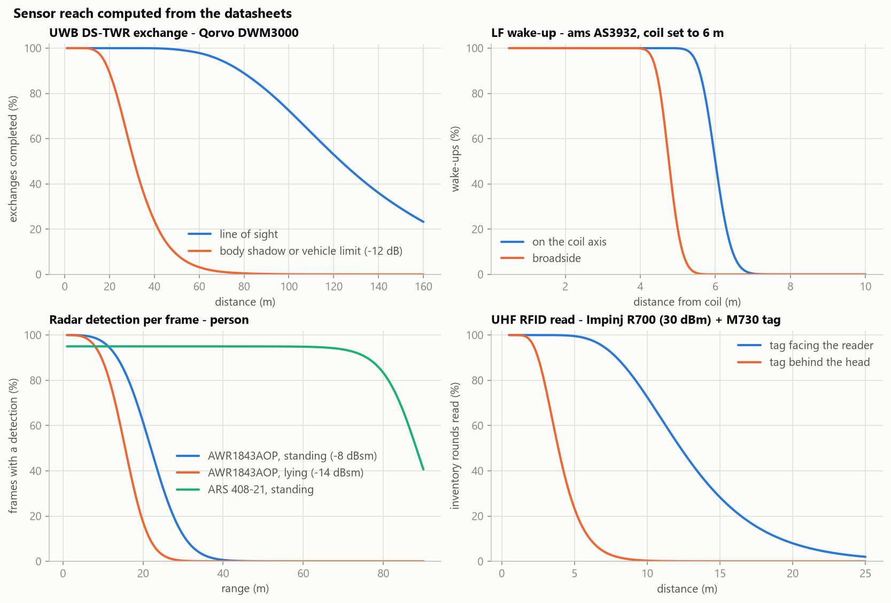
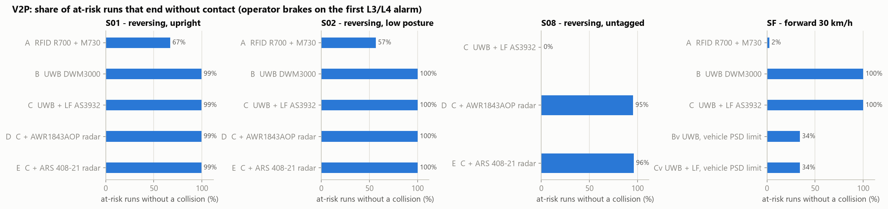
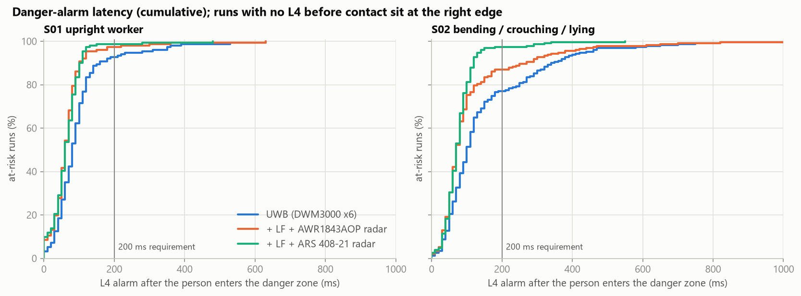
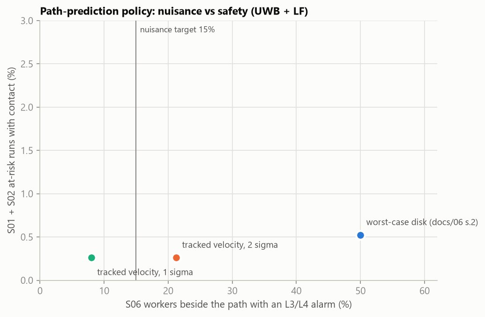
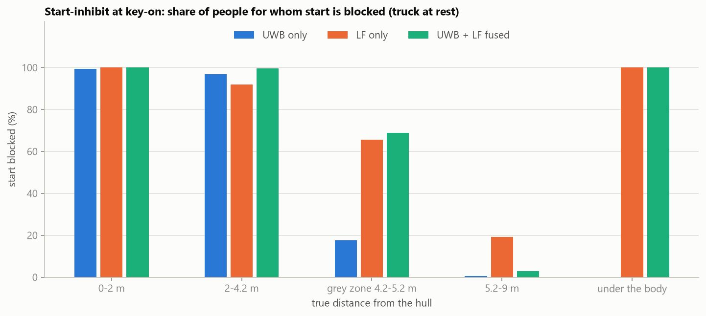
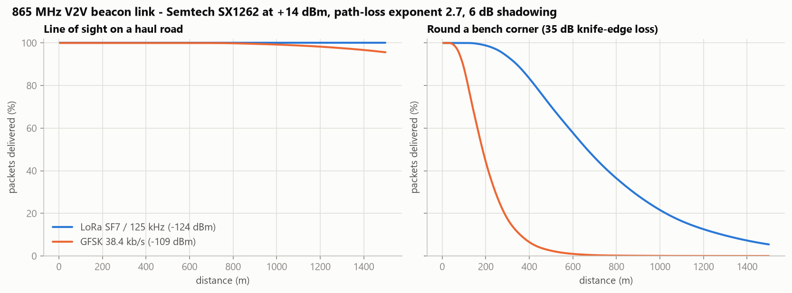
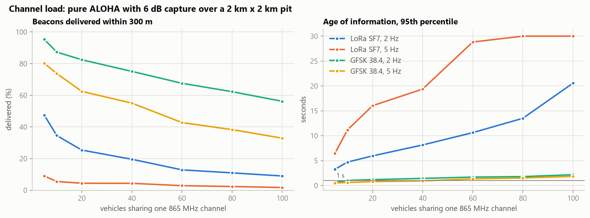
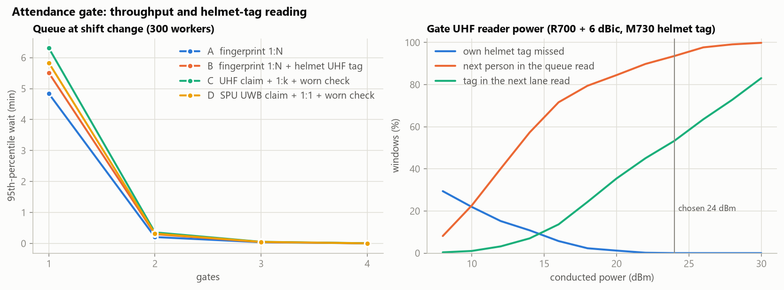

# Simulation results (generated)

Produced by `sim/run_all.py` from `sim/components.toml` and `docs/tools/machine_profiles.toml`. Do not edit by hand; see [docs/13](../docs/13_component_simulation.md) for the method and discussion.

Runs: 400 V2P runs per scenario and policy, 300 V2V runs per configuration, 20 shifts per attendance configuration and gate count; wall time 107 s on 16 processes. Seeds are fixed, so a re-run reproduces every number.

## 1. Sensor reach computed from the datasheets

| Sensor (datasheet values used) | Condition | 90 % reach (m) | 50 % reach (m) |
|---|---|---|---|
| UWB DS-TWR exchange (DWM3000, CH5 6.8 Mb/s, 89 dB link budget) | line of sight | 78 | 123 |
|  | helmet antenna shadowed by the body (-12 dB) | 19 | 31 |
|  | anchors at the vehicle limit -53.3 dBm/MHz | 19 | 31 |
| LF wake-up (AS3932, 100 uVrms; rear coil set to 6 m) | on the coil axis | 5.6 | 6.0 |
|  | broadside to the coil | 4.4 | 4.7 |
| Radar per-frame detection (AWR1843AOP, EIRP 16 dBm, EINF 10 dB) | standing person, -8 dBsm | 14 | 22 |
|  | lying person, -14 dBsm | 9 | 15 |
| Radar per-frame detection (IWR6843AOP, EIRP 16 dBm, EINF 9 dB) | standing person, -8 dBsm | 16 | 26 |
| Radar (ARS 408-21 envelope scaled by RCS^1/4) | standing person, boresight | 76 | 88 |
| UHF RFID read (R700 30 dBm + 6 dBic, M730 -24 dBm) | tag facing the reader | 7.9 | 12.2 |
|  | tag behind the head/body (-10 dB) | 2.5 | 3.8 |

Radar chirp used: 20 MHz/us x 30 us, 10 Msps complex, 192 chirps per 50 ms frame -> maximum range 75 m (IF limited), range resolution 0.25 m. RFID EIRP 35 dBm (ERP 32.9 dBm, India limit 36 dBm).

## 2. Vehicle-to-person collision warning (RDT100, prediction policy 'tracked')

At-risk = the person would be hit if nobody braked. Detected = first L3/L4 alarm before contact. Latency = time from entering the danger zone (in path and inside the stop band) to the L4 alarm, 0 when the alarm was already on; 'no L4' = no danger alarm before contact. Lead = time from the first alarm to the would-be contact.

| Scenario | Configuration | At-risk runs | Detected | No collision | 1st alarm at (m) | Stop zone (m) | L4 p50 (ms) | L4 p95 (ms) | L4 p99 (ms) | No L4 | L4 <= 200 ms | Lead p50 (s) |
|---|---|---|---|---|---|---|---|---|---|---|---|---|
| S01 | A: UHF RFID presence (R700 + M730) | 151 | 97.4% | 66.9% | 16.9 | 15.0 | 0 | 4072 | 4753 | 4 | 49.7% | 6.0 |
| S01 | B: UWB only (6 x DWM3000) | 151 | 100.0% | 99.3% | 14.7 | 15.0 | 80 | 255 | 460 | 0 | 92.7% | 5.2 |
| S01 | C: UWB + LF (DWM3000 + AS3932) | 151 | 100.0% | 99.3% | 14.7 | 15.0 | 80 | 255 | 460 | 0 | 92.7% | 5.2 |
| S01 | D: UWB + LF + radar (AWR1843AOP) | 151 | 100.0% | 99.3% | 14.8 | 15.0 | 60 | 120 | 330 | 0 | 97.4% | 5.2 |
| S01 | E: UWB + LF + radar (ARS 408-21) | 151 | 100.0% | 99.3% | 14.8 | 15.0 | 60 | 110 | 215 | 0 | 98.7% | 5.2 |
| S02 | A: UHF RFID presence (R700 + M730) | 230 | 98.3% | 56.5% | 8.0 | 15.0 | 2505 | 3963 | 4478 | 4 | 36.5% | 2.8 |
| S02 | B: UWB only (6 x DWM3000) | 230 | 100.0% | 100.0% | 14.7 | 15.0 | 100 | 431 | 736 | 0 | 77.0% | 5.2 |
| S02 | C: UWB + LF (DWM3000 + AS3932) | 230 | 100.0% | 100.0% | 14.7 | 15.0 | 100 | 431 | 736 | 0 | 77.0% | 5.2 |
| S02 | D: UWB + LF + radar (AWR1843AOP) | 230 | 100.0% | 100.0% | 14.8 | 15.0 | 70 | 371 | 686 | 0 | 87.0% | 5.2 |
| S02 | E: UWB + LF + radar (ARS 408-21) | 230 | 100.0% | 100.0% | 14.8 | 15.0 | 70 | 136 | 311 | 0 | 97.4% | 5.2 |
| S08 | C: UWB + LF (DWM3000 + AS3932) | 151 | 0.0% | 0.0% | - | 15.0 | - | - | - | 151 | 0.0% | - |
| S08 | D: UWB + LF + radar (AWR1843AOP) | 151 | 98.0% | 95.4% | 14.7 | 15.0 | 90 | 1559 | 2928 | 3 | 69.5% | 5.2 |
| S08 | E: UWB + LF + radar (ARS 408-21) | 151 | 96.7% | 96.0% | 14.7 | 15.0 | 80 | 223 | 1477 | 5 | 91.4% | 5.2 |
| SF | A: UHF RFID presence (R700 + M730) | 214 | 92.1% | 2.3% | 15.6 | 53.2 | 4510 | 5920 | 5990 | 17 | 0.0% | 1.8 |
| SF | B: UWB only (6 x DWM3000) | 214 | 100.0% | 100.0% | 52.5 | 53.2 | 90 | 134 | 1446 | 0 | 96.3% | 6.3 |
| SF | C: UWB + LF (DWM3000 + AS3932) | 214 | 100.0% | 100.0% | 52.5 | 53.2 | 90 | 134 | 1446 | 0 | 96.3% | 6.3 |
| SF | Bv: UWB only, vehicle PSD limit | 214 | 100.0% | 34.1% | 34.4 | 53.2 | 2250 | 3795 | 4313 | 0 | 0.9% | 4.1 |
| SF | Cv: UWB + LF, vehicle PSD limit | 214 | 100.0% | 34.1% | 34.4 | 53.2 | 2250 | 3795 | 4313 | 0 | 0.9% | 4.1 |

### 2.1 Nuisance (S06) and false alarms (S00)

S06: a worker 5-12 m beside the corridor of a reversing truck, standing or walking parallel; any L3/L4 alarm is a nuisance alarm (target <= 15 %; radar-only baseline 42 % [P8]).

| Configuration | Runs | Runs with an L3/L4 alarm |
|---|---|---|
| A: UHF RFID presence (R700 + M730) | 400 | 29.5% |
| B: UWB only (6 x DWM3000) | 400 | 20.8% |
| C: UWB + LF (DWM3000 + AS3932) | 400 | 21.2% |
| D: UWB + LF + radar (AWR1843AOP) | 400 | 40.8% |
| E: UWB + LF + radar (ARS 408-21) | 400 | 33.8% |

S00: reversing with rocks and berm segments behind the truck (Poisson mean 4, 80 % already in the twin's static map) and nobody present.

| Configuration | Manoeuvres | False L3/L4 alarms | Per 100 manoeuvres |
|---|---|---|---|
| A: UHF RFID presence (R700 + M730) | 400 | 0 | 0.0 |
| C: UWB + LF (DWM3000 + AS3932) | 400 | 0 | 0.0 |
| D: UWB + LF + radar (AWR1843AOP) | 400 | 3 | 0.8 |
| E: UWB + LF + radar (ARS 408-21) | 400 | 7 | 1.8 |

### 2.2 Path-prediction policy (configuration C, UWB + LF)

| Policy | At-risk runs (S01+S02) | Contact | S06 nuisance | Alarms for not-at-risk S01/S02 |
|---|---|---|---|---|
| worst-case disk (docs/06 s.2) | 381 | 0.52% | 50.0% | 74.0% |
| tracked velocity, 2 sigma | 381 | 0.26% | 21.2% | 60.6% |
| tracked velocity, 1 sigma | 381 | 0.26% | 8.0% | 57.8% |

### 2.3 Start-inhibit at key-on (S03, truck at rest)

Share of people for whom start is blocked, by true distance from the hull. Start-inhibit radius 4.2 m. Correct = 100 % inside the radius and under the body; unnecessary = above 5.2 m (target <= 1 %). Decision ready 0.74 s after key-on (boot 0.5 s assumed + 4 LF slots + 3 UWB polls; requirement <= 1 s).

| True position | People | A RFID (front + rear antennas) | B UWB only | LF only | C UWB + LF fused | C + canopy anchor U7 |
|---|---|---|---|---|---|---|
| 0-2 m | 803 | 20.9% | 99.5% | 100.0% | 100.0% | 100.0% |
| 2-4.2 m | 1178 | 25.3% | 96.8% | 91.9% | 99.6% | 99.6% |
| grey 4.2-5.2 m | 432 | 25.2% | 17.6% | 65.5% | 69.0% | 69.0% |
| 5.2-9 m | 1184 | 18.0% | 0.6% | 19.3% | 2.9% | 3.0% |
| under the body | 403 | 0.0% | 0.0% | 100.0% | 100.0% | 100.0% |

## 3. Vehicle-to-vehicle conflict warning

### 3.1 Blind bench corner (S05): loaded 100 t truck at 30 km/h vs LMV at 40 km/h

Lead = time from the later of the two drivers' first L3 alarm to the would-be contact (requirement R-CA-8 >= 4 s; S05 asks L3 >= 6 s, i.e. as soon as TTC reaches the 6 s L3 threshold). PDR = share of the LMV's beacons the truck received over the whole approach. 'Alarms, no conflict' = runs where the two pass 7-12 s apart.

| Configuration | Conflicts | Contact | Both alarmed >= 4 s | Both >= 6 s | A driver never alarmed | Lead p5 when both alarmed (s) | PDR direct | PDR direct + relay | Alarms, no conflict |
|---|---|---|---|---|---|---|---|---|---|
| LoRa SF7, 2 Hz, direct only, RTK | 296 | 9.5% | 87.8% | 84.8% | 4.1% | 2.6 | 63% | 63% | 0.0% |
| LoRa SF7, 2 Hz, Guardian relay, RTK | 296 | 0.0% | 80.4% | 67.6% | 2.0% | 0.6 | 52% | 61% | 0.0% |
| LoRa SF7, 5 Hz, Guardian relay, RTK | 296 | 0.7% | 58.4% | 41.6% | 5.4% | -0.1 | 17% | 21% | 0.0% |
| GFSK 38.4 kb/s, 2 Hz, Guardian relay, RTK | 296 | 0.0% | 100.0% | 100.0% | 0.0% | 6.0 | 48% | 93% | 0.0% |
| LoRa SF7, 2 Hz, Guardian relay, standalone GNSS | 296 | 0.0% | 80.1% | 65.9% | 2.0% | 0.4 | 51% | 60% | 0.0% |

All configurations use pure ALOHA (no slot timing), the worst case for collisions; a GNSS-time-slotted MAC would remove most of them (see docs/13).

### 3.2 Two 100 t trucks passing in adjacent lanes (10 m centre to centre, 3.9 m between bodies)

| GNSS (ZED-F9P mode) | Passes | Uncertainty margin (1 m + 2 sigma_rel) | Passes with a nuisance L3/L4 |
|---|---|---|---|
| ZED-F9P RTK fixed (0.01 m + 1 ppm CEP) | 300 | 1.03 m | 0.0% |
| ZED-F9P SBAS (1.0 m CEP) | 300 | 3.40 m | 54.3% |
| ZED-F9P standalone (1.5 m CEP) | 300 | 4.60 m | 79.7% |

### 3.3 Channel load on one 865 MHz channel (delivered within 300 m / 95th-percentile age of information)

Beacon airtime for 24 bytes: LoRa SF7/125 kHz 61.7 ms, GFSK 38.4 kb/s 7.3 ms.

| Vehicles | LoRa SF7, 2 Hz | LoRa SF7, 5 Hz | GFSK 38.4, 2 Hz | GFSK 38.4, 5 Hz |
|---|---|---|---|---|
| 5 | 48% / 3.3 s | 9% / 6.5 s | 95% / 0.6 s | 80% / 0.5 s |
| 10 | 35% / 4.7 s | 6% / 11.2 s | 87% / 1.0 s | 74% / 0.6 s |
| 20 | 25% / 5.9 s | 4% / 16.0 s | 82% / 1.2 s | 62% / 0.8 s |
| 40 | 20% / 8.1 s | 4% / 19.4 s | 75% / 1.4 s | 55% / 0.9 s |
| 60 | 13% / 10.6 s | 3% / 28.8 s | 68% / 1.7 s | 43% / 1.3 s |
| 80 | 11% / 13.5 s | 2% / 30.0 s | 62% / 1.8 s | 38% / 1.5 s |
| 100 | 9% / 20.6 s | 2% / 30.0 s | 56% / 2.2 s | 33% / 1.8 s |

### 3.4 Coexistence: a UHF RFID reader next to the 865 MHz V2V radio (same band in India)

Reader EIRP 35 dBm; the SX1262 tolerates about -33 dBm at 1 MHz offset (blocking 88 dB above sensitivity + 3 dB, D8). Free-space separation needed: 78 m.

| Separation | Reader power at the V2V radio | Tolerable | Result |
|---|---|---|---|
| 3 m | -4.7 dBm | -33 dBm | desensitised |
| 10 m | -15.2 dBm | -33 dBm | desensitised |
| 30 m | -24.7 dBm | -33 dBm | desensitised |
| 100 m | -35.2 dBm | -33 dBm | ok |

## 4. Attendance with biometric + helmet

### 4.1 Throughput at a shift change (300 workers arriving over 30 min, peak 10 min before the shift)

| Configuration | Gates | Service mean | Service p95 | Workers/min/gate | Wait p95 | Last through vs shift start | Late workers | Supervisor exceptions | False PPE flags |
|---|---|---|---|---|---|---|---|---|---|
| A: Fingerprint 1:N only (GT-521F52) | 1 | 5.0 s | 6.0 s | 11.9 | 4.8 min | +1.8 min | 23 | 0.20 | 0.0 |
| A: Fingerprint 1:N only (GT-521F52) | 2 | 5.0 s | 5.9 s | 12.0 | 0.2 min | -0.8 min | 0 | 0.05 | 0.0 |
| B: Fingerprint 1:N + helmet UHF tag present (GT-521F52 + R700/M730) | 1 | 5.2 s | 6.2 s | 11.5 | 5.5 min | +2.6 min | 31 | 0.40 | 0.0 |
| B: Fingerprint 1:N + helmet UHF tag present (GT-521F52 + R700/M730) | 2 | 5.2 s | 6.1 s | 11.5 | 0.3 min | -0.8 min | 0 | 0.20 | 0.0 |
| C: Helmet UHF claim + fingerprint 1:k (R503) + SPU worn/self-test | 1 | 5.5 s | 9.3 s | 11.0 | 6.3 min | +3.5 min | 40 | 0.10 | 1.2 |
| C: Helmet UHF claim + fingerprint 1:k (R503) + SPU worn/self-test | 2 | 5.5 s | 9.4 s | 11.0 | 0.4 min | -0.8 min | 0 | 0.30 | 1.4 |
| D: SPU UWB claim + fingerprint 1:1 (R503) + SPU worn/self-test | 1 | 5.3 s | 9.1 s | 11.3 | 5.8 min | +2.9 min | 35 | 0.15 | 0.8 |
| D: SPU UWB claim + fingerprint 1:1 (R503) + SPU worn/self-test | 2 | 5.3 s | 9.3 s | 11.2 | 0.3 min | -0.8 min | 0 | 0.20 | 1.1 |

### 4.2 Violations caught at the gate (all gate counts pooled; number of cases in brackets)

| Configuration | Strap open | Carried in hand | Carried under arm | No helmet | Wearing someone else's helmet | Personal unit dead |
|---|---|---|---|---|---|---|
| A | 0% (688) | 0% (328) | 0% (188) | 0% (220) | 0% (124) | 0% (116) |
| B | 0% (688) | 0% (328) | 0% (188) | 100% (220) | 100% (124) | 0% (116) |
| C | 100% (688) | 100% (328) | 100% (188) | 100% (220) | 100% (124) | 100% (116) |
| D | 100% (688) | 100% (328) | 100% (188) | 100% (220) | 100% (124) | 100% (116) |
| Camera helmet detector (alternative) | - | 92%* | 92%* | 92% | - | - |

\* A camera detector sees a helmet that is not on the head only if it is out of frame; it cannot read the strap, the owner or the personal unit. Recall from SHWD mAP@0.5 0.84-0.94 [E30].

The 100 % for carried helmets in C and D needs all three cues (FDC1004 capacitance, IMU tilt and the strap switch) to be fooled at once. With the capacitance cue alone (threshold 2.0 pF): carried in hand caught 96.6 %, carried under the arm caught 99.9 %, correctly worn helmets falsely flagged 0.30 %. The electrode geometry and the cue probabilities are assumptions to be replaced by bench measurements.

### 4.3 Gate UHF reader power (1.5 s window)

| Conducted power (dBm) | Own tag missed | Next in queue read | Next lane read | Within 4 W ERP |
|---|---|---|---|---|
| 8 | 29.43% | 8.1% | 0.4% | yes |
| 10 | 21.95% | 22.6% | 1.0% | yes |
| 12 | 15.22% | 40.1% | 3.2% | yes |
| 14 | 10.82% | 57.3% | 7.0% | yes |
| 16 | 5.73% | 71.6% | 13.7% | yes |
| 18 | 2.30% | 79.5% | 24.3% | yes |
| 20 | 1.20% | 84.5% | 35.4% | yes |
| 22 | 0.18% | 89.8% | 45.1% | yes |
| 24 | 0.00% | 93.6% | 53.3% | yes |
| 26 | 0.00% | 97.7% | 63.5% | yes |
| 28 | 0.00% | 99.1% | 72.8% | yes |
| 30 | 0.00% | 99.9% | 83.1% | yes |

### 4.4 Outsider acceptance with the datasheet FAR (0.001 % per template compared)

| Matching mode | Per attempt | Attempts until a 50 % chance of one false acceptance |
|---|---|---|
| 1:1 (SPU claim, config D) | 1.00e-05 | 69,314 |
| 1:k, k = 3 (UHF claim, config C) | 3.00e-05 | 23,105 |
| 1:N, N = 300 (one shift's gallery, configs A/B) | 3.00e-03 | 231 |
| 1:N, N = 3000 (GT-521F52 full) | 2.96e-02 | 23 |

### 4.5 Roll-call: first in-pit sighting of the personal unit after the gate

Event-driven heartbeat <= 60 s, 98 % delivery: median 30 s, 99th percentile 92 s, share not seen within 5 min 0.000 %. The twin can therefore flag 'checked in but not seen' after 5 min without false alerts.

## 5. Datasheet cross-check of the wearable power budget (docs/05 s.6)

| Item | Indicative value in design_calcs.py | Datasheet value |
|---|---|---|
| UWB TX current | 35 mA | 40 mA (D1, CH5) |
| UWB RX current | 65 mA | 50 mA (D1, CH5) |
| UWB wake/INIT current | 8 mA | 6 mA (D1) |
| 865 MHz TX current at +14 dBm | 40 mA | 45 mA (D8) |
| 865 MHz RX current | 5.0 mA | 4.6 mA (D8) |
| Event-driven budget per 12 h shift | 6.2 mAh | 6.0 mAh |
| Fixed-rate polling per 12 h shift | 25.1 mAh | 23.4 mAh |

Event-driven advantage over polling: 3.9x with datasheet currents (4.0x with the indicative ones).

## Figures

